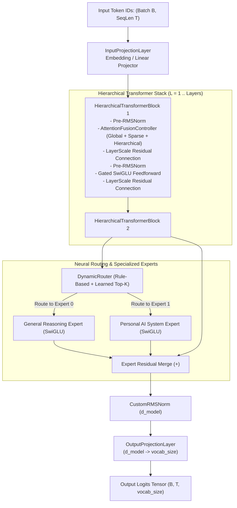
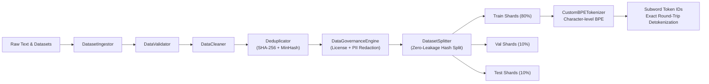
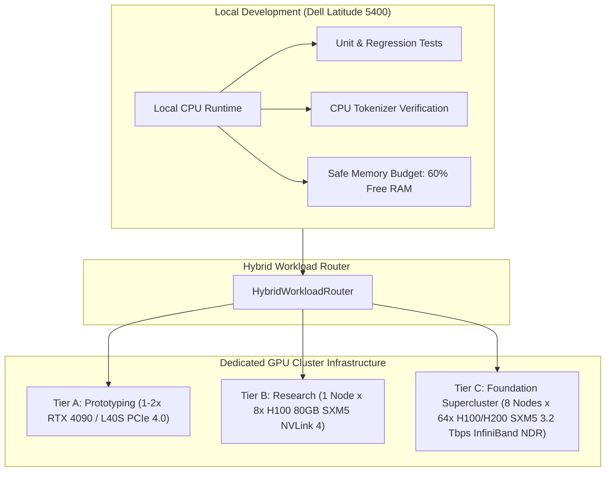

# 404 FOUNDERS

> **Intelligence Without Boundaries**  
> *Enterprise-Grade Custom Multimodal Foundation AI & Personal Operating Intelligence System*

---

## 1. Project Overview

**404 FOUNDERS** is an enterprise AI ecosystem engineered around:
1. **Custom Multimodal Foundation Architecture:** Built from scratch with **zero pretrained model weights**, featuring a hybrid hierarchical Transformer backbone, sparse Mixture-of-Experts (MoE), multi-mechanism attention, and an independent character-level Custom BPE tokenizer.
2. **Personal Operating Intelligence System:** An autonomous resident copilot for Linux (Kali/Debian) and Windows endpoints, capable of deep systems analysis, defensive cybersecurity, repository intelligence, and workflow automation.

The system operates across two core modes:
- **General Intelligence Mode:** Multi-step reasoning, mathematical theorem proving, scientific research, code synthesis, and unified cross-modal semantic understanding.
- **Personal AI Mode:** Host operating system analysis, hardware telemetry, repository intelligence, defensive vulnerability audits, network diagnostics, task automation, and episodic memory.

---

## 2. Finalized Architectural Decisions

- **Custom Neural Architecture:** Designed from first principles; zero pretrained open-weights.
- **Random Initialization:** All model parameter tensors are initialized from scratch using scaled Gaussian distributions ($\mathcal{N}(0, 1/d_{\text{in}})$).
- **Custom Character-Level BPE Tokenizer:** Native subword BPE avoiding 3-byte fragmentation for Hindi and multilingual text.
- **Unified Multimodal Foundation Model:** Shared latent space across Text, Vision, Audio, Video, and Documents.
- **Hybrid Modular & Hierarchical Backbone:** Hierarchical Transformer blocks with sparse Mixture-of-Experts (MoE).
- **Hybrid Multi-Mechanism Attention (MMA):** Fuses sliding-window local attention, global anchor tokens, and Grouped-Query Attention (GQA).
- **Advanced Multi-Layer Memory:** In-context KV-cache, episodic execution logs, persistent vector stores, factual knowledge graphs, and background consolidation.
- **Hybrid Intelligent Routing:** Dynamic task-directed routing between general reasoning and personal AI tools.
- **Multi-Framework Decoupling:** Strict separation between PyTorch and JAX behind abstract interfaces (`neural_architecture/interfaces.py`).
- **Targeted Polyglot Design:** Python for orchestration and ML core; C++, CUDA, and Rust reserved for performance-critical kernels and tokenization.
- **Tri-Protocol API Gateway:** High-performance REST (FastAPI), real-time bidirectional WebSocket, and binary gRPC.
- **Hybrid Edge-Cloud Infrastructure:** Local laptop execution (Dell Latitude 5400) for agent automation, prototyping, and quantized inference; dedicated high-performance GPU cluster (NVIDIA H100/H200) for large-scale pretraining.

---

## 3. Repository Structure

```
404-FOUNDERS/
├── .env.example              # Environment variable configuration template
├── .gitignore                # Security, Python, Node, weight, and OS exclusions
├── pyproject.toml            # Python build specifications, dependencies, and tool settings
├── README.md                 # Project architecture blueprint and quickstart
├── PHASE_STATUS.md           # Phase governance matrix and gating criteria
├── DEVELOPMENT_LOG.md        # Chronological engineering decision log
├── CHANGELOG.md              # Versioned phase releases (Keep a Changelog)
│
├── core/                     # Foundational orchestration, reasoning & configuration
│   ├── intelligence/         # High-level cognitive synthesis & NeuralCore
│   ├── reasoning/            # Symbolic, math, and deductive reasoning
│   ├── attention/            # Multi-mechanism attention primitives (Global, Sparse, Hierarchical, Fusion)
│   ├── routing/              # Mixture-of-Experts and task routing (Rule-based, Learned, Dynamic)
│   ├── context/              # Infinite-context state tracking
│   └── orchestration/        # Lifecycle coordination and telemetry
│
├── neural_architecture/      # Custom neural topology & framework abstractions
│   ├── interfaces.py         # Framework-agnostic backend engine contracts
│   ├── inference.py          # Autoregressive generation & numerical validation harness
│   ├── jax_interface.py      # Separated functional JAX model interfaces
│   ├── layers/               # Custom layers (RMSNorm, RoPE, SwiGLU, Projections, Residuals)
│   ├── modules/              # Hierarchical Transformer blocks & specialized experts
│   ├── encoders/             # Modality-specific projection layers
│   ├── decoders/             # Autoregressive generation heads
│   ├── fusion/               # Cross-attention & multimodal gating
│   └── research/             # Micro-prototypes and experimental modules
│
├── tokenizer/                # Custom BPE tokenizer engine (non-byte-level)
│   ├── bpe_tokenizer.py      # CustomBPETokenizer unified model interface
│   ├── bpe_trainer.py        # Pair frequency calculation & merge generation
│   ├── config.py             # Hyperparameters & whitespace configuration
│   ├── normalization.py      # Non-destructive Unicode NFC/NFKC normalizer
│   ├── pre_tokenizer.py      # Code operators, Indic scripts, ' ' whitespace
│   ├── encoder.py            # Priority-ranked subword BPE encoder
│   ├── decoder.py            # Exact round-trip detokenizer
│   ├── special_tokens.py     # 25-token isolated special tokens registry
│   ├── serialization.py      # Model JSON & vocab/merges exporter
│   ├── evaluation/           # Compression ratio & fertility benchmark
│   ├── training/             # Training subpackage initializers
│   └── vocabulary/           # Bi-directional token-to-ID mapping
│
├── memory/                   # Multi-layer cognitive memory fabric
│   ├── short_term/           # Working memory & attention KV-cache
│   ├── long_term/            # Semantic vector persistence
│   ├── knowledge/            # Structured factual knowledge graphs
│   ├── episodic/             # Action logs and user interaction trajectories
│   ├── retrieval/            # Hybrid sparse-dense (BM25 + ANN) search
│   └── consolidation/        # Background distillation and salience decay
│
├── multimodal/               # Modality-specific ingestion pipelines
│   ├── text/                 # Text & source code normalization
│   ├── vision/               # High-resolution patch extraction
│   ├── audio/                # Log-mel spectrogram feature extraction
│   ├── video/                # Spatiotemporal 3D patch tubelets
│   └── documents/            # Document layout & coordinate parsing
│
├── training/                 # Distributed training orchestration & dataset pipeline
│   ├── datasets/             # Governed dataset preparation pipeline
│   │   ├── ingestion/        # Ingestors across 9 data domains
│   │   ├── validation/       # Format, encoding, schema, corrupted line audits
│   │   ├── cleaning/         # Sanitization, quality & language heuristics
│   │   ├── deduplication/    # Exact SHA-256 + 32-perm MinHash near-dedup
│   │   ├── governance/       # License whitelist compliance & PII redaction
│   │   ├── splitting/        # Zero-leakage deterministic hash partitioning
│   │   ├── manifests/        # Immutable JSON cryptographic manifests
│   │   └── statistics/       # Corpus metrics & Markdown table reports
│   ├── preprocessing/        # Chunked binary shard packing
│   ├── experiments/          # Metric tracking & manifests
│   ├── checkpoints/          # Atomic checkpoint persistence
│   └── evaluation/           # Benchmark suites & perplexity evaluation
│
├── personal_ai/              # Endpoint intelligence & desktop assistance
│   ├── system_monitor/       # Read-only CPU, RAM, NVMe telemetry
│   ├── coding_assistant/     # AST analysis, diff review, git automation
│   ├── cybersecurity/        # Port auditing, socket check, anomaly detection
│   ├── network_analysis/     # Latency, DNS, and interface diagnostics
│   └── automation/           # Pre-approved task automation scripts
│
├── agent/                    # Autonomous planning & execution guardrails
│   ├── planner/              # Hierarchical goal decomposition (ReAct)
│   ├── tools/                # Permission-controlled tool registry
│   ├── permissions/          # 4-tier security validation engine
│   └── execution/            # Sandboxed subprocess runner
│
├── api/                      # Tri-protocol communication gateway
│   ├── rest/                 # FastAPI REST controllers
│   ├── websocket/            # Real-time token & event streaming
│   └── grpc/                 # High-throughput binary RPC services
│
├── infrastructure/           # Multi-tier deployment definitions
│   ├── local/                # Workstation constraints & memory budgeting
│   ├── cloud/                # Cloud pricing profiles & hybrid workload router
│   ├── gpu_cluster/          # Tier A/B/C cluster configs & rail-optimized topology
│   ├── distributed/          # 4D parallelism, gradient sync & atomic checkpointing
│   ├── storage/              # Hot/Warm/Cold tiering & Checkpoint Vault
│   ├── containers/           # Dockerfiles & Slurm SBATCH job submission generators
│   ├── monitoring/           # DCGM metrics, MFU calculator & air-gapped tracker
│   ├── security/             # Zero-trust RBAC, Ed25519 SSH validator & secret redaction
│   └── deployment/           # Systemd user services & container manifests
│
├── database/                 # SQLite & DuckDB analytical storage
├── security/                 # Zero-trust policy, audit logger & sanitization
├── configs/                  # YAML system configurations, tokenizer & cluster tiers
├── frontend/                 # Client interfaces (React / Next.js / Tauri)
├── scripts/                  # Developer CLI tools (system, gpu, env, storage, tokenizer)
├── tests/                    # 98 automated tests covering all subsystems
└── docs/                     # 29 exhaustive technical architecture manuals
```

---

## 4. Core AI Foundation Architecture (Phase 03)

The central neural engine (`NeuralCore`) coordinates multi-stage hierarchical processing with full autograd gradient support:



---

## 5. Custom BPE Tokenizer & Data Pipeline (Phase 04)



### Key Tokenizer Properties
- **Non-Byte-Level BPE:** Operates at the character and grapheme level, preventing 3-byte fragmentation for Hindi, Sanskrit, and Indic languages.
- **Lossless Whitespace:** Spaces explicitly mapped to ` ` (`\u2581`), guaranteeing exact string reconstruction.
- **25 Special Control Tokens:** Segregated IDs `0` through `24` matching atomically (`<pad>`, `<unk>`, `<bos>`, `<eos>`, `<sys_start>`, `<user_start>`, `<asst_start>`, `<thought>`, `<tool_call>`, etc.).
- **Deterministic Splitting:** Content-hashed partitioning ($\text{SHA256}(x) \pmod{1000}$) guarantees 0% cross-split data leakage.

---

## 6. Training Infrastructure & GPU Cluster Architecture (Phase 05)

The infrastructure decouples local workstation prototyping (Dell Latitude 5400, Kali Linux, Intel i5-8365U, 15.4 GB RAM, 0B swap, Intel UHD 620 UMA) from cloud and dedicated GPU cluster training:



### Cluster Tier Specifications
- **Tier A (Development):** 1-2x NVIDIA RTX 4090 24GB or L40S 48GB PCIe Gen 4.0 x16. For module unit verification, synthetic convergence checks, and subword tokenizer evaluation.
- **Tier B (Research):** 1 Node x 8x NVIDIA H100 80GB SXM5 (640 GB VRAM), 4th-Gen NVLink (900 GB/s) + NVSwitch mesh (7.2 TB/s). For attention scaling benchmarks and 1B–7B parameter research models.
- **Tier C (Foundation Supercluster):** 8 Nodes x 8 = 64x NVIDIA H100/H200 SXM5 (5,120 GB VRAM total), NVLink 4 intra-node + 8-way Rail-Optimized InfiniBand NDR 400 Gbps (3.2 Tbps/node). For full-scale foundation pretraining from random initialization across multi-trillion tokens.

### Multi-Tier Storage Hierarchy & Checkpoint Vault
- **Hot Scratch:** Direct-Attached PCIe 5.0 NVMe (15 TB/node, >30 GB/s read, >1M IOPS) with LRU cache eviction at 80% capacity.
- **Warm Shared:** High-speed parallel filesystem (Lustre / WEKA, 500 TB, >100 GB/s throughput) hosting tokenized dataset shards and rolling checkpoints.
- **Cold Vault:** Immutable S3 / Ceph object storage (2 PB, 11 9s durability) preserving milestone checkpoints with SHA-256 verification and read-only locks (`0444`).

---

## 7. Technical Documentation Index

Complete architectural specifications are maintained in [`docs/`](docs/):

### Training Infrastructure & GPU Computing (Phase 05)
1. [**GPU Cluster Architecture**](docs/GPU_CLUSTER_ARCHITECTURE.md) (`DOC-INFRA-001`): Tier A/B/C cluster hardware, rail-optimized InfiniBand NDR fabric, and hardware comparison matrix.
2. [**Distributed Training Architecture**](docs/DISTRIBUTED_TRAINING.md) (`DOC-INFRA-002`): 4D Parallelism ($DP \times TP \times PP \times SP$), FSDP/ZeRO-3, gradient overlap, and fault recovery.
3. [**PyTorch & JAX Infrastructure**](docs/PYTORCH_JAX_INFRASTRUCTURE.md) (`DOC-INFRA-003`): Dual-framework strategy, XLA compilation, FSDP sharding, and bidirectional checkpoint translation.
4. [**CUDA & Hardware Compatibility**](docs/CUDA_COMPATIBILITY.md) (`DOC-INFRA-004`): CUDA 12.4, cuDNN 9.1, NCCL 2.21, Hopper/Ada architecture features, and BF16/FP8 precision policies.
5. [**Storage Architecture & Vault**](docs/STORAGE_ARCHITECTURE.md) (`DOC-INFRA-005`): Hot NVMe scratch, Warm parallel filesystem, Cold object storage, and atomic Checkpoint Vault persistence.
6. [**Infrastructure Security**](docs/INFRASTRUCTURE_SECURITY.md) (`DOC-INFRA-006`): Zero-trust RBAC, Ed25519 SSH enforcement, automated regex credential masking, and audit trails.
7. [**Training Compute Estimation**](docs/TRAINING_COMPUTE_ESTIMATION.md) (`DOC-INFRA-007`): Chinchilla compute laws ($C = 6ND$), token budgets, empirical MFU factors, and duration calculations.
8. [**Infrastructure Cost Analysis**](docs/INFRASTRUCTURE_COST_ANALYSIS.md) (`DOC-INFRA-008`): Reference market pricing (Lambda, RunPod, CoreWeave, AWS), cost-per-run models, and spot optimization.

### Tokenizer & Data Pipeline Architecture (Phase 04)
9. [**Custom BPE Tokenizer**](docs/CUSTOM_BPE_TOKENIZER.md) (`DOC-TOK-001`): Character-level BPE architecture, whitespace handling, and special token registry.
10. [**Tokenizer Training**](docs/TOKENIZER_TRAINING.md) (`DOC-TOK-002`): BPE merge mathematics, pair frequencies, deterministic tie-breaking, and scaling.
11. [**Multilingual Tokenization**](docs/MULTILINGUAL_TOKENIZATION.md) (`DOC-TOK-003`): Devanagari conjuncts, code syntax, mathematical expressions, and fertility metrics.
12. [**Data Pipeline Architecture**](docs/DATA_PIPELINE.md) (`DOC-DATA-001`): Ingestion, validation, cleaning, MinHash deduplication, and hash-partitioned splits.
13. [**Data Governance & Security**](docs/DATA_GOVERNANCE.md) (`DOC-DATA-002`): Provenance tracking, PII/secret regex scanning, canonical redaction, and access control.
14. [**Dataset License Policy**](docs/DATASET_LICENSE_POLICY.md) (`DOC-DATA-003`): Whitelist of approved open licenses, copyleft prohibitions, and copyright compliance.

### Core AI Foundation (Phase 03)
15. [**Core AI Foundation**](docs/CORE_AI_FOUNDATION.md) (`DOC-CORE-001`): Central neural core, custom layers, tensor shape conventions, and inference engine.
16. [**Custom Attention Design**](docs/CUSTOM_ATTENTION_DESIGN.md) (`DOC-ATTN-001`): Global, Sparse, Hierarchical, and Fusion Attention formulations and complexity.
17. [**Neural Routing Design**](docs/NEURAL_ROUTING_DESIGN.md) (`DOC-ROUTE-001`): Rule-based, learned top-$k$ MoE, and dynamic hybrid routing architectures.
18. [**Model Initialization**](docs/MODEL_INITIALIZATION.md) (`DOC-INIT-001`): Pure random Gaussian parameter initialization, deterministic seeding, and parameter census.

### System Architecture & Governance (Phase 01 & 02)
19. [**System Architecture**](docs/SYSTEM_ARCHITECTURE.md) (`DOC-ARCH-001`): Operating modes, orchestration, and data flow.
20. [**Neural Architecture**](docs/NEURAL_ARCHITECTURE.md) (`DOC-ARCH-002`): Layers, RoPE, SwiGLU, MMA attention, and MoE routing.
21. [**Multimodal Architecture**](docs/MULTIMODAL_ARCHITECTURE.md) (`DOC-ARCH-003`): Vision, audio, video, text, and documents fusion.
22. [**Memory Architecture**](docs/MEMORY_ARCHITECTURE.md) (`DOC-ARCH-004`): Multi-tier memory, infinite context, and consolidation.
23. [**Personal AI Architecture**](docs/PERSONAL_AI_ARCHITECTURE.md) (`DOC-ARCH-005`): OS copilot, telemetry, coding, and defensive cybersecurity.
24. [**API Architecture**](docs/API_ARCHITECTURE.md) (`DOC-ARCH-006`): REST, WebSocket, and gRPC protocol specifications.
25. [**Security Architecture**](docs/SECURITY_ARCHITECTURE.md) (`DOC-ARCH-007`): Threat model, 4-tier permissions, audit logging, and sandbox.
26. [**Data Architecture**](docs/DATA_ARCHITECTURE.md) (`DOC-ARCH-008`): Streaming ETL, MinHash deduplication, and binary sharding.
27. [**Infrastructure Architecture**](docs/INFRASTRUCTURE_ARCHITECTURE.md) (`DOC-ARCH-009`): Hybrid local, cloud, and GPU cluster targets.
28. [**Development Standards**](docs/DEVELOPMENT_STANDARDS.md) (`DOC-STANDARDS-001`): Code formatting, typing, logging, and exceptions.
29. [**Hardware Assessment Report**](docs/phase-01-hardware-assessment.md) (`DOC-PHASE01-SYS-001`): Physical host telemetry on Dell Latitude 5400.

---

## 8. Development Roadmap & Phase Status

| Phase | Phase Name | Status |
|---|---|---|
| **Phase 01** | Environment & Hardware Assessment | **Completed** |
| **Phase 02** | Project Architecture & Workspace Design | **Completed** |
| **Phase 03** | Core AI Foundation Development | **Completed** |
| **Phase 04** | Custom BPE Tokenizer & Data Pipeline | **Completed** |
| **Phase 05** | **Training Infrastructure & GPU Cluster Architecture** | **Completed (Review Pending)** |
| Phase 06 | Foundation Model Pretraining & Optimization | Planned |
| Phase 07 | Personal AI Assistant & OS Intelligence | Planned |
| Phase 08 | Tri-Protocol API Services & Production Release | Planned |

---

## 9. Quickstart & Verification

```bash
# 1. Run complete automated test suite (98 tests) on CPU
.venv/bin/python -m pytest tests/

# 2. Perform safe host hardware audit & runtime budgeting check
.venv/bin/python scripts/system_check.py

# 3. Perform GPU & CUDA compatibility inspection (reports local host & cluster tiers)
.venv/bin/python scripts/gpu_check.py

# 4. Audit software environment, compiler toolchain, and libraries
.venv/bin/python scripts/environment_check.py

# 5. Run storage tiering capacity and local sequential I/O benchmark
.venv/bin/python scripts/storage_check.py

# 6. Train a Custom BPE Tokenizer model on sample text
.venv/bin/python scripts/train_tokenizer.py \
    --input README.md \
    --output configs/tokenizer/tokenizer_model.json \
    --vocab-size 512

# 7. Encode text with BOS/EOS tags
.venv/bin/python scripts/encode_text.py \
    --model configs/tokenizer/tokenizer_model.json \
    --text "नमस्ते भारत! 404 FOUNDERS is an enterprise AI assistant." \
    --add-bos --add-eos

# 8. Execute prototype inference with greedy token prediction
.venv/bin/python -c "
from neural_architecture.inference import InferenceEngine
engine = InferenceEngine()
prompt = [10, 20, 30]
output = engine.generate_greedy_tokens(prompt, max_new_tokens=5)
print('Prompt:', prompt)
print('Generated sequence:', output)
print('Total parameters:', engine.model.parameter_count)
"
```
