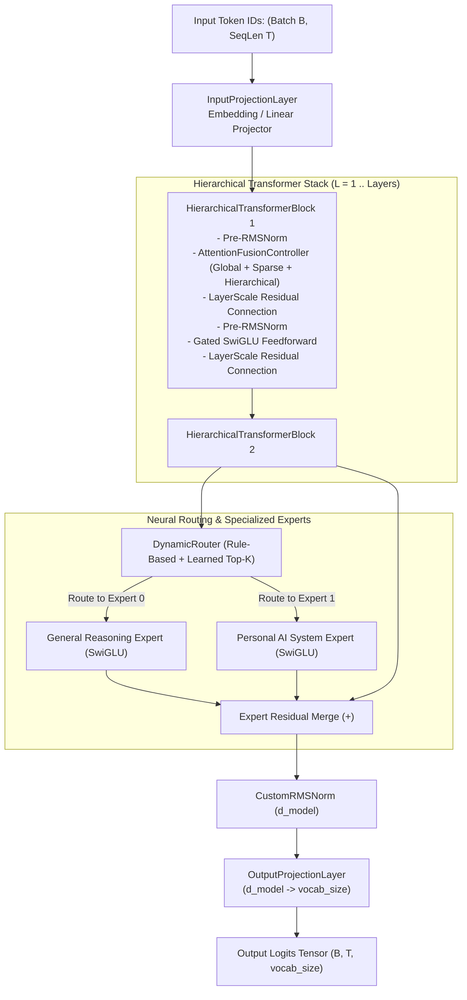

# 404 FOUNDERS

> **Intelligence Without Boundaries**  
> *Enterprise-Grade Custom Multimodal Foundation AI & Personal Operating Intelligence System*

---

## 1. Project Overview

**404 FOUNDERS** is an enterprise AI ecosystem engineered around:
1. **Custom Multimodal Foundation Architecture:** Built from scratch with **zero pretrained model weights**, featuring a hybrid hierarchical Transformer backbone, sparse Mixture-of-Experts (MoE), and multi-mechanism attention.
2. **Personal Operating Intelligence System:** An autonomous resident copilot for Linux (Kali/Debian) and Windows endpoints, capable of deep systems analysis, defensive cybersecurity, repository intelligence, and workflow automation.

The system operates across two core modes:
- **General Intelligence Mode:** Multi-step reasoning, mathematical theorem proving, scientific research, code synthesis, and unified cross-modal semantic understanding.
- **Personal AI Mode:** Host operating system analysis, hardware telemetry, repository intelligence, defensive vulnerability audits, network diagnostics, task automation, and episodic memory.

---

## 2. Finalized Architectural Decisions

- **Custom Neural Architecture:** Designed from first principles; zero pretrained open-weights.
- **Random Initialization:** All model parameter tensors are initialized from scratch using scaled Gaussian distributions ($\mathcal{N}(0, 1/d_{\text{in}})$).
- **Unified Multimodal Foundation Model:** Shared latent space across Text, Vision, Audio, Video, and Documents.
- **Hybrid Modular & Hierarchical Backbone:** Hierarchical Transformer blocks with sparse Mixture-of-Experts (MoE).
- **Hybrid Multi-Mechanism Attention (MMA):** Fuses sliding-window local attention, global anchor tokens, and Grouped-Query Attention (GQA).
- **Advanced Multi-Layer Memory:** In-context KV-cache, episodic execution logs, persistent vector stores, factual knowledge graphs, and background consolidation.
- **Hybrid Intelligent Routing:** Dynamic task-directed routing between general reasoning and personal AI tools.
- **Multi-Framework Decoupling:** Strict separation between PyTorch and JAX behind abstract interfaces (`neural_architecture/interfaces.py`).
- **Targeted Polyglot Design:** Python for orchestration and ML core; C++, CUDA, and Rust reserved for performance-critical kernels and tokenization.
- **Tri-Protocol API Gateway:** High-performance REST (FastAPI), real-time bidirectional WebSocket, and binary gRPC.
- **Hybrid Edge-Cloud Infrastructure:** Local laptop execution (Dell Latitude 5400) for agent automation, prototyping, and quantized inference; dedicated high-performance GPU cluster (NVIDIA H100/H200) for large-scale pretraining.

---

## 3. Core AI Foundation Architecture (Phase 03)

The central neural engine (`NeuralCore`) coordinates multi-stage hierarchical processing with full autograd gradient support:



### Multi-Mechanism Attention (MMA) Breakdown
1. **Global Attention (`GlobalAttention`):** Dense pairwise scaled dot-product interaction ($O(T^2 \cdot d)$) with mask support.
2. **Sparse Attention (`SparseAttention`):** Sliding-window banded diagonal mask ($O(T \cdot W \cdot d)$) for linear context scaling.
3. **Hierarchical Attention (`HierarchicalAttention`):** Multi-resolution micro (intra-chunk) and macro (inter-chunk) attention ($O(T \cdot C + (T/C)^2 \cdot d)$).
4. **Attention Fusion Controller (`AttentionFusionController`):** Input-conditioned dynamic 3-way gating network synthesizing outputs across all branches.

---

## 4. Technical Documentation Index

Complete architectural specifications are maintained in [`docs/`](docs/):

1. [**Core AI Foundation**](docs/CORE_AI_FOUNDATION.md) (`DOC-CORE-001`): Central neural core, custom layers, tensor shape conventions, and inference engine.
2. [**Custom Attention Design**](docs/CUSTOM_ATTENTION_DESIGN.md) (`DOC-ATTN-001`): Mathematical descriptions and complexity proofs for Global, Sparse, Hierarchical, and Fusion Attention.
3. [**Neural Routing Design**](docs/NEURAL_ROUTING_DESIGN.md) (`DOC-ROUTE-001`): Rule-based, learned top-$k$ MoE, and dynamic hybrid routing architectures.
4. [**Model Initialization**](docs/MODEL_INITIALIZATION.md) (`DOC-INIT-001`): Pure random Gaussian parameter initialization, deterministic seeding, and parameter census.
5. [**System Architecture**](docs/SYSTEM_ARCHITECTURE.md) (`DOC-ARCH-001`): Operating modes, orchestration, and data flow.
6. [**Neural Architecture**](docs/NEURAL_ARCHITECTURE.md) (`DOC-ARCH-002`): Layers, RoPE, SwiGLU, MMA attention, and MoE routing.
7. [**Multimodal Architecture**](docs/MULTIMODAL_ARCHITECTURE.md) (`DOC-ARCH-003`): Vision, audio, video, text, and documents fusion.
8. [**Memory Architecture**](docs/MEMORY_ARCHITECTURE.md) (`DOC-ARCH-004`): Multi-tier memory, infinite context, and consolidation.
9. [**Personal AI Architecture**](docs/PERSONAL_AI_ARCHITECTURE.md) (`DOC-ARCH-005`): OS copilot, telemetry, coding, and defensive cybersecurity.
10. [**API Architecture**](docs/API_ARCHITECTURE.md) (`DOC-ARCH-006`): REST, WebSocket, and gRPC protocol specifications.
11. [**Security Architecture**](docs/SECURITY_ARCHITECTURE.md) (`DOC-ARCH-007`): Threat model, 4-tier permissions, audit logging, and sandbox.
12. [**Data Architecture**](docs/DATA_ARCHITECTURE.md) (`DOC-ARCH-008`): Streaming ETL, MinHash deduplication, and binary sharding.
13. [**Infrastructure Architecture**](docs/INFRASTRUCTURE_ARCHITECTURE.md) (`DOC-ARCH-009`): Hybrid local, cloud, and GPU cluster targets.
14. [**Development Standards**](docs/DEVELOPMENT_STANDARDS.md) (`DOC-STANDARDS-001`): Code formatting, typing, logging, and exceptions.
15. [**Hardware Assessment Report**](docs/phase-01-hardware-assessment.md) (`DOC-PHASE01-SYS-001`): Physical host telemetry on Dell Latitude 5400.

---

## 5. Development Roadmap & Phase Status

| Phase | Phase Name | Status |
|---|---|---|
| **Phase 01** | Environment & Hardware Assessment | **Completed** |
| **Phase 02** | Project Architecture & Workspace Design | **Completed** |
| **Phase 03** | **Core AI Foundation Development** | **Completed (Review Pending)** |
| Phase 04 | Neural Architecture & Model Prototyping | Planned |
| Phase 05 | Personal AI Assistant & Endpoint Core | Planned |
| Phase 06 | Tri-Protocol API Services & Client Interface | Planned |
| Phase 07 | Testing, Security Audit & Performance Benchmarking | Planned |
| Phase 08 | Production Deployment & Hybrid Cluster CI/CD | Planned |

---

## 6. Quickstart & Verification

```bash
# 1. Run complete automated test suite (44 tests) on CPU
.venv/bin/python -m pytest tests/

# 2. Execute prototype inference with greedy token prediction
.venv/bin/python -c "
from neural_architecture.inference import InferenceEngine
engine = InferenceEngine()
prompt = [10, 20, 30]
output = engine.generate_greedy_tokens(prompt, max_new_tokens=5)
print('Prompt:', prompt)
print('Generated sequence:', output)
print('Total parameters:', engine.model.parameter_count)
"
```
