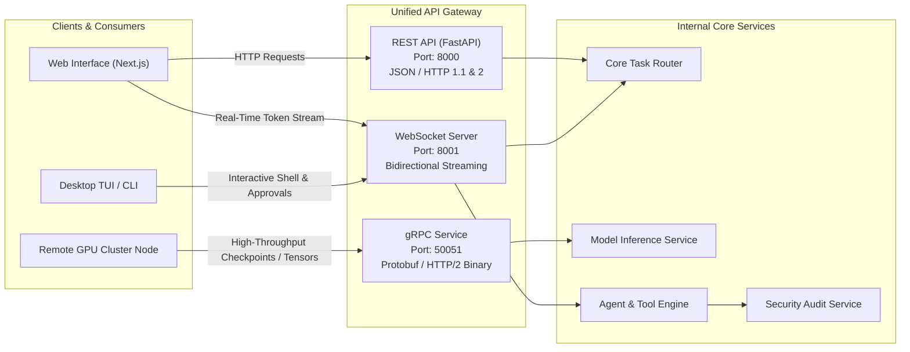

# 404 FOUNDERS — API Architecture Specification

**Document ID:** `DOC-ARCH-006`  
**Status:** Architecture Blueprint (Phase 02 Baseline)  
**Authors:** Chief Software Architect & Principal AI Systems Engineer  

---

## 1. Tri-Protocol Communication Architecture

404 FOUNDERS employs a **Tri-Protocol API Gateway** combining REST, WebSocket, and gRPC to meet diverse throughput, latency, and streaming requirements:

---

## 2. Protocol Specifications & Route Design

### 2.1 REST API (`api/rest/`)
- **Framework:** FastAPI (Python 3.11+) with ASGI server (Uvicorn).
- **Format:** Strict JSON serialization via Pydantic schemas.
- **Key Route Contracts:**
  - `GET /api/v1/health`: System health, CPU load, memory utilization, compute backend.
  - `POST /api/v1/infer`: General intelligence generation (non-streaming batch requests).
  - `GET /api/v1/system/telemetry`: Hardware and OS metrics collected by Personal AI monitor.
  - `GET /api/v1/phases/status`: Active project phase, completion criteria, and milestone history.
  - `POST /api/v1/tools/execute`: Controlled tool invocation with permission parameters.

### 2.2 WebSocket API (`api/websocket/`)
- **Protocol:** RFC 6455 over TLS (WSS).
- **Framing:** JSON event envelopes with discrete action types (`TOKEN_CHUNK`, `TOOL_PLAN`, `APPROVAL_REQUEST`, `APPROVAL_RESPONSE`, `ERROR`).
- **Use Cases:**
  - **Token-by-Token Generation:** Real-time visual typing for language and multimodal generation.
  - **Interactive User Approval Channel:** Pushes permission requests to user terminal for immediate authorization (`[Y/N]`) without polling.
  - **Live Terminal Emulation:** Streams stdout/stderr from sandboxed commands back to client.

### 2.3 gRPC API (`api/grpc/`)
- **Protocol:** HTTP/2 with binary Protocol Buffers (`protobuf v4+`).
- **Key Service Definitions:**
  - `ModelService.GenerateTokens(GenerateRequest) returns (stream TokenResponse)`
  - `VectorService.QuerySimilar(VectorQuery) returns (VectorResultList)`
  - `ClusterService.SyncWeights(WeightChunk) returns (SyncAck)`
- **Optimization:** Low-overhead serialization for multi-gigabyte tensor checkpoints and cross-node communication on dedicated GPU clusters.

---

## 3. Security, Rate Limiting & Authentication

1. **Authentication:**
   - Local IPC: Unix domain sockets with POSIX file permission checks.
   - Network HTTP/WS: Ephemeral cryptographically random bearer tokens (`FOUNDERS_API_KEY`).
   - gRPC Inter-Node: Mutual TLS (mTLS) with pinned cluster certificates.
2. **Rate Limiting & Concurrency:**
   - Token-bucket rate limiter per IP/client token.
   - Maximum active concurrent model generation sessions enforced by compute memory budget.

---

## 4. Implementation Status

- **Established in Phase 02:**
  - Package structure: `api/rest/`, `api/websocket/`, `api/grpc/`.
  - Port and host configurations defined in `core/config.py` (`8000`, `8001`, `50051`).
- **Scheduled for Future Phases:**
  - Protocol buffer schemas (`.proto`) and code generation (Phase 06).
  - FastAPI route handlers and middleware (Phase 06).
  - WebSocket event dispatcher and frontend hooks (Phase 06).
