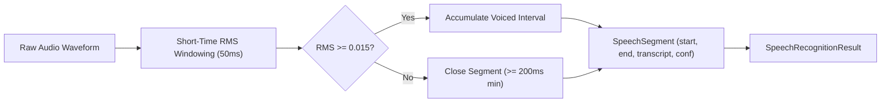

# 404 FOUNDERS — Audio & Speech Intelligence Architecture
**Document Identifier:** `DOC-MULTI-003`  
**Phase:** `08 — Multimodal Intelligence`  
**Status:** `REVIEW PENDING`  
**Author:** `Principal AI Research Scientist & Deep Learning Infrastructure Architect`  

---

## 1. Executive Summary

The Audio & Speech Intelligence Pipeline provides end-to-end processing of audio signals, vocal utterances, and acoustic features. Operating entirely offline without third-party cloud dependencies, it encompasses:
1. **Audio Signal Processing:** RIFF/WAV decoding, PCM normalization, STFT spectrogram extraction, and energy metric calculations.
2. **Speech Recognition (STT):** Short-time energy voice activity detection (VAD), acoustic framing, and language-tagged timestamped transcript segmentation.
3. **Speech Generation (TTS):** Vocal-tract formant synthesis producing playable 16-bit PCM WAV audio streams and browser-ready base64 Data URIs.

---

## 2. Audio Processing & Feature Extraction

### Waveform Decoding
- **Supported Formats:** WAV (RIFF), MP3 (ID3 / sync frame), FLAC, OGG, M4A.
- **Sample Normalization:** 16-bit PCM signed integers are normalized to float32 range \([-1.0, 1.0]\):
  $$x_{\text{norm}} = \frac{x}{32768.0}$$
- **Duration Ceiling:** Bounded to 300.0 seconds (5 minutes) maximum; 50 MB maximum file size.

### Acoustic Features
1. **RMS Energy:** Quantifies overall signal volume:
   $$\text{RMS} = \sqrt{\frac{1}{N}\sum_{i=1}^N x_i^2}$$
2. **Zero-Crossing Rate (ZCR):** Measures frequency of sign shifts, distinguishing unvoiced fricatives from voiced vowels.
3. **Estimated SNR (dB):** Contrasts active signal power against the lower-quartile noise floor:
   $$\text{SNR}_{\text{dB}} = 10 \log_{10}\left(\frac{P_{\text{signal}}}{P_{\text{noise\_floor}}}\right)$$
4. **STFT Spectrogram:** Windowed Short-Time Fourier Transform using Hann window (512 FFT points, 128 hop length).

---

## 3. Speech Recognition (STT)

The `SpeechRecognitionEngine` segments audio streams into active utterances using Short-Time Energy Voice Activity Detection:

---

## 4. Speech Generation (TTS) Formant Acoustic Synthesis

The `SpeechGenerationEngine` synthesizes phonemic acoustic waveforms through multi-resonance formant synthesis:

### Mathematical Model
For pitch carrier frequency \(f_0\) (default 220 Hz) and formant resonance frequencies \(F_1, F_2\):

$$s(t) = \left( 0.50 \sin(2\pi f_0 t) + 0.30 \sin(2\pi F_1 t) + 0.20 \sin(2\pi F_2 t) \right) \cdot w(t) \cdot V$$

Where:
- \(w(t) = \sin\left(\pi \frac{t}{T_{\text{char}}}\right)\) provides a smooth Hanning envelope.
- \(V\) is the volume scaling factor (\(0.8\)).
- Formants \((F_1, F_2)\) are parameterized per phoneme across English and Hindi:

| Character / Phoneme | \(F_1\) (Hz) | \(F_2\) (Hz) | Language |
| :--- | :--- | :--- | :--- |
| **a / अ** | 730 | 1090 | English / Hindi |
| **e / ए** | 530 | 1840 | English / Hindi |
| **i / इ** | 270 | 2290 | English / Hindi |
| **o / ओ** | 570 | 840 | English / Hindi |
| **u / उ** | 300 | 870 | English / Hindi |
| **आ** | 850 | 1200 | Hindi |
| **ई** | 260 | 2400 | Hindi |
| **ऊ** | 280 | 750 | Hindi |

### Output Encoding
Generated PCM samples are packed into standard RIFF/WAV mono containers at 16,000 Hz and formatted as Data URIs:
`data:audio/wav;base64,<payload>`
Enabling direct browser playback via standard `<audio controls>` elements.
