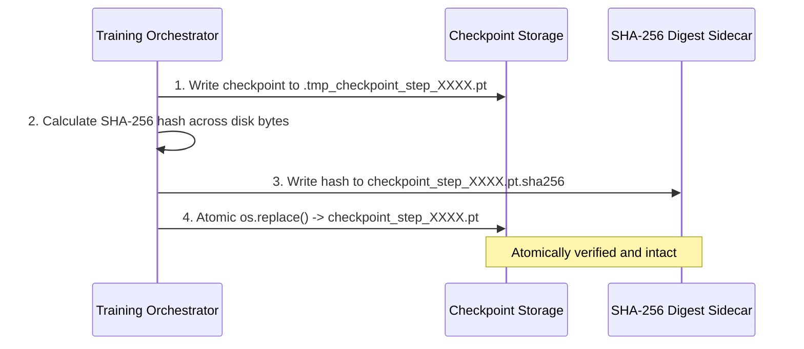

# 404 FOUNDERS — Secure Checkpoint Management Specification

**Document ID:** `DOC-TRAIN-004`  
**Phase:** Phase 06 Baseline  
**Authors:** Distributed Systems Engineer & Checkpoint Infrastructure Architect  

---

## 1. Overview & Security Mandate

Model checkpoints store complete neural weight tensors, optimizer momentums, scheduler states, and RNG seeds.
To guarantee fault tolerance, security, and reproducible recovery:
1. **Never Commit Checkpoints:** All checkpoint paths (`checkpoints/`, `training_runs/`, `*.pt`, `*.pth`) are strictly excluded in `.gitignore`.
2. **Two-Phase Atomic Writes:** Checkpoints are written to a temporary staging file before an atomic rename, preventing partial writes during node failure or power loss.
3. **Cryptographic SHA-256 Verification:** Every checkpoint produces a cryptographic digest stored in a `.sha256` sidecar; corrupted files are rejected on load.



---

## 2. Checkpoint Payload Structure

Every `.pt` checkpoint file stores a typed Python dictionary containing:

| Key | Type | Description |
| :--- | :--- | :--- |
| `step` | `int` | Global optimizer step count |
| `timestamp` | `str` | ISO 8601 UTC timestamp of creation |
| `model_state_dict` | `Dict[str, Tensor]` | Model weight and buffer tensors |
| `optimizer_state_dict` | `Dict[str, Any]` | AdamW first ($m$) and second ($v$) momentums |
| `scheduler_state_dict` | `Dict[str, Any]` | Cosine schedule progress and base learning rates |
| `model_config` | `Dict[str, Any]` | Structural hyperparameters (`FoundationModelConfig`) |
| `pretraining_config` | `Dict[str, Any]` | Optimization hyperparameters (`PretrainingConfig`) |
| `rng_states` | `Dict[str, Any]` | RNG states for `python.random`, `numpy`, and `torch` |
| `dataset_version` | `str` | Approved dataset manifest version |
| `tokenizer_version` | `str` | Approved tokenizer model version |
| `metrics` | `Dict[str, float]` | Evaluation metrics (`train_loss`, `val_loss`, `ppl`) |
| `is_best` | `bool` | True if this checkpoint achieved lowest validation loss |

---

## 3. Atomic Write Protocol

The `CheckpointManager` (`training/checkpoints/checkpoint_manager.py`) executes:
```python
# 1. Write to temporary staging file
torch.save(payload, staging_path)

# 2. Compute SHA-256
sha256_digest = compute_file_sha256(staging_path)

# 3. Write SHA-256 sidecar
with open(sha_path, "w") as f:
    f.write(f"{sha256_digest}  {filename}\n")

# 4. Atomic rename replaces destination
os.replace(staging_path, dest_path)
```

---

## 4. Integrity Validation on Load

When restoring a checkpoint via `load_checkpoint(path, verify_integrity=True)`:
1. The `.sha256` sidecar is located and read.
2. The current SHA-256 digest of the `.pt` file is computed from raw disk bytes.
3. If digests mismatch, execution raises `CheckpointCorruptedError`, preventing undefined neural behavior from partially written or corrupted weights.

---

## 5. Retention Policy & Best Model Management

- **Rolling Window:** Keeps the last $N$ step checkpoints (default $N = 3$) to conserve disk space.
- **Milestone Checkpoints:** Checkpoints with custom tags (e.g. `_milestone`, `_final`) are exempt from automatic pruning.
- **Best Model Pointer:** When validation loss reaches a new minimum, `best_model.pt` is updated atomically.
