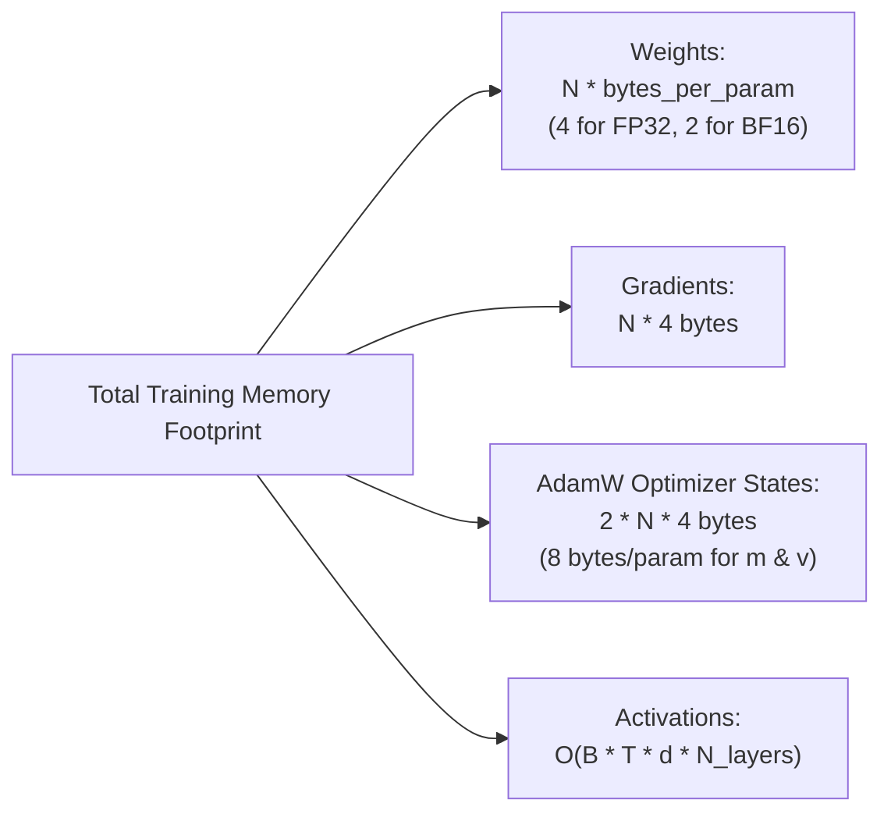

# 404 FOUNDERS — Compute Readiness Gate & Capacity Analysis

**Document ID:** `DOC-TRAIN-006`  
**Phase:** Phase 06 Baseline  
**Authors:** Chief AI Infrastructure Architect & Systems Performance Engineer  

---

## 1. Executive Summary & Workstation Constraints

The developer workstation is a **Dell Latitude 5400** running Kali Linux 2026.3 with:
- **CPU:** Intel Core i5-8365U (4 physical cores, 8 threads, AVX2, FMA3)
- **RAM:** 15.44 GB physical memory
- **Swap Space:** **0 B (Swapless Host)**
- **GPU:** Intel UHD 620 UMA (0 MB dedicated VRAM, no CUDA support)

> [!CAUTION]
> On a Linux system with **0 B swap**, memory over-allocation causes instantaneous invocation of the Linux kernel Out-Of-Memory (OOM) Killer, terminating the process or causing kernel panics. The `ComputeReadinessGate` strictly enforces memory budgeting before tensor allocation.

---

## 2. Analytical Memory Footprint Formulations

Pretraining memory consists of four primary components:

$$M_{\text{total}} = M_{\text{weights}} + M_{\text{grads}} + M_{\text{opt}} + M_{\text{act}}$$

### 2.1 Model Weights & Gradients
For $N_{\text{params}}$ trainable parameters:
$$M_{\text{weights}} = N_{\text{params}} \times 4 \text{ bytes (FP32)}$$
$$M_{\text{grads}} = N_{\text{params}} \times 4 \text{ bytes (FP32)}$$

### 2.2 AdamW Optimizer State
AdamW maintains two 32-bit floating-point momentum buffers per trainable parameter:
- First momentum estimate: $m_t \in \mathbb{R}$ (4 bytes)
- Second uncentered variance estimate: $v_t \in \mathbb{R}$ (4 bytes)
$$M_{\text{opt}} = N_{\text{params}} \times 8 \text{ bytes}$$

Thus, weights + gradients + optimizer require **16 bytes per parameter** during FP32 training.

### 2.3 Activation Memory
For batch size $B$, sequence length $T$, hidden dimension $d$, and $L$ layers:
$$M_{\text{act}} \approx B \times T \times d \times L \times 34 \times \text{bytes\_per\_param}$$
where factor 34 accounts for attention QKV projections, attention matrices, SwiGLU gated activations, RMSNorm states, and LayerScale residuals.

---

## 3. Scale Feasibility Matrix

| Profile | Parameters ($N$) | Peak Memory ($M_{\text{total}}$) | Workstation Feasibility | Target Execution Environment |
| :--- | :--- | :--- | :--- | :--- |
| **Experimental Tiny** | ~221,000 | ~4.1 MB | **Approved (Pilot Test)** | Workstation CPU |
| **Local Workstation CPU** | ~633,000 | ~15.2 MB | **Approved (Pilot Test)** | Workstation CPU |
| **Research Pilot** | ~25,400,000 | ~1.24 GB | Feasible (High Load) | Workstation / Tier A GPU |
| **Production Foundation** | ~1,210,000,000 | ~48.2 GB | **BLOCKED (OOM Panic)** | Tier B/C Multi-Node GPU Cluster |

---

## 4. Compute Readiness Gate Protocol

The `ComputeReadinessGate` (`training/engine/compute_readiness.py`) enforces:
1. **Dynamic Safe Ceiling:** Calculates safe workstation memory budget:
   $$\text{Budget}_{\text{RAM}} = 0.60 \times \text{RAM}_{\text{available}}$$
2. **Pre-Allocation Inspection:** Compares analytical memory demand $M_{\text{total}}$ against safe budget.
3. **Execution Verdicts:**
   - `APPROVED_LOCAL_PILOT`: Memory fits within budget; local execution permitted.
   - `BLOCKED_INSUFFICIENT_MEMORY`: Halts immediately with descriptive blocker report.
   - `REQUIRES_GPU_CLUSTER`: Flags workloads requiring Slurm submission to Tier B/C clusters.
