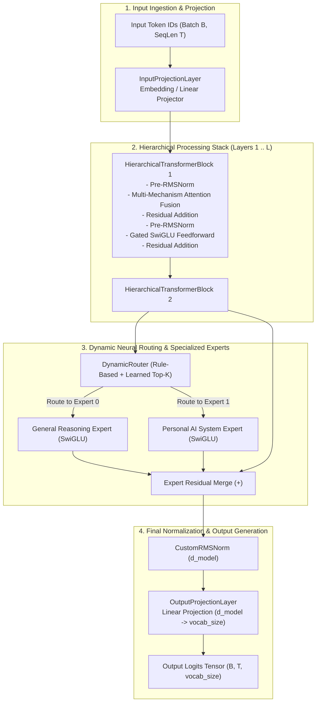

# 404 FOUNDERS — Core AI Foundation Specification

**Document ID:** `DOC-CORE-001`  
**Status:** Initial Prototype Implemented (Phase 03 Baseline)  
**Authors:** Principal AI Research Engineer & Neural Architecture Developer  

---

## 1. Executive Summary & Purpose

This document specifies the initial software foundation of the **404 FOUNDERS Custom AI Architecture**. Established entirely from first principles with **zero pretrained model weights**, this prototype provides the core neural computational engine coordinating inputs, layer normalizations, projections, multi-mechanism attention, dynamic routing, and structured output generation.

---

## 2. Tensor Shape Conventions & Flow

Throughout the neural core, tensors adhere to standardized dimensional contracts:

| Stage | Tensor Variable | Shape Convention | Description |
|---|---|---|---|
| **Input** | `input_ids` | $(B, T)$ | Discrete integer token identifiers |
| **Projected Hidden** | `h_0` | $(B, T, d_{\text{model}})$ | Continuous latent token representations |
| **Attention Queries** | `Q` | $(B, H, T, d_k)$ | Multi-head query states ($d_k = d_{\text{model}} / H$) |
| **Attention Keys** | `K` | $(B, H, T, d_k)$ | Multi-head key states |
| **Attention Values** | `V` | $(B, H, T, d_k)$ | Multi-head value states |
| **Attention Matrix** | `scores` | $(B, H, T, T)$ | Pairwise affinity attention matrix |
| **FFN Intermediate** | `h_{\text{intermediate}}` | $(B, T, d_{\text{ffn}})$ | Expanded feature dimension ($d_{\text{ffn}} = \lfloor \frac{8}{3} d_{\text{model}} \rfloor$) |
| **Layer Output** | `h_l` | $(B, T, d_{\text{model}})$ | Transformed hidden states per block |
| **Output Logits** | `logits` | $(B, T, V)$ | Unnormalized token probability distributions ($V = \text{vocab\_size}$) |

---

## 3. Implemented Subsystems & Component Responsibilities

### 3.1 Normalization Layer (`neural_architecture/layers/normalization.py`)
- **Class:** `CustomRMSNorm`
- **Responsibility:** Scales inputs by the root mean square of their elements along the hidden dimension:
  $$y = \frac{x}{\sqrt{\frac{1}{d} \sum_{i=1}^d x_i^2 + \epsilon}} \odot \gamma$$
- **Stability:** Uses $\epsilon = 10^{-6}$ and computes the mean square in FP32 precision to prevent underflow.

### 3.2 Projection & Transformation Layers (`neural_architecture/layers/projections.py`)
- **Input Projection (`InputProjectionLayer`):** Dual-mode input processor supporting discrete token lookups via `nn.Embedding` or continuous linear mappings for multimodal embeddings.
- **Output Projection (`OutputProjectionLayer`):** Unembeds final normalized hidden representations back into vocabulary logits.
- **Feature Transformation (`FeatureTransformationLayer`):** Gated SwiGLU non-linear network:
  $$\text{SwiGLU}(x) = (\text{SiLU}(x W_{\text{gate}}) \odot (x W_{\text{up}})) W_{\text{down}}$$

### 3.3 Residual Connections (`neural_architecture/layers/residual.py`)
- **Class:** `ResidualConnection`
- **Responsibility:** Implements pre-normalized residual addition with learnable LayerScale coefficients ($\alpha \in \mathbb{R}^d$) to stabilize deep gradient propagation.

### 3.4 Rotary Position Embeddings (`neural_architecture/layers/position.py`)
- **Class:** `RotaryPositionEmbedding`
- **Responsibility:** Encodes relative token distance by rotating queries and keys in pairwise 2D complex planes.

### 3.5 Central Neural Core (`core/intelligence/neural_core.py`)
- **Class:** `NeuralCore`
- **Responsibility:** Central coordinator integrating input projection, hierarchical blocks, dynamic routing, specialized experts, and prediction output.
- **Initialization:** Every trainable parameter is initialized randomly from a normal distribution with scale-aware standard deviations ($\sigma = 1/\sqrt{d_{\text{in}}}$).

### 3.6 Inference Harness (`neural_architecture/inference.py`)
- **Class:** `InferenceEngine`
- **Responsibility:** Validates input tensor dimensions, bounds token IDs to vocabulary limits, executes forward evaluation, guards against numerical NaN/Inf generation, and provides step-by-step greedy token generation.

---

## 4. Computational Complexity Analysis

| Subsystem | Time Complexity | Space / Memory Complexity | Notes |
|---|---|---|---|
| **Input Projection** | $O(B \cdot T \cdot d_{\text{model}})$ | $O(B \cdot T \cdot d_{\text{model}})$ | Linear in sequence length |
| **Global Attention** | $O(B \cdot H \cdot T^2 \cdot d_k)$ | $O(B \cdot H \cdot T^2)$ | Quadratic bottleneck on long sequences |
| **Sparse Attention** | $O(B \cdot H \cdot T \cdot W \cdot d_k)$ | $O(B \cdot H \cdot T \cdot W)$ | Linear complexity when $W \ll T$ |
| **Hierarchical Attention** | $O(B \cdot H \cdot (T \cdot C + (T/C)^2) \cdot d_k)$ | $O(B \cdot H \cdot T \cdot C)$ | Sub-quadratic micro/macro decomposition |
| **SwiGLU FFN** | $O(B \cdot T \cdot d_{\text{model}} \cdot d_{\text{intermediate}})$ | $O(B \cdot T \cdot d_{\text{intermediate}})$ | Linear in sequence length |

---

## 5. Prototype Dimensions vs. Production Targets

| Parameter | Phase 03 Prototype (Laptop Verified) | Future Phase Target (Dedicated GPU Cluster) |
|---|---|---|
| **Hidden Dimension ($d_{\text{model}}$)** | 128 | 2048 – 4096 |
| **Transformer Layers ($L$)** | 2 | 24 – 32 |
| **Attention Heads ($H$)** | 4 | 16 – 32 |
| **Vocabulary Size ($V$)** | 1024 | 32,000 – 64,000 |
| **Max Sequence Length ($T$)** | 512 | 8,192 – 32,768 (Infinite context paged) |
| **Total Parameters** | ~430,000 (0.43M params) | 1.0B – 7.0B+ params |
| **Execution Hardware** | Intel Core i5-8365U CPU | 8x–64x NVIDIA H100 SXM5 80GB |

---

## 6. Known Limitations & Research Questions

1. **Untrained Parameters:**
   - *Status:* The model is initialized from pure random Gaussian distributions. Outputs represent mathematical transformations and do not yet contain trained linguistic semantics.
2. **CPU Execution Throughput:**
   - *Status:* The prototype runs on 8 CPU threads using oneDNN/MKL. Throughput is suited for architectural validation and shape verification, not large-scale text generation.
3. **Future Research Questions:**
   - What is the optimal static-to-dynamic ratio for attention fusion across distinct modalities?
   - How does the auxiliary load-balancing loss $\mathcal{L}_{\text{balance}}$ impact expert specialization during from-scratch pretraining?
