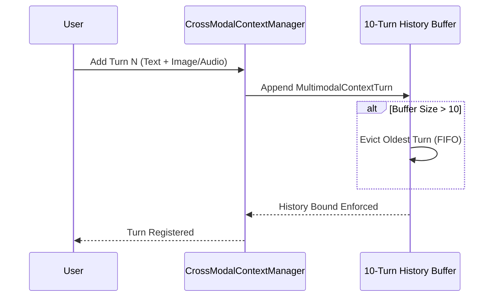

# 404 FOUNDERS — Cross-Modal Context Manager Architecture
**Document Identifier:** `DOC-MULTI-007`  
**Phase:** `08 — Multimodal Intelligence`  
**Status:** `REVIEW PENDING`  
**Author:** `Principal AI Research Scientist & Deep Learning Infrastructure Architect`  

---

## 1. Executive Summary

Conversational multimodal interaction requires retaining media artifacts and contextual references across multiple dialogue turns. The Cross-Modal Context Manager (`multimodal.context_manager`) maintains a bounded multi-turn interaction history, indexes multimodal media summaries, resolves cross-modal conversational coreferences, and prevents memory leakage.

---

## 2. Bounded Context Ring Buffer

To prevent memory exhaustion during long sessions, `CrossModalContextManager` implements a strict FIFO eviction buffer capped at **10 turns** (`MAX_HISTORY_TURNS = 10`):

Each turn records:
- `turn_id`: Monotonically increasing sequence integer.
- `timestamp_utc`: ISO 8601 UTC timestamp.
- `user_query`: Original input prompt.
- `active_modalities`: List of active modalities (`["TEXT", "IMAGE", ...]`).
- Artifact summaries (`document_summary`, `image_caption`, `audio_transcript`, `video_summary`).
- `assistant_response`: Output generated by the neural subsystem.

---

## 3. Cross-Modal Coreference Resolution

When users refer obliquely to previously uploaded media (e.g., *"What was in that picture?"*, *"Summarize the PDF again"*), the context manager resolves the target artifact by scanning recent history in reverse chronological order:

| Reference Keywords | Target Modality | Resolution Strategy |
| :--- | :--- | :--- |
| `image`, `picture`, `photo`, `diagram` | **IMAGE** | Most recent `image_caption` |
| `document`, `pdf`, `file`, `report`, `text` | **DOCUMENT** | Most recent `document_summary` |
| `audio`, `speech`, `recording`, `voice` | **AUDIO** | Most recent `audio_transcript` |
| `video`, `clip`, `footage`, `stream` | **VIDEO** | Most recent `video_summary` |

If matched, the relevant context artifact is injected into the prompt context for grounded downstream reasoning without requiring re-upload.
