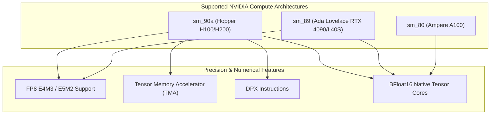

# 404 FOUNDERS — CUDA, cuDNN & Accelerator Compatibility Matrix

## 1. Executive Summary

This document specifies the exact software and hardware accelerator compatibility matrix for **404 FOUNDERS**. All cluster nodes, container base images, and runtime execution environments must strictly adhere to these verified combinations to prevent numerical divergence, kernel launch failures, or inter-GPU communication stalls.

---

## 2. Software Compatibility Matrix

| Component | Target Version | Minimum Version | Supported Architectures | Purpose |
| :--- | :--- | :--- | :--- | :--- |
| **NVIDIA Driver** | 550.54.15 | 535.129.03 | Hopper, Ada, Ampere | Kernel-space accelerator management |
| **CUDA Toolkit** | 12.4.1 | 12.2.2 | sm_80, sm_89, sm_90a | Parallel computing platform & compilers |
| **cuDNN** | 9.1.0 | 8.9.7 | sm_80, sm_89, sm_90a | Deep neural network primitives |
| **NCCL** | 2.21.5 | 2.18.3 | sm_80, sm_89, sm_90a | Multi-GPU collective communications |
| **PyTorch** | 2.4.0+cu124 | 2.2.0 | x86_64, aarch64 | Primary dynamic neural runtime |
| **JAX / JAXlib**| 0.4.30+cuda12 | 0.4.23 | x86_64, aarch64 | Functional XLA compiled supercomputing |
| **Triton** | 3.0.0 | 2.2.0 | sm_80, sm_89, sm_90a | Custom fused kernel JIT compiler |
| **Transformer Engine** | 1.7.0 | 1.4.0 | sm_89, sm_90a | FP8 mixed precision GEMMs |

---

## 3. GPU Hardware Compute Architectures

### Hopper sm_90a (H100 / H200 SXM5)
- **Primary Pretraining Engine (Tier C)**: 989 TFLOPS BF16 / 1,978 TFLOPS FP8 per GPU.
- **Tensor Memory Accelerator (TMA)**: Asynchronous multidirectional data transfer directly between shared memory (SRAM) and global memory (HBM3) without stalling Tensor Cores.
- **Distributed Shared Memory (DSMEM)**: Permits thread blocks across distinct Streaming Multiprocessors to directly address each other's shared memory over NVLink.

### Ada Lovelace sm_89 (RTX 4090 / L40S)
- **Primary Prototyping Engine (Tier A)**: 330 TFLOPS BF16 / 660 TFLOPS FP8 per GPU.
- **FP8 Support**: Supported for training acceleration, utilizing FP8 Transformer Engine GEMMs.

---

## 4. Precision & Numerical Policy

To guarantee mathematical stability across trillions of tokens trained from random initialization:

1. **Standard Precision**: **BFloat16 (`torch.bfloat16`)** is the default baseline for all forward passes, backward passes, and gradient representations. Unlike FP16, BF16 maintains the same 8-bit exponent range as FP32, preventing gradient underflow without requiring complex loss scaling heuristics.
2. **Master Weights & Optimizer**: Master model weights, AdamW first moments ($m$), and second moments ($v$) are held strictly in **FP32** to preserve numerical precision during optimization updates.
3. **FP8 Accelerated Training (Tier C)**:
   - Activations and weights: Quantized dynamically to `fp8_e4m3` during matrix multiplications.
   - Gradients: Quantized to `fp8_e5m2` during backward passes to preserve dynamic range.
   - Normalization and attention softmax: Maintained strictly in FP32 / BF16.
