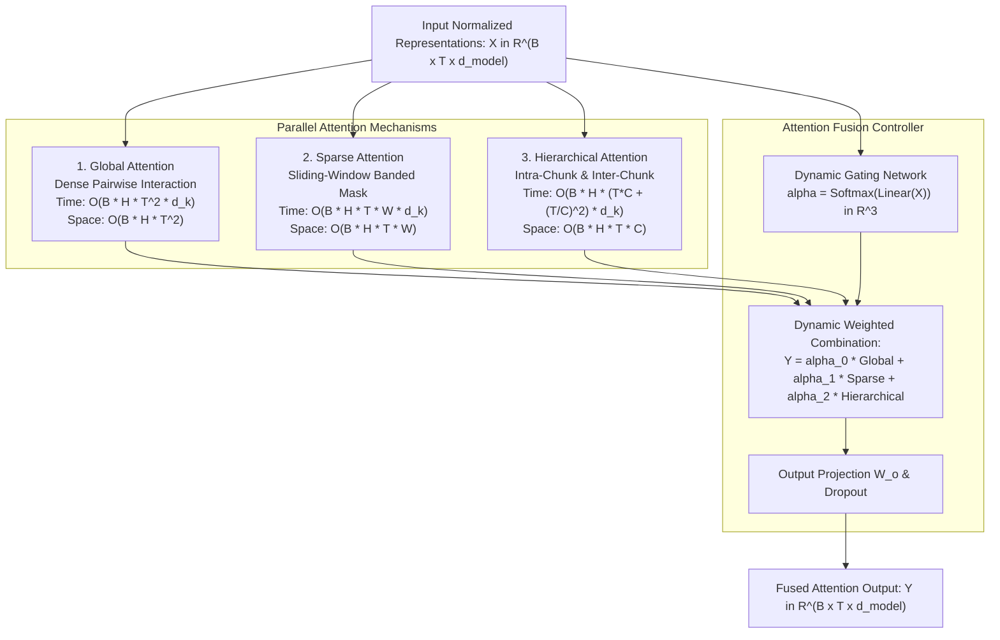

# 404 FOUNDERS — Custom Multi-Mechanism Attention Design

**Document ID:** `DOC-ATTN-001`  
**Status:** Architecture Prototype Implemented (Phase 03 Baseline)  
**Authors:** Principal AI Research Engineer & Neural Architecture Developer  

---

## 1. Design Hypothesis & Theoretical Motivation

Standard Dense Multi-Head Attention scales quadratically ($O(N^2)$) with sequence length $N$. In multimodal foundation models processing high-resolution visual patches, continuous audio spectrograms, and large source code repositories, dense quadratic attention imposes severe memory bottlenecks.

**Design Hypothesis:**  
Natural sequences possess multi-scale information structures:
1. **Local Fine-Grained Syntax:** Governed by immediate token neighborhoods (best captured by sliding-window **Sparse Attention**).
2. **Intermediate Structural Grouping:** Paragraphs, functions, and image tiles exhibit hierarchical coherence (best captured by **Hierarchical Attention**).
3. **Global Semantic Anchors:** System instructions, query prompts, and document summaries require persistent sequence-wide visibility (best captured by **Global Attention**).

Rather than forcing a single static compromise, 404 FOUNDERS implements **Hybrid Multi-Mechanism Attention (MMA)**, evaluating all three pathways in parallel and dynamically fusing their outputs via an input-conditioned neural gating network.

---

## 2. Mathematical Formulations & Component Details

### 2.1 Global Attention (`core/attention/global_attention.py`)
Dense dot-product attention computing full pairwise interactions:
$$Q = X W_q, \quad K = X W_k, \quad V = X W_v$$
$$\text{Scores} = \frac{Q K^T}{\sqrt{d_k}} + M_{\text{attn}}$$
$$\text{Attention}(Q, K, V) = \text{Softmax}(\text{Scores}) V$$

- **Numerical Stability:** Subtracts row-wise maximum ($\max_j S_{i,j}$) prior to exponential evaluation to prevent FP32 overflow.
- **Complexity:** Time $O(T^2 \cdot d)$, Memory $O(T^2)$.

### 2.2 Sparse Sliding-Window Attention (`core/attention/sparse_attention.py`)
Restricts attention to a symmetric sliding window of width $W$:
$$M_{\text{sparse}}(i, j) = \begin{cases} 0 & \text{if } |i - j| \le W \\ -\infty & \text{if } |i - j| > W \end{cases}$$
$$\text{Scores}_{\text{sparse}} = \frac{Q K^T}{\sqrt{d_k}} + M_{\text{sparse}} + M_{\text{padding}}$$
- **Complexity:** Time $O(T \cdot W \cdot d)$, Memory $O(T \cdot W)$. When $W \ll T$, computation scales linearly with sequence length.

### 2.3 Hierarchical Multi-Resolution Attention (`core/attention/hierarchical_attention.py`)
Decomposes the sequence into non-overlapping chunks $U_1, U_2, \dots, U_K$ of size $C$:
1. **Intra-Chunk Micro Attention:**
   $$\text{Local}_k = \text{Attention}(Q_{U_k}, K_{U_k}, V_{U_k}) \quad \forall k \in \{1, \dots, K\}$$
2. **Inter-Chunk Macro Attention:**
   $$\bar{X}_k = \frac{1}{C} \sum_{t \in U_k} X_t, \quad \text{GlobalChunks} = \text{Attention}(\bar{X} W_{\bar{q}}, \bar{X} W_{\bar{k}}, \bar{X} W_{\bar{v}})$$
3. **Multi-Scale Gated Fusion:**
   $$Y = g \odot \text{Local} + (1 - g) \odot \text{Expand}(\text{GlobalChunks}), \quad g = \sigma(\text{Linear}([Local, GlobalChunks]))$$
- **Complexity:** Time $O(T \cdot C + (T/C)^2 \cdot d)$. For $T=4096, C=32$, quadratic operations drop from $16.7\text{M}$ to $16,384$ ($>99.9\%$ reduction).

### 2.4 Attention Fusion Controller (`core/attention/fusion_controller.py`)
Learns dynamic, per-token mixing coefficients:
$$\alpha(x) = \text{Softmax}(x W_{\text{gate}} + b_{\text{gate}}) \in \Delta^2$$
$$Y_{\text{fused}} = \left(\sum_{m \in \{\text{global, sparse, hier}\}} \alpha_m(x) \cdot Y_m\right) W_o$$

---

## 3. Comparison with Established Attention Baselines

| Attention Architecture | Mechanism Type | Complexity (Time) | Memory Scaling | Local Detail | Long-Range Capture |
|---|---|---|---|---|---|
| **Standard Transformer (Vaswani et al.)** | Full Dense Quadratic | $O(N^2)$ | $O(N^2)$ | High | High |
| **Longformer (Beltagy et al.)** | Static Sliding Window + Dilated | $O(N \cdot W)$ | $O(N \cdot W)$ | High | Moderate |
| **BigBird (Zaheer et al.)** | Random + Window + Global | $O(N)$ | $O(N)$ | Moderate | Moderate (Stochastic) |
| **Perceiver (Jaegle et al.)** | Cross-Attention to Latent Bottleneck | $O(N \cdot L)$ | $O(L^2)$ | Low (Compressed) | High |
| **404 FOUNDERS MMA (This Work)** | **Dynamic Gated Fusion (Global + Sparse + Hierarchical)** | **Adaptive $O(N \cdot W) \to O(N^2)$** | **Controlled by Window $W$** | **High** | **High (Deterministic)** |

---

## 4. Empirical Gradient Propagation & Shape Verification

All four attention modules have been tested for:
1. **Output Shape Invariance:** Verified that for any input $(B, T, d_{\text{model}})$, output matches $(B, T, d_{\text{model}})$.
2. **Gradient Flow:** Backward autograd passes verify non-zero, non-NaN gradients across all projection matrices:
   $$\frac{\partial \mathcal{L}}{\partial W_q} \ne 0, \quad \frac{\partial \mathcal{L}}{\partial W_k} \ne 0, \quad \frac{\partial \mathcal{L}}{\partial W_v} \ne 0, \quad \frac{\partial \mathcal{L}}{\partial W_{\text{gate}}} \ne 0$$
3. **Mask Handling:** Tested on causal triangular masks and boolean padding masks.

---

## 5. Future Research Directions

- **FlashAttention Kernel Integration:** In Phase 04/08, replace naive matrix multiplications with custom CUDA kernels implementing online softmax tiling.
- **Sparse Block Offsets:** Investigate dynamic dilated windows that expand at deeper layers of the Transformer stack.
