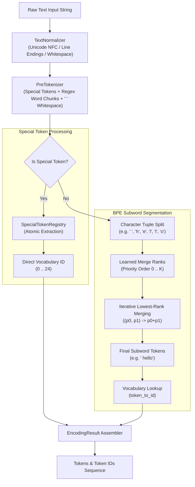

# 404 FOUNDERS — Custom BPE Tokenizer Architecture

> **Document ID:** `DOC-TOK-001`  
> **Phase:** 04 — Custom BPE Tokenizer & Data Pipeline  
> **Target Audience:** Principal NLP Engineers, Neural Architecture Developers, ML Researchers  
> **Status:** Verified Implementation

---

## 1. Architectural Philosophy: Custom BPE vs. Byte-Level BPE

In contemporary language modeling, Byte-Level Byte Pair Encoding (BBPE) is frequently adopted to bypass out-of-vocabulary (OOV) tokens by decomposing any arbitrary byte stream (`0x00`–`0xFF`) into individual byte tokens. However, for a truly multilingual and sovereign foundation model like **404 FOUNDERS**, Byte-Level BPE exhibits severe structural liabilities:

1. **Catastrophic Byte Fragmentation in Indic Scripts:** In UTF-8, Devanagari (Hindi, Sanskrit, Marathi) characters require 3 bytes each. Under Byte-Level BPE, an un-merged Hindi character is fragmented into three meaningless byte tokens (`\xe0\xa4\xa8`), diluting attention bandwidth and driving fertility (tokens per word) to 3× to 5× that of English.
2. **Loss of Grapheme Integrity:** Combining marks (mātrās such as `ा`, `ि`, `ी`, `े` and virama halant `्`) become disjoint byte tokens, corrupting phonetic and semantic continuity in the transformer's latent space.
3. **Suboptimal Context Window Utilization:** Byte fragmentation wastes 60–75% of context length on non-Latin scripts, penalizing Hindi, Arabic, and multilingual reasoning.

**The Approved Architectural Choice: Custom Character-Level BPE**  
404 FOUNDERS implements **Custom BPE** operating directly on Unicode code points and pre-tokenized grapheme clusters:
- Base alphabet consists of individual Unicode characters discovered from corpora plus standard printable ASCII.
- Preserves whole Devanagari letters, vowels, mātrās, and virama marks as atomic Unicode units.
- Frequent conjuncts (e.g. `'स्'` = `'स'` + `'्'`, `'भा'` = `'भ'` + `'ा'`) merge naturally into high-salience subwords.
- Guarantees $O(1)$ token preservation for code operators, mathematical signs, and multilingual characters.

---

## 2. Tokenizer Subsystem Topology



---

## 3. Explicit Whitespace Representation (` `)

To achieve 100% lossless detokenization without ambiguous space insertions, 404 FOUNDERS utilizes the Unicode Lower One Eighth Block symbol (` ` / `\u2581`):

- Every space `' '` is transformed into ` ` during pre-tokenization.
- Words preceded by whitespace explicitly carry the ` ` prefix (e.g., `" Hello"`).
- Words without preceding whitespace (such as the start of a line or symbols attached to punctuation) have no ` ` prefix (e.g., `"Hello"`, `","`).
- Indentation blocks in programming code (e.g., Python 4-space indent) are cleanly represented as `["    "]` or `[" ", " ", " ", " "]`.
- **Decodability Guarantee:** Joining all tokens and replacing ` ` with `' '` yields the exact original text character-for-character.

---

## 4. Special Tokens Registry Specification

Special control tokens are strictly segregated from ordinary BPE merges. They are registered with immutable, stable IDs from `0` to `24`:

| Token ID | Token String | Category | Purpose |
|---|---|---|---|
| `0` | `<pad>` | Structural | Tensor batch padding |
| `1` | `<unk>` | Fallback | Out-of-vocabulary character fallback |
| `2` | `<bos>` | Delimiter | Beginning of sequence marker |
| `3` | `<eos>` | Delimiter | End of sequence generation delimiter |
| `4` | `<eot>` | Dialogue | End of turn in multi-turn interaction |
| `5` | `<sys_start>` | Role Boundary | System instruction block start |
| `6` | `<sys_end>` | Role Boundary | System instruction block end |
| `7` | `<user_start>` | Role Boundary | User prompt block start |
| `8` | `<user_end>` | Role Boundary | User prompt block end |
| `9` | `<asst_start>` | Role Boundary | Assistant response block start |
| `10` | `<asst_end>` | Role Boundary | Assistant response block end |
| `11` | `<thought>` | Reasoning | Chain-of-thought internal reasoning start |
| `12` | `</thought>` | Reasoning | Chain-of-thought internal reasoning end |
| `13` | `<tool_call>` | Agent | Autonomous agent tool invocation payload |
| `14` | `<tool_result>`| Agent | Sandboxed tool execution response payload |
| `15` | `<image>` | Multimodal | Continuous vision patch insertion anchor |
| `16` | `</image>` | Multimodal | Vision patch boundary end |
| `17` | `<audio>` | Multimodal | Continuous audio latent frame anchor |
| `18` | `</audio>` | Multimodal | Audio frame boundary end |
| `19` | `<video>` | Multimodal | Spatiotemporal video tubelet anchor |
| `20` | `</video>` | Multimodal | Video boundary end |
| `21` | `<spatial>` | Multimodal | Bounding box and coordinate coordinate anchor |
| `22` | `</spatial>` | Multimodal | Spatial boundary end |
| `23` | `<code_start>` | Technical | Programming block start delimiter |
| `24` | `<code_end>` | Technical | Programming block end delimiter |

### Atomic Matching Guarantee
The `SpecialTokenRegistry` compiles an optimized regular expression matching all special tokens longest-first. The pre-tokenizer extracts these tokens atomically before any subword decomposition, guaranteeing that a sequence like `<tool_call>` is never fragmented into `<` + `tool` + `_` + `call` + `>`.

---

## 5. Algorithmic Complexity

- **Pre-Tokenization:** $O(N)$ where $N$ is the length of the input text in characters.
- **BPE Subword Encoding:** $O(W \cdot M)$ where $W$ is the number of pre-tokenized words and $M$ is the average character length of a word. With heap-accelerated or priority lookup, this completes in sub-millisecond CPU time per document.
- **Decoding:** $O(T)$ where $T$ is the number of token IDs. String joining and single-pass whitespace replacement execute at memory bandwidth speeds.

---

## 6. Implementation Interfaces

```python
from tokenizer import CustomBPETokenizer, TokenizerConfig

# 1. Initialize tokenizer
config = TokenizerConfig(vocab_size=1024, min_frequency=2)
tokenizer = CustomBPETokenizer(config=config)

# 2. Train on text iterator
tokenizer.train_from_iterator(["404 FOUNDERS custom tokenizer.", "नमस्ते भारत!"])

# 3. Encode text
res = tokenizer.encode("नमस्ते 404 FOUNDERS!", add_bos=True, add_eos=True)
print("Tokens:", res.tokens)
print("IDs:", res.ids)

# 4. Decode
text = tokenizer.decode(res.ids, skip_special_tokens=True)
assert text == "नमस्ते 404 FOUNDERS!"
```
