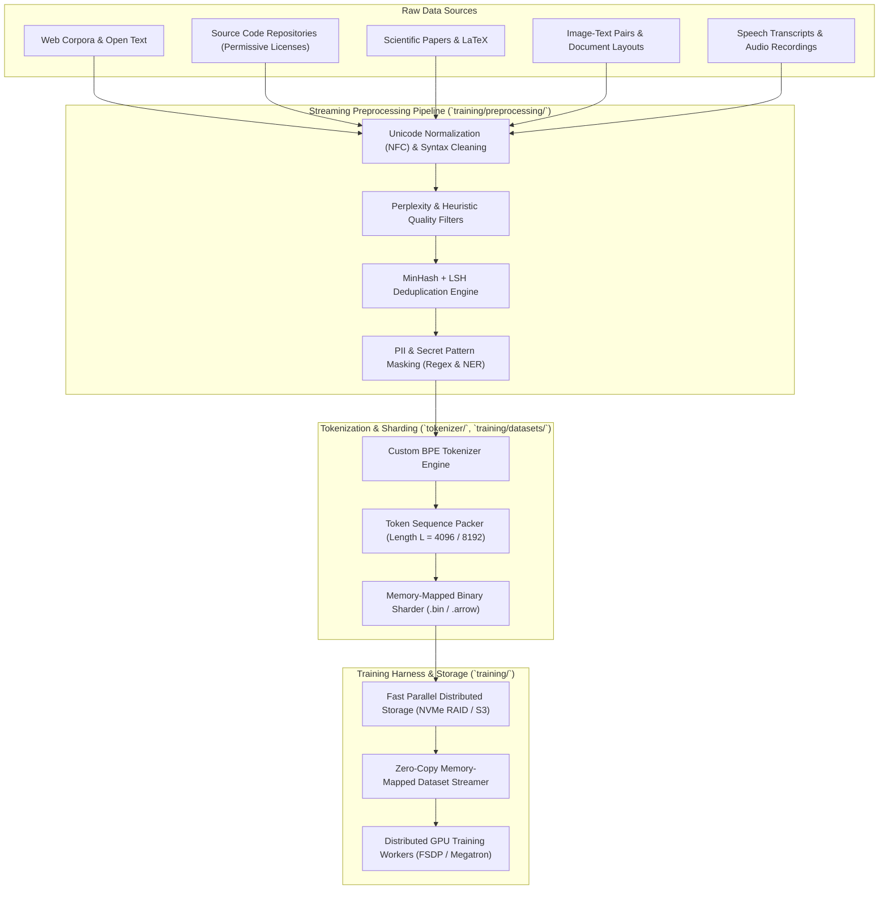

# 404 FOUNDERS — Data Architecture Specification

**Document ID:** `DOC-ARCH-008`  
**Status:** Architecture Blueprint (Phase 02 Baseline)  
**Authors:** Chief Software Architect & Principal AI Systems Engineer  

---

## 1. Data Pipeline Principles & Overview

The 404 FOUNDERS foundation model is trained on curated multimodal datasets processed through a high-throughput, reproducible data engineering pipeline:

---

## 2. Ingestion & Preprocessing Mechanics

### 2.1 Text & Code Normalization
- Converts all text streams into standardized UTF-8 NFC representation.
- Strips malformed escape characters, null bytes, and invisible Unicode directionality overrides.
- Normalizes whitespace indentation in code files to standard 4-space blocks without destroying semantic formatting.

### 2.2 Deduplication: Exact & Fuzzy MinHash LSH
- **Exact Hash Deduplication:** Computes 64-bit xxHash on normalized documents; duplicate hashes are dropped immediately.
- **Fuzzy MinHash LSH:** Documents are segmented into 5-gram word shingles. 128 hash permutations are computed into 16 bands of 8 rows. Documents with Jaccard similarity $\ge 0.85$ are pruned to eliminate synthetic web spam.

### 2.3 PII & Secret Scrubbing
- Scrubbers automatically mask:
  - IPv4/IPv6 private and public addresses.
  - Email addresses, telephone numbers, and government identification patterns.
  - High-entropy cryptographic API keys, private keys (`BEGIN PRIVATE KEY`), and password assignments.

---

## 3. Binary Sharding & Zero-Copy Token Packing

To prevent training bottlenecks when streaming trillions of tokens across dozens of GPU nodes:
1. **Document Boundary Packing:** Continuous documents are packed into fixed sequence lengths (e.g. $L = 4096$) separated by special `<|endoftext|>` token IDs, using cross-document attention masking.
2. **Memory-Mapped Storage:** Token sequences are written into uint16/uint32 binary files (`shard_00000.bin`) alongside index offsets (`shard_00000.idx`).
3. **Zero-Copy Streaming:** PyTorch/JAX data loaders read shards directly into page cache using `mmap()`, eliminating CPU memory bottlenecks.

---

## 4. Local Database Persistence (`database/`)

For local personal AI operations:
- **SQLite (`database/sqlite_meta.db`):** Houses user configurations, task status logs, and relational episodic sessions.
- **DuckDB (`database/analytics.duckdb`):** Embedded columnar engine for fast analytical queries over system performance telemetry and tokenizer training statistics.

---

## 5. Implementation Status

- **Established in Phase 02:**
  - Package structure initialized: `training/datasets/`, `training/preprocessing/`, `database/`.
  - Storage directory `.gitignore` policies safeguarding raw datasets and processed binary shards.
- **Scheduled for Future Phases:**
  - Fast BPE tokenizer training script (Phase 03).
  - Streaming sharded binary dataset builder (Phase 03).
  - SQLite/DuckDB schema migrations (Phase 05).
