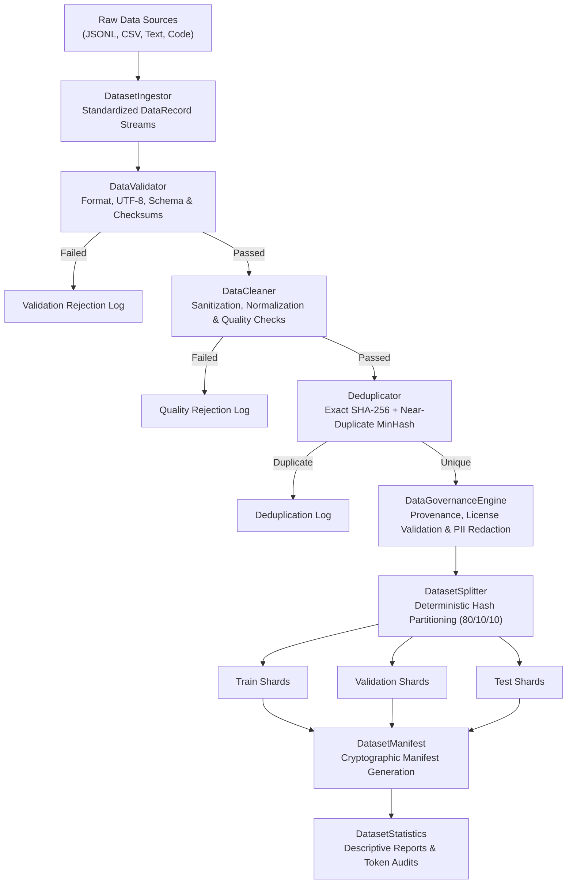

# 404 FOUNDERS — Data Preparation Pipeline Architecture

> **Document ID:** `DOC-DATA-001`  
> **Phase:** 04 — Custom BPE Tokenizer & Data Pipeline  
> **Target Audience:** Data Platform Architects, ML Infrastructure Engineers, Pipeline Developers  
> **Status:** Verified Implementation

---

## 1. Architectural Overview

The **404 FOUNDERS Data Preparation Pipeline** provides an automated, secure, and reproducible pipeline for ingesting, validating, sanitizing, deduplicating, and partitioning multimodal and text corpora prior to foundation model training.

---

## 2. Pipeline Subsystems

### A. Data Ingestion (`DatasetIngestor`)
Converts heterogeneous input sources into uniform `DataRecord` objects containing unique IDs, content strings, domain classifications, language tags, and UTC timestamps.
- **Supported Formats:** JSON Lines (`.jsonl`), CSV (`.csv`), Plain Text (`.txt`), Source Code (`.py`, `.rs`, `.cpp`, `.js`, `.sql`), JSON (`.json`).
- **Domain Categories:** `general_text`, `code`, `mathematics`, `scientific`, `cybersecurity`, `multilingual`, `instruction`, `synthetic`, `multimodal_metadata`.

### B. Data Validation (`DataValidator`)
Enforces strict file format, encoding, and schema constraints:
- **Encoding:** Rejects any non-UTF-8 bytes (`UnicodeDecodeError`).
- **Schema:** Requires valid string `content` of at least `min_content_length` (default 5 chars).
- **Security:** Rejects zero-byte files, unapproved extensions, and files exceeding `max_file_size` (100 MB safe limit on local workstation).

### C. Data Cleaning (`DataCleaner`)
- Null-byte stripping and control-character filtering.
- Consecutive newline compaction ($\ge 4$ newlines condensed to 3).
- Quality thresholding: rejects gibberish (symbol-to-char ratio $> 0.50$) and repetition loops (line repetition $> 0.40$).
- Heuristic language detection across Latin, Devanagari, Cyrillic, Arabic, CJK, and Code.

### D. Deduplication (`Deduplicator`)
1. **Exact Deduplication:** High-speed set lookup on content SHA-256 hashes ($O(1)$ per record).
2. **Near-Duplicate Detection (MinHash):**
   - Extracts character 5-shingles.
   - Computes 32-permutation MinHash signature vectors.
   - Estimates Jaccard similarity between candidates.
   - Filters pairs with Jaccard similarity $\ge 0.85$.

### E. Zero-Leakage Dataset Splitting (`DatasetSplitter`)
Partitioning is conducted via **deterministic content hashing**:
$$\text{bucket}(x) = \text{SHA256}(x)[:8] \pmod{1000}$$

- **Train Split (80%):** $\text{bucket}(x) < 800$.
- **Validation Split (10%):** $800 \le \text{bucket}(x) < 900$.
- **Test Split (10%):** $900 \le \text{bucket}(x) < 1000$.

**Zero Data Leakage Guarantee:**  
Because bucket assignment is purely a deterministic function of the content checksum, identical or cloned records are mathematically guaranteed to land in the exact same split, preventing train-test data contamination.

### F. Cryptographic Manifests (`DatasetManifest`)
For every finalized dataset split, the pipeline generates an immutable JSON manifest storing:
- Dataset name, version, and license identifier.
- Total record and byte counts.
- Domain and language distribution breakdowns.
- Per-split file SHA-256 checksums and exact byte sizes.
- `verify(base_dir)` method to cryptographically audit on-disk shard integrity prior to training.
