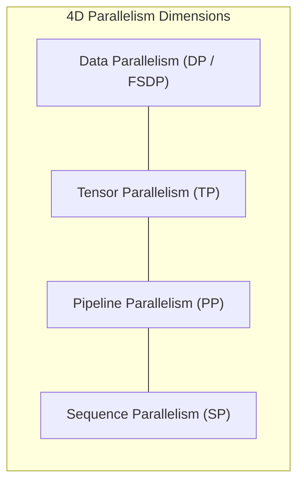
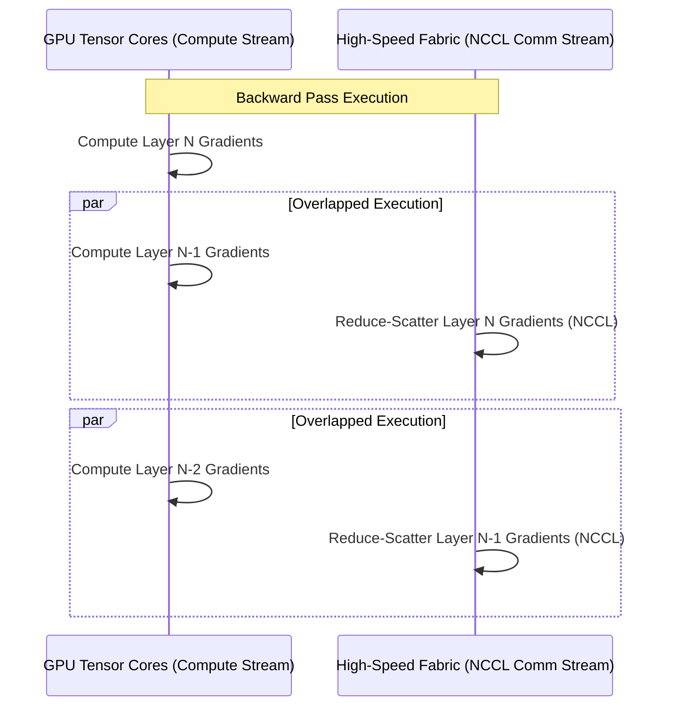

# 404 FOUNDERS — Distributed Training Architecture

## 1. Executive Summary

Training the **404 FOUNDERS** foundation model from random initialization requires a scalable distributed computing strategy capable of coordinating tens to hundreds of accelerators. This document defines the 4D Parallelism strategy, Fully Sharded Data Parallel (FSDP) mechanics, gradient synchronization protocols, and automated fault recovery.

---

## 2. 4D Parallelism Grid

Distributed training distributes model weights, gradients, optimizer states, and activations across four orthogonal dimensions:

$$\text{Total GPUs} = \text{DP} \times \text{TP} \times \text{PP} \times \text{SP}$$

### A. Data Parallelism (DP) & FSDP (ZeRO-3)
- Divides the global batch across data-parallel ranks.
- Under **FSDP (Fully Sharded Data Parallel)**:
  - **Parameters**: Sharded across the DP group; gathered via `all_gather` immediately prior to layer forward execution and freed immediately after.
  - **Gradients**: Sharded across DP group via `reduce_scatter` during backward pass.
  - **Optimizer States**: Sharded across ranks (ZeRO-3), eliminating redundant optimizer memory overhead.

### B. Tensor Parallelism (TP)
- Splits individual weight matrices across GPUs within the same physical node over high-speed NVLink.
- **Attention Projections**: Column-parallel for Query/Key/Value projections; Row-parallel for Output projection.
- **SwiGLU MLP**: Column-parallel for Gate/Up projections; Row-parallel for Down projection.
- **Communication Cost**: Two `all_reduce` or `reduce_scatter` operations per transformer block.

### C. Pipeline Parallelism (PP)
- Splits sequential layers across multiple physical nodes.
- Utilizes the **1F1B (One-Forward-One-Backward)** schedule to minimize pipeline bubbles to:

$$\text{Bubble Fraction} = \frac{PP - 1}{PP - 1 + M}$$

where $M$ is the number of microbatches ($M \gg PP$).

### D. Sequence Parallelism (SP)
- Shards long sequence contexts (e.g., 32k to 128k tokens) along the sequence dimension across attention heads.
- Integrates with RingAttention or Megatron Sequence Parallelism to eliminate activation memory bottlenecks on long inputs.

---

## 3. Communication and Compute Overlap

To maximize Model FLOPs Utilization (MFU), distributed operations must hide collective communication behind GPU matrix multiplications (GEMM).

### Optimization Techniques:
1. **CUDA Streams**: Forward/backward matrix multiplications run on the default compute stream, while NCCL collective calls run asynchronously on dedicated high-priority CUDA communication streams.
2. **`CUDA_DEVICE_MAX_CONNECTIONS=1`**: Ensures the hardware concurrency engine executes independent kernels on distinct streams in parallel without serialization.
3. **Gradient Bucketing**: Small gradient tensors are fused into configurable memory buckets (e.g., 25 MB) before triggering `reduce_scatter`, preventing high-latency network packet overhead.

---

## 4. Fault Tolerance & Automatic Recovery

Large-scale distributed runs spanning 64+ GPUs will encounter hardware degradations, silent data corruptions, and node preemption.

### Recovery Architecture:
1. **Heartbeat Protocol**: Slurm and torchrun rank monitors send heartbeats every 10 seconds. If a node fails to report within 120 seconds, the coordinator marks the job as stalled.
2. **Node Drain & Eviction**: The faulty node is drained automatically (`scontrol update nodename=... state=drain`).
3. **Atomic Rollback**: The training orchestrator reads `checkpoint_manifest.json` from the checkpoint vault, verifies the SHA-256 hash of all sharded weight files, rolls back to the last verified checkpoint, and resumes training on surviving nodes.
