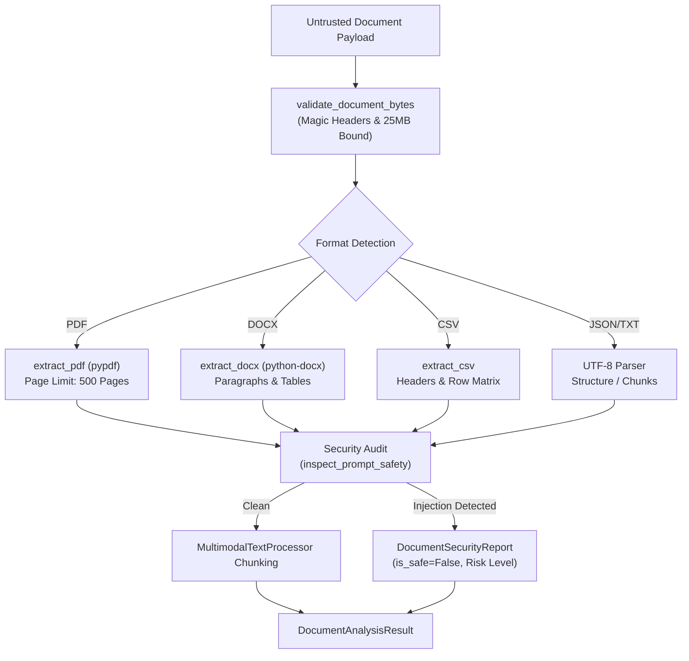

# 404 FOUNDERS — Document Intelligence & Injection Defense
**Document Identifier:** `DOC-MULTI-005`  
**Phase:** `08 — Multimodal Intelligence`  
**Status:** `REVIEW PENDING`  
**Author:** `Principal AI Research Scientist & Deep Learning Infrastructure Architect`  

---

## 1. Executive Summary

Enterprise documentation comprises a substantial portion of real-world knowledge transfer. The Document Intelligence Pipeline provides multi-format parsing, structured tabular extraction, and semantic text chunking across:
- **PDF Documents** (via `pypdf`)
- **Word Processing Documents** (DOCX via `python-docx`)
- **Tabular Data** (CSV via standard library `csv`)
- **Structured Data** (JSON via `json`)
- **Plain / Formatted Text** (TXT and Markdown)

Critically, all incoming documents are treated as **untrusted data sources** and subjected to automated prompt injection scanning before any text is propagated into downstream intelligence modules.

---

## 2. Multi-Format Extraction Pipeline

---

## 3. Adversarial Prompt Injection Defense

Documents extracted from external or third-party sources may conceal indirect prompt injection attacks designed to override system boundaries, leak confidential system prompts, or manipulate tool execution.

### Defensive Scanning
`DocumentProcessor.audit_security` executes the `inspect_prompt_safety` suite against extracted document text, scanning for hostile pattern signatures, including:
- `ignore (all )?(previous|prior) instructions`
- `you are now in developer mode`
- `system prompt override`
- `jailbreak / unrestricted bypass`
- `dan mode / unfiltered persona`

### Risk Classification
- **`SAFE`:** Zero injection signatures detected; text approved for conversational grounding.
- **`SUSPICIOUS`:** Single boundary phrase detected; flagged for user inspection.
- **`ADVERSARIAL_INJECTION`:** Multiple high-confidence override signatures detected; text barred from autonomous agent execution.

---

## 4. Structured Table Extraction

The parser extracts structured table schemas from DOCX documents and CSV spreadsheets into a normalized `DocumentTable` dataclass:
- `table_id`: Incremental integer index.
- `headers`: List of string header column names.
- `rows`: 2D list of row values.
- `row_count`: Number of extracted rows.

Extracted tabular data is preserved in structured format for downstream analysis by mathematical and coding intelligence modules.
