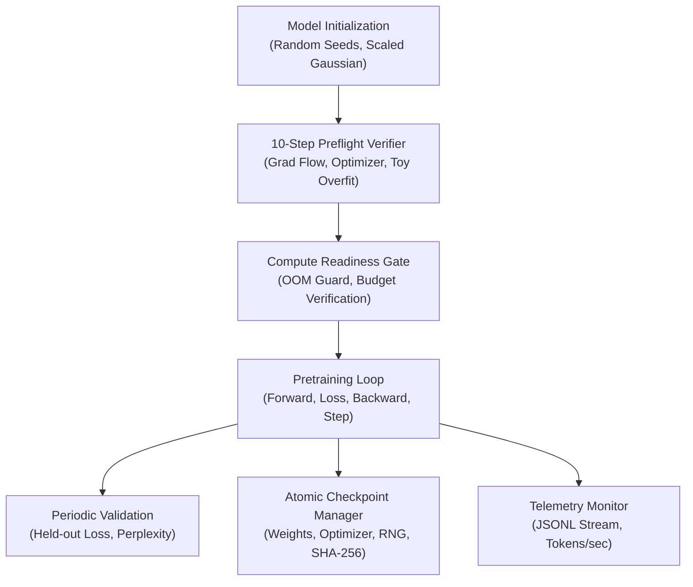

# 404 FOUNDERS — Foundation Model Pretraining Architecture

**Document ID:** `DOC-TRAIN-001`  
**Phase:** Phase 06 Baseline  
**Authors:** Principal AI Research Scientist & Deep Learning Infrastructure Architect  

---

## 1. Executive Summary & Zero-Pretrained Mandate

The **404 FOUNDERS** foundation model is engineered strictly from random initialization ($\mathcal{N}(0, 1/d_{\text{in}})$) without loading pretrained checkpoints, adapter weights, or distillation caches from third-party closed or open-weight models.

The Phase 06 pretraining system establishes the mathematical and software foundation for training our custom multimodal neural architecture:
- **Autoregressive Language Foundation:** Initial training track optimizes next-token cross-entropy over discrete multilingual and code token streams.
- **Auditable Initialization:** Cryptographic SHA-256 parameter hashing and non-finite tensor rejection.
- **Decoupled Optimization:** AdamW with selective weight decay and cosine annealing with warmup.
- **Fail-Safe Checkpointing:** Atomic two-phase writes (`.tmp` -> `.pt`) with SHA-256 sidecars.
- **Compute Readiness Gate:** Rigorous analytical memory budgeting preventing Linux kernel OOM panics on swapless developer workstations.

---

## 2. Model Configurations & Profiles

The model configuration system (`training/configs/model_config.py`) decouples architecture parameters from training hyperparameters:

| Parameter | Experimental Tiny | Local Workstation CPU | Research Pilot | Production Cluster Spec |
| :--- | :--- | :--- | :--- | :--- |
| **Target Hardware** | Micro CPU Smoke Tests | Dell Latitude 5400 | Single Node 8x RTX 4090 | 8 Nodes 64x H100 SXM5 |
| **Vocabulary Size ($V$)** | 512 | 512 | 4,096 | 32,000 |
| **Hidden Dimension ($d$)** | 64 | 128 | 512 | 2,048 |
| **Layers ($N$)** | 2 | 2 | 8 | 24 |
| **Attention Heads ($H$)** | 2 | 4 | 8 | 16 |
| **SwiGLU FFN Dim** | 128 | 256 | 1,536 | 5,632 |
| **Max Context ($T$)** | 64 | 128 | 512 | 2,048 |
| **Attention Mechanism** | Global | Fusion (Global+Sparse+Hier) | Fusion Controller | Fusion Controller |
| **Domain Experts** | 2 | 2 | 4 | 8 |
| **Total Parameters** | **~221k** | **~633k** | **~25.4M** | **~1.21B** |
| **Training Memory** | ~4 MB | ~15 MB | ~1.2 GB | ~48 GB / GPU |

---

## 3. Mathematical Training Objective

For sequence tokens $x = (x_1, x_2, \dots, x_T) \in \mathcal{V}^T$, the initial pretraining objective minimizes negative log-likelihood under causal autoregressive factorisation:

$$\mathcal{L}_{\text{AR}}(\theta) = -\frac{1}{N} \sum_{i=1}^N \sum_{t=1}^{T-1} \log P_\theta(x_{i, t+1} \mid x_{i, 1:t})$$

### Tensor Alignments
- Model inputs: $x_{1:T-1} \in \mathbb{R}^{B \times (T-1)}$
- Target labels: $x_{2:T} \in \mathbb{R}^{B \times (T-1)}$
- Prediction logits: $\hat{y} \in \mathbb{R}^{B \times (T-1) \times V}$
- Causal Masking: Upper-triangular boolean mask $M_{i,j} = \text{True}$ for $j > i$, applied via additive $-\infty$ to pre-softmax attention scores.

### Documented Objective Limitations
The causal autoregressive next-token objective trains discrete token sequence dynamics (natural languages, programming syntax, mathematical symbols). It does **not** yet train continuous visual patch projections or audio latent tokens, which are phased in during Multimodal Pretraining.

---

## 4. Optimization Dynamics & Hyperparameters

Pretraining utilizes **AdamW** with decoupled weight decay:

$$\theta_{t+1} = \theta_t - \eta_t \cdot \left(\frac{\hat{m}_t}{\sqrt{\hat{v}_t} + \epsilon} + \lambda \theta_t\right)$$

### Parameter Decay Partitioning
- **Decayed Parameters ($\lambda = 0.01\dots 0.05$):** 2D matrix weights in linear projections ($W_q, W_k, W_v, W_o$, SwiGLU gates, expert transforms).
- **Non-Decayed Parameters ($\lambda = 0.0$):** 1D biases, RMSNorm scale gains $\gamma$, and LayerScale vectors $\alpha$.

### Learning Rate Schedule
Linear warmup for $t \le t_{\text{warmup}}$, followed by cosine annealing decay down to $\eta_{\min}$:

$$\eta(t) = \begin{cases} 
\eta_{\min} + (\eta_{\max} - \eta_{\min}) \cdot \frac{t + 1}{t_{\text{warmup}}} & t < t_{\text{warmup}} \\
\eta_{\min} + \frac{1}{2}(\eta_{\max} - \eta_{\min}) \left(1 + \cos\left(\pi \frac{t - t_{\text{warmup}}}{t_{\max} - t_{\text{warmup}}}\right)\right) & t_{\text{warmup}} \le t \le t_{\max} \\
\eta_{\min} & t > t_{\max}
\end{cases}$$

---

## 5. Security & Verification Policy

1. **Zero Pretrained Checkpoints:** Automated tests assert that weights originate exclusively from random distributions.
2. **Cryptographic Checkpoints:** Every checkpoint requires a matching `.sha256` sidecar; corrupted bytes are immediately rejected with `CheckpointCorruptedError`.
3. **Local OOM Safety Guard:** The `ComputeReadinessGate` halts execution if estimated peak memory exceeds the safe RAM ceiling ($0.55\dots 3.5$ GB on Dell Latitude 5400).
