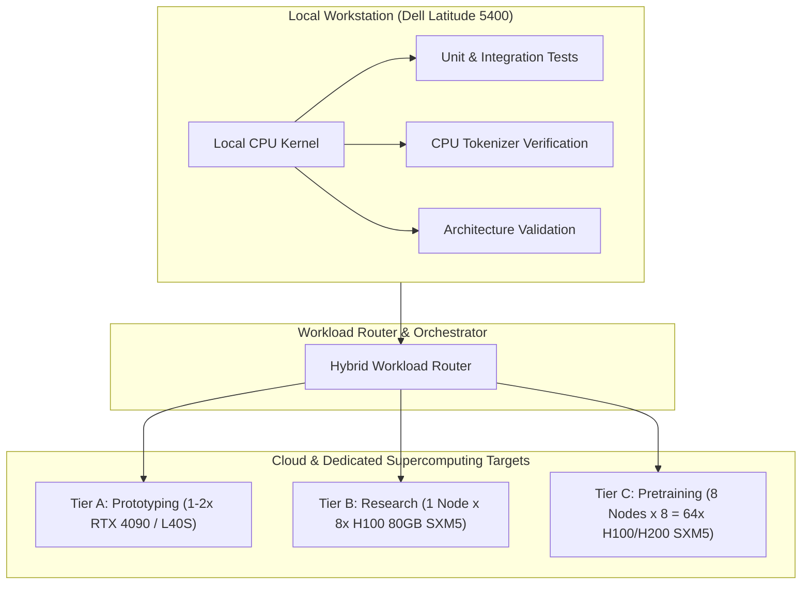
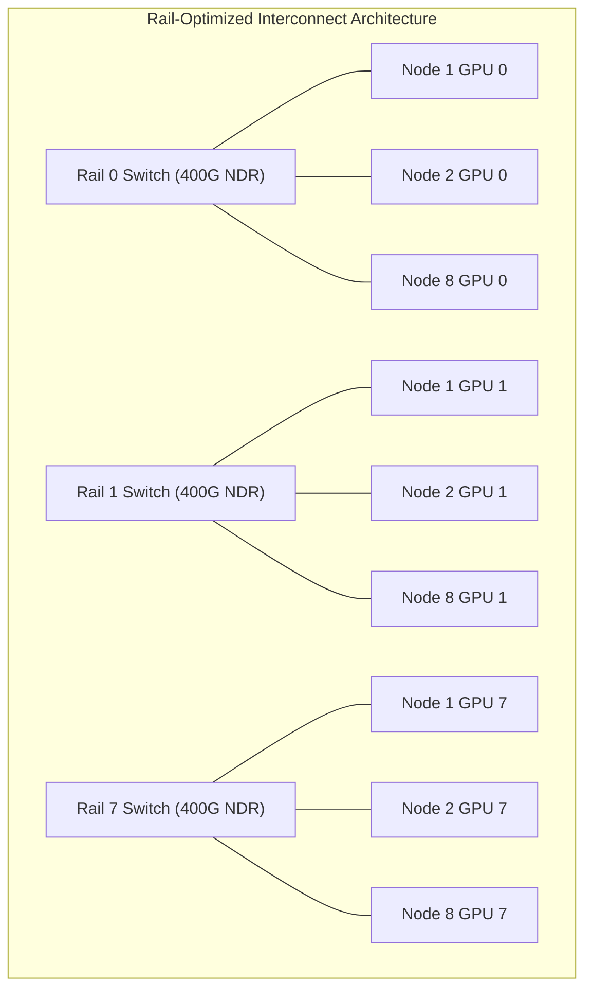

# 404 FOUNDERS — GPU Cluster Architecture & Hardware Specification

## 1. Executive Overview

The **404 FOUNDERS** project builds a completely custom multimodal foundation AI from random initialization without using pretrained model weights. To realize this objective while honoring physical developer workstation realities, the infrastructure architecture establishes a strict physical separation between the developer's local development workstation (Dell Latitude 5400, Kali Linux, Intel i5-8365U, 15.4 GB RAM, 0B swap, Intel UHD 620 UMA, 0 dedicated VRAM) and cloud-hosted accelerator clusters.

---

## 2. Cluster Tier Definitions

### Tier A: Development & Prototyping
- **Target Workload**: Single-GPU and dual-GPU prototyping, tokenization validation on subsets, unit convergence checks (<1.5B parameters).
- **Accelerators**: 1–2x NVIDIA RTX 4090 24GB or NVIDIA L40S 48GB.
- **Intra-Node Interconnect**: PCIe Gen 4.0 x16 (64 GB/s bi-directional).
- **Host Hardware**: 32 vCPU AMD EPYC / Intel Xeon, 128 GB Host RAM.
- **Storage**: 2 TB NVMe local scratch, 10 TB warm shared filesystem.
- **Deployment Model**: On-demand hourly cloud instances (RunPod, Lambda Labs).

### Tier B: Research & Scaling Validation
- **Target Workload**: Custom attention scaling benchmarks (Global + Sliding Window + Hierarchical), dynamic router loss convergence, 1B–7B parameter research models.
- **Accelerators**: 1 Node x 8x NVIDIA H100 80GB SXM5 (640 GB total VRAM).
- **Intra-Node Interconnect**: 4th-Gen NVLink (900 GB/s bi-directional per GPU), 7.2 TB/s aggregate NVSwitch mesh.
- **Host Hardware**: Dual Intel Xeon Platinum 8480+ (112 physical cores), 1 TB System RAM.
- **Storage**: 15 TB NVMe scratch (30 GB/s aggregate throughput), 50 TB parallel shared filesystem.
- **Deployment Model**: Reserved cloud HGX H100 instances (Lambda Labs, CoreWeave).

### Tier C: Foundation Model Pretraining Supercluster
- **Target Workload**: Multi-billion parameter multimodal foundation pretraining from random initialization across multi-trillion tokens.
- **Topology**: 8 Nodes x 8x NVIDIA H100/H200 SXM5 = 64 GPUs (5,120 GB VRAM total).
- **Intra-Node Interconnect**: NVLink 4 + NVSwitch (900 GB/s bi-directional per GPU).
- **Inter-Node Interconnect**: NVIDIA Quantum-2 InfiniBand NDR 400 Gbps (8x OSFP HCAs per node = 3.2 Tbps per node, rail-optimized 2-tier Fat-Tree).
- **Host Hardware per Node**: Dual AMD EPYC 9654 96-core processors (192 cores / 384 threads), 2 TB DDR5 ECC RAM (16 TB total cluster RAM).
- **Storage**:
  - Hot Scratch: 120 TB NVMe (15 TB direct-attached per node, 400+ GB/s cluster aggregate).
  - Warm Filesystem: 500 TB Lustre / WEKA parallel filesystem (100+ GB/s throughput).
  - Cold Storage: 2 PB S3-compatible immutable object vault (11 9s durability).
- **Orchestration**: Slurm Workload Manager with Pyxis / Enroot container runtime.

---

## 3. High-Speed Interconnect & Rail Optimization

In large-scale foundation model pretraining, cross-node communication overhead during distributed Tensor Parallelism (TP) and Data Parallelism (DP) can bottleneck computational scaling.

### Key Principles of Rail Optimization:
1. **Dedicated Rail per GPU Index**: GPU index $k$ on any node connects directly to InfiniBand HCA $k$ and participates in Rail $k$ across the entire cluster.
2. **Zero Intersite Cross-Talk**: All-to-all and all-gather operations for data parallelism proceed across independent non-blocking switch rails without contending for the same physical uplinks.
3. **GPUDirect RDMA**: Data moves directly from GPU HBM3 memory through the PCIe/NVLink switch directly to the InfiniBand NIC, completely bypassing host CPU memory and avoiding OS kernel context switches.

---

## 4. Hardware Comparison Matrix

| Specification | Tier A (Development) | Tier B (Research) | Tier C (Supercluster) |
| :--- | :--- | :--- | :--- |
| **GPU Models** | 2x RTX 4090 / L40S | 8x H100 80GB SXM5 | 64x H100 / H200 SXM5 |
| **Node Count** | 1 Node | 1 Node | 8 Nodes |
| **Total VRAM** | 48 GB GDDR6X / ECC | 640 GB HBM3 | 5,120 GB HBM3 / HBM3e |
| **Intra-Node Bus** | PCIe Gen 4.0 (64 GB/s) | NVLink 4 (900 GB/s) | NVLink 4 (900 GB/s) |
| **Inter-Node Network**| 10 Gbps Ethernet | N/A (Single node) | 3.2 Tbps InfiniBand NDR |
| **BFloat16 TFLOPS** | 660 TFLOPS | 7,912 TFLOPS | 63,296 TFLOPS |
| **Host System RAM** | 128 GB DDR5 | 1,024 GB DDR5 ECC | 16,384 GB DDR5 ECC |
| **Storage (Scratch)**| 2 TB NVMe | 15 TB NVMe | 120 TB NVMe Scratch |
| **Storage (Warm)** | 10 TB SSD | 50 TB Parallel FS | 500 TB Lustre / WEKA |
| **Orchestrator** | Docker Compose | Docker / Slurm | Slurm + Pyxis / Enroot |
| **Power Target** | ~1.2 kW | ~10.2 kW | ~95.0 kW |
| **Cooling** | Air-cooled | Direct liquid or high-airflow | Direct-to-Chip Liquid Cooling |
