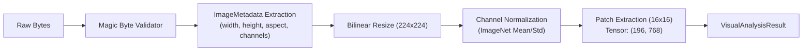

# 404 FOUNDERS — Vision & Image Intelligence Pipeline
**Document Identifier:** `DOC-MULTI-002`  
**Phase:** `08 — Multimodal Intelligence`  
**Status:** `REVIEW PENDING`  
**Author:** `Principal AI Research Scientist & Deep Learning Infrastructure Architect`  

---

## 1. Executive Summary

The Image Intelligence Pipeline provides secure, defensive, and high-performance ingestion of visual media. It validates raw byte streams against magic header signatures, enforces strict memory and decompression-bomb safeguards, normalizes spatial dimensions, and extracts patch embeddings formatted for Vision Transformer (ViT) architectures.

---

## 2. Magic-Byte Header Validation

To prevent extension spoofing and malicious payload smuggling, `ImageProcessor` examines initial byte signatures before invoking image decoders:

| Format | Magic Byte Header | Validation Rule |
| :--- | :--- | :--- |
| **PNG** | `\x89PNG\r\n\x1a\n` (8 bytes) | Exact prefix match |
| **JPEG** | `\xff\xd8\xff` (3 bytes) | Exact SOI (Start of Image) marker |
| **BMP** | `BM` (2 bytes) | Exact prefix match |
| **WEBP** | `RIFF` at offset 0, `WEBP` at offset 8 | Offset 0:4 and 8:12 validation |

Any input failing magic-byte matching is immediately rejected with a `ValueError("Unsupported or corrupted image header")`.

---

## 3. Decompression Safeguards & Resolution Normalization

- **Max File Size:** Capped at 25 MB (`26,214,400` bytes).
- **Max Image Pixels:** PIL `Image.MAX_IMAGE_PIXELS` set to `25,000,000` to prevent decompression-bomb denial-of-service.
- **Max Native Dimensions:** `4096 x 4096` pixels.
- **Target Spatial Normalization:** Resized to standard resolution \(224 \times 224\) using bilinear interpolation.

---

## 4. Vision Transformer (ViT) Patch Extraction

Standard Vision Transformers divide an input image \(I \in \mathbb{R}^{H \times W \times C}\) into non-overlapping 2D patches \(P \in \mathbb{R}^{P \times P \times C}\):

$$\text{num\_patches} = \left(\frac{H}{P}\right) \times \left(\frac{W}{P}\right) = \left(\frac{224}{16}\right) \times \left(\frac{224}{16}\right) = 14 \times 14 = 196$$

Each patch has raw dimensionality:
$$\text{patch\_dim} = P \times P \times C = 16 \times 16 \times 3 = 768$$

The resulting tensor has shape:
$$\mathbf{X}_{\text{patches}} \in \mathbb{R}^{196 \times 768}$$

Normalized with standard ImageNet channel statistics:
$$\mu = [0.485, 0.456, 0.406], \quad \sigma = [0.229, 0.224, 0.225]$$

---

## 5. Architectural Interface Contracts

### Architectural Notice
Visual patch features are extracted deterministically. Semantic object detection and open-vocabulary captioning interfaces operate via structural feature estimators; foundational open-vocabulary weights require cluster pretraining in Phase 08.
