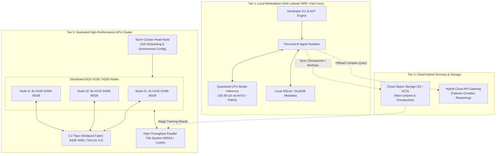

# 404 FOUNDERS — Infrastructure Architecture Specification

**Document ID:** `DOC-ARCH-009`  
**Status:** Architecture Blueprint (Phase 02 Baseline)  
**Authors:** Chief Software Architect & Principal AI Systems Engineer  

---

## 1. Hybrid Multi-Tier Infrastructure Topology

404 FOUNDERS is deployed across a **Hybrid Multi-Tier Infrastructure Fabric**, cleanly decoupling local desktop operations from cloud storage and enterprise GPU training clusters:

---

## 2. Infrastructure Tier Specifications

### 2.1 Local Workstation Tier (`infrastructure/local/`)
- **Hardware Profile:** Dell Latitude 5400 laptop, Intel Core i5-8365U CPU (4C/8T, AVX2, FMA3), 15.4 GiB RAM, 43 GB free NVMe disk.
- **Operational Profile:**
  - Zero swap memory discipline: Enforces a strict **4.0 GB memory ceiling** (`FOUNDERS_MAX_LOCAL_MEMORY_MB=4096`) to prevent kernel OOM killing.
  - CPU Thread Budgeting: Constrained to 4–6 worker threads to maintain system responsiveness.
  - Storage Management: All training shards and model checkpoints are streamed or compressed.

### 2.2 Cloud Auxiliary Tier (`infrastructure/cloud/`)
- **Persistent Object Storage:** High-capacity buckets for raw web crawls, tokenized binary datasets, and long-term model checkpoints.
- **Hybrid API Router:** Routes high-complexity mathematical proofs or heavy research queries to external cloud foundation models during local development phases.

### 2.3 Dedicated GPU Cluster Tier (`infrastructure/gpu_cluster/`)
- **Hardware Target:** 8× to 64× NVIDIA H100/H200 SXM5 GPUs (640 GB – 5.1 TB aggregate VRAM).
- **Cluster Networking:** Rail-optimized 400 Gbps InfiniBand interconnect with GPU Direct RDMA.
- **Distributed Training Framework:** PyTorch Fully Sharded Data Parallel (FSDP) and Megatron-LM 3D Parallelism (Tensor Parallelism + Pipeline Parallelism + Data Parallelism).
- **Job Orchestration:** Slurm workload manager with automated job resumption and health check monitoring.

---

## 3. Deployment & Service Management (`infrastructure/deployment/`)

For production desktop deployment:
- **Systemd Service Unit:** Background personal AI monitor managed via non-root user systemd daemon (`~/.config/systemd/user/founders-ai.service`).
- **Resource Slices:** Local service governed by systemd cgroups (`MemoryMax=4G`, `CPUQuota=400%`).

---

## 4. Implementation Status

- **Established in Phase 02:**
  - Package structure initialized: `infrastructure/local/`, `infrastructure/cloud/`, `infrastructure/gpu_cluster/`, `infrastructure/deployment/`.
  - Resource constraints codified in `core/config.py` and `configs/default_config.yaml`.
- **Scheduled for Future Phases:**
  - Slurm batch job templates and Megatron-LM launch configs (Phase 04/08).
  - Systemd user service unit files (Phase 06).
  - Cloud synchronization and checkpoint export scripts (Phase 08).
