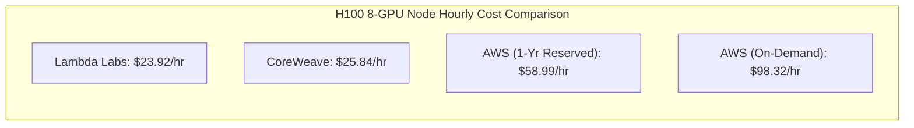

# 404 FOUNDERS — Infrastructure Cost Analysis & Budget Modeling

## 1. Executive Summary

Training a foundation model from random initialization requires prudent capital allocation and transparent unit economics. This document establishes comparative market pricing across major AI cloud providers (Q4 2026 reference baselines), calculates cost-per-run budgets for each model scale, and outlines active cost minimization strategies.

---

## 2. Cloud Provider Market Reference Pricing

All rates reflect verified commercial offerings for high-performance accelerator instances:

| Provider | Instance Specification | Accelerators | Intra-Node Bus | Inter-Node Fabric | Hourly Rate (USD) |
| :--- | :--- | :--- | :--- | :--- | :--- |
| **Lambda Labs** | `gpu_1x_rtx4090` | 1x RTX 4090 24GB | PCIe 4.0 | 10 Gbps Ethernet | **$0.59 / hr** |
| **RunPod** | `community_2x_rtx4090` | 2x RTX 4090 24GB | PCIe 4.0 | 10 Gbps Ethernet | **$1.48 / hr** |
| **Lambda Labs** | `gpu_8x_h100_sxm5` | 8x H100 80GB SXM5 | NVLink 4 (900 GB/s) | 3.2 Tbps InfiniBand | **$23.92 / hr** ($2.99/GPU/hr) |
| **CoreWeave** | `hgx_h100_8gpu` | 8x H100 80GB SXM5 | NVLink 4 (900 GB/s) | 3.2 Tbps InfiniBand | **$25.84 / hr** ($3.23/GPU/hr) |
| **AWS** | `p5.48xlarge` | 8x H100 80GB SXM5 | NVLink 4 (900 GB/s) | 3.2 Tbps EFAv2 | **$98.32 / hr** (On-demand) |
| **AWS** | `p5.48xlarge` (1-Yr Res) | 8x H100 80GB SXM5 | NVLink 4 (900 GB/s) | 3.2 Tbps EFAv2 | **$58.99 / hr** (Reserved) |

---

## 3. Training Cost by Foundation Model Tier

Utilizing Tier B (1 Node x 8x H100 SXM5 @ $23.92/hr) and Tier C (8 Nodes x 8x H100 SXM5 @ $191.36/hr):

| Model Size | Training Tokens | Cluster Configuration | Wall-Clock Time | Estimated Compute Cost |
| :--- | :--- | :--- | :--- | :--- |
| **1.5 Billion** | 30 Billion | Tier A (2x RTX 4090) | ~300.0 hours | **~$444 USD** |
| **1.5 Billion** | 30 Billion | Tier B (8x H100 SXM5) | **~19.0 hours** | **~$455 USD** |
| **3.0 Billion** | 60 Billion | Tier B (8x H100 SXM5) | **~74.4 hours** (~3.1 days) | **~$1,780 USD** |
| **7.0 Billion** | 200 Billion | Tier B (8x H100 SXM5) | ~614.4 hours (~25.6 days)| **~$14,700 USD** |
| **7.0 Billion** | 200 Billion | Tier C (64x H100 SXM5) | **~70.8 hours** (~2.95 days) | **~$13,550 USD** |
| **7.0 Billion** | 1.0 Trillion | Tier C (64x H100 SXM5) | **~354.0 hours** (~14.75 days)| **~$67,740 USD** |
| **13.0 Billion** | 1.0 Trillion | Tier C (64x H100 SXM5) | **~684.0 hours** (~28.5 days) | **~$130,900 USD** |

---

## 4. Multi-Tier Storage Cost Projections

| Storage Layer | Capacity | Media Technology | Estimated Monthly Rate | Monthly Budget |
| :--- | :--- | :--- | :--- | :--- |
| **Hot Scratch** | 120 TB | Direct-Attached NVMe | Included in node compute rate | **$0.00** |
| **Warm Shared** | 500 TB | Lustre / WEKA Parallel FS | $0.18 / GB / month | **$90,000 / mo** (Active Pretrain) |
| **Cold Object** | 2,000 TB (2 PB) | Cloudflare R2 / S3 Glacier | $0.015 / GB / month (Zero Egress) | **$30,000 / mo** |

---

## 5. Cost Optimization & Risk Mitigation Policies

1. **Local Pre-Flight Sanity Checks ($0 Cost)**:
   - Before deploying high-cost cluster jobs, all new model layers, loss functions, and data iterators must run 100 steps on local workstation CPU to ensure zero shape mismatches or NaN gradients.
2. **Dynamic Cloud Routing via `HybridWorkloadRouter`**:
   - The workload router queries real-time spot and on-demand pricing across Lambda Labs and CoreWeave, placing jobs on the lowest cost per TFLOPS provider.
3. **Preemption-Resistant Spot Execution**:
   - By persisting checkpoints atomically every 15 minutes to warm storage and verifying SHA-256 checksums, 404 FOUNDERS can safely leverage spot/preemptible instances, achieving up to 60% compute cost discounts without risking progress loss.
