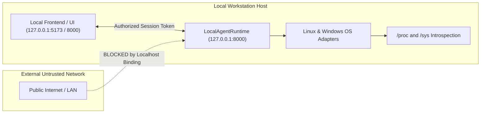

# 404 FOUNDERS — Local Agent Runtime Specification

**Document ID:** `DOC-PAI-002`  
**Status:** Implemented & Verified (Phase 10)  
**Authors:** Lead Distributed Systems Engineer & OS Integration Architect  

---

## 1. Scope & Operating Model

The **Local Agent Runtime** (`personal_ai/runtime.py`) manages the execution lifecycle, network isolation, session authentication, and telemetry orchestration for the personal AI workstation assistant.

Operating on the user's local machine, the runtime guarantees that personal computer interaction occurs safely without exposing internal services or private user data to untrusted networks.

---

## 2. Runtime Architecture & Localhost Invariant

### 2.1 Network Binding & Isolation
- **Binding Address:** The runtime enforces binding exclusively to `127.0.0.1` (`localhost`).
- **Public Network Rejection:** Any configuration attempting to bind to `0.0.0.0` or external network adapters triggers a fatal `SecurityViolationError` during initialization.
- **Port Management:** Standard local port `8000` is utilized for REST and WebSocket interactions, verified through local socket inspection.

---

## 3. Session Lifecycle & Authentication

### 3.1 Session Creation
- Sessions are instantiated via `create_session(user_id: str)`.
- Each session receives a cryptographically secure 256-bit entropy token generated via `secrets.token_urlsafe(32)`.
- Sessions maintain an expiration window (default 3600 seconds) after which re-authentication is required.

### 3.2 Session Validation
- All non-public runtime endpoints require token presentation in request headers.
- Invalid, expired, or non-existent session tokens are rejected immediately with HTTP 403 Forbidden.
- Session activity refreshes the expiration window unless the emergency shutdown is triggered.

---

## 4. Subsystem Integration & Health Introspection

The runtime coordinates eight primary internal subsystems:

| Subsystem | Class Name | Function |
|---|---|---|
| OS Telemetry | `SystemInfoProvider` | Gathers CPU, RAM, disk, and battery vitals |
| Process Guard | `ProcessMonitor` | Tracks running processes and enforces PID shields |
| File Assistant | `FileSystemAssistant` | Traversal-guarded reading and search with secret scrubbing |
| Command Advisor | `TerminalCommandAdvisor` | Risk tiering and blocklist enforcement |
| App Manager | `ApplicationManager` | Discovers desktop applications and verifies launch tickets |
| Network Diagnostics | `NetworkDiagnosticsModule` | Safe ping, DNS resolution, and interface telemetry |
| Repo Assistant | `RepositoryAssistant` | AST topology, git inspection, and sandboxed test execution |
| Defensive Security | `DefensiveSecurityAssistant` | Port auditing, firewall posture, and hardening advice |

---

## 5. Emergency Shutdown Integration

The runtime continuously monitors the `EmergencyShutdownController`. When an emergency stop is active:
1. `runtime.assert_not_shutdown()` raises `SecurityViolationError`.
2. All running sessions are flagged and prevented from dispatching new commands.
3. System telemetry responses report `emergency_shutdown_active: True`.
4. The runtime requires an explicit human operator reset to resume normal operation.
