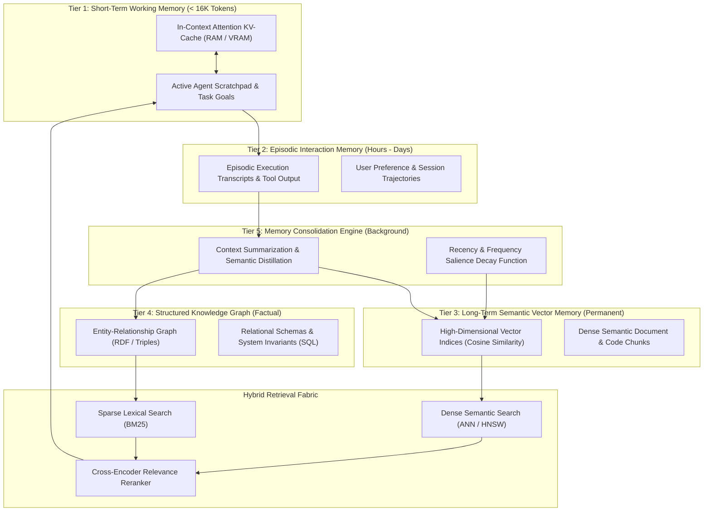

# 404 FOUNDERS — Memory Architecture Specification

**Document ID:** `DOC-ARCH-004`  
**Status:** Architecture Blueprint (Phase 02 Baseline)  
**Authors:** Chief Software Architect & Principal AI Systems Engineer  

---

## 1. Multi-Layer Memory Architecture

To overcome the finite context window limitations of conventional LLMs, 404 FOUNDERS implements an **Advanced Multi-Layer Cognitive Memory System** comprising five hierarchical tiers:

---

## 2. Detailed Memory Tier Specifications

### 2.1 Short-Term Working Memory (`memory/short_term/`)
- **Medium:** Dynamic host memory (RAM) or GPU VRAM.
- **Components:** In-context active tokens, Grouped-Query Attention (GQA) KV-cache, active chain-of-thought scratchpad.
- **Eviction / Sliding Window:** When context approaches operational ceiling ($N_{\text{max}} = 16,384$ local tokens), older peripheral tokens are dynamically paged out to Tier 2, retaining initial system instructions and recent conversation turns.

### 2.2 Episodic Memory (`memory/episodic/`)
- **Medium:** Local append-only SQLite/JSONL storage.
- **Components:** User instructions, executed agent plans, tool inputs, stdout/stderr streams, file modification diffs, and outcome states.
- **Index:** Timestamped with monotonic clock, indexed by project workspace ID and session ID.

### 2.3 Long-Term Semantic Vector Memory (`memory/long_term/`)
- **Medium:** Local DuckDB / SQLite-VSS / Chroma embedded vector database.
- **Components:** High-dimensional embeddings (768 or 1024 dimensions) representing documentation, codebases, user notes, and past problem resolutions.
- **Search Strategy:** Approximate Nearest Neighbor (ANN) using Hierarchical Navigable Small World (HNSW) graph indexing with cosine distance.

### 2.4 Structured Knowledge Graph (`memory/knowledge/`)
- **Medium:** Relational SQL schema with graph adjacency tables.
- **Components:** Explicit factual entities: classes, functions, architectural decisions, hardware invariants, security permissions, and dependency trees.
- **Lookup:** Exact graph traversal for deterministic factual recall, eliminating vector hallucination.

### 2.5 Memory Consolidation & Decay (`memory/consolidation/`)
- **Mechanism:** Background consolidation pipeline scheduled during idle CPU periods.
- **Salience Score:**
$$S(m) = \alpha \cdot R(m) + \beta \cdot F(m) + \gamma \cdot I(m)$$
Where $R(m) = e^{-\lambda \Delta t}$ is temporal recency, $F(m)$ is retrieval frequency, and $I(m)$ is explicit user importance.
- Items with salience $S(m) < \theta_{\text{prune}}$ are compressed into high-level episodic summaries.

---

## 3. Hybrid Infinite-Context Architecture

To support unbounded conversations and multi-million-token repository analyses without linear computational degradation:
1. **Chunked Attention with Anchor Tokens:**
   - Active context is segmented into sequential chunks ($C_i$). Attention is computed locally within $C_i$ while maintaining continuous connectivity via initial anchor tokens.
2. **Context Memory Paging:**
   - Evicted KV-caches are compressed and stored in host system RAM or NVMe storage. When the agent's attention query detects semantic affinity with an evicted chunk, the corresponding KV-tensors are paged back into the active computation stream.

---

## 4. Implementation Status

- **Established in Phase 02:**
  - Package structure initialized: `memory/short_term/`, `memory/long_term/`, `memory/knowledge/`, `memory/episodic/`, `memory/retrieval/`, `memory/consolidation/`.
  - Abstract exception boundaries (`ContextWindowExceededError`, `MemorySubsystemError`).
  - Configuration specifications in `configs/default_config.yaml`.
- **Scheduled for Future Phases:**
  - Embedded vector store implementation using SQLite/DuckDB (Phase 05).
  - Background memory consolidation cron worker (Phase 05).
  - Infinite-context KV-cache paging manager (Phase 04).
