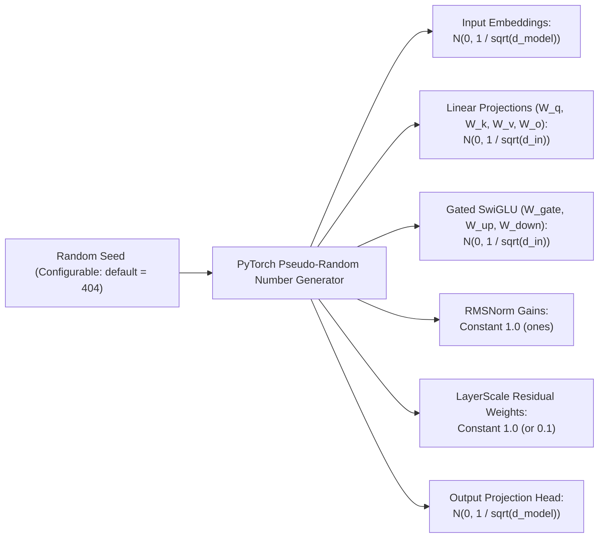

# 404 FOUNDERS — Model Initialization & Seeding Specification

**Document ID:** `DOC-INIT-001`  
**Status:** Verification Complete (Phase 03 Baseline)  
**Authors:** Principal AI Research Engineer & Neural Architecture Developer  

---

## 1. Zero-Pretrained Mandate & Engineering Policy

In strict accordance with the approved architecture decisions:
1. **Completely Custom Topology:** Parameter matrices do not mirror proprietary third-party topologies.
2. **Pure Random Initialization:** **Zero pretrained weights, external checkpoints, or adapter layers are used.** Every single parameter tensor is initialized randomly from statistical distributions.
3. **No External Network Downloads:** The initialization runtime makes zero network calls to download model weights.

---

## 2. Statistical Initialization Formulations

To ensure that activations and gradients maintain stable unit variance throughout deep forward and backward passes:



### 2.1 Embedding & Linear Projections
Linear projections ($W_q, W_k, W_v, W_o$) and input embeddings are sampled from a zero-mean Gaussian distribution with standard deviation scaled by fan-in:
$$W_{i,j} \sim \mathcal{N}\left(0, \sigma^2\right), \quad \sigma = \frac{1}{\sqrt{d_{\text{in}}}}$$
This prevents variance explosion across matrix multiplications:
$$\mathbb{E}[y_i] = 0, \quad \text{Var}(y_i) = d_{\text{in}} \cdot \text{Var}(x_j) \cdot \frac{1}{d_{\text{in}}} = \text{Var}(x_j)$$

### 2.2 Normalization Gains & LayerScale
- **CustomRMSNorm:** Gain parameter $\gamma$ is initialized uniformly to $1.0$ (`torch.ones(dim)`).
- **Residual LayerScale:** Learnable residual scale vector $\alpha$ is initialized uniformly to $1.0$ (`torch.full((dim,), initial_scale)`).

### 2.3 Output Projection Head
The un-embedding head ($W_{\text{head}} \in \mathbb{R}^{d_{\text{model}} \times V}$) is initialized with small standard deviation:
$$W_{\text{head}} \sim \mathcal{N}\left(0, \frac{1}{d_{\text{model}}}\right)$$
Biases, when configured, are explicitly zero-initialized (`torch.zeros(output_dim)`).

---

## 3. Deterministic Seed Control & Reproducibility

To ensure identical numerical outcomes across debugging and testing:
```python
if config.random_seed is not None:
    torch.manual_seed(config.random_seed)
```
- Initializing two independent models with `random_seed=404` produces **bit-for-bit identical parameter weights**.
- Initializing with differing seeds produces distinct parameters, verified by automated unit tests.

---

## 4. Prototype Parameter Census

The prototype supports fully configurable dimensions. Two primary configurations are established:

### 4.1 Default Core Prototype ($d_{\text{model}}=128, L=2, H=4, V=1024, C=16, W=64$)
- **Input Embedding Matrix:** $1024 \times 128 = 131,072$
- **Hierarchical Block 1 (Fusion Attention + SwiGLU):** ~443,100
- **Hierarchical Block 2 (Fusion Attention + SwiGLU):** ~443,100
- **Dynamic Router:** 256
- **General Reasoning Expert (SwiGLU FFN):** 147,456
- **Personal AI System Expert (SwiGLU FFN):** 147,456
- **Output Projection Matrix:** $128 \times 1024 = 131,072$
- **Layer Normalizations & Scales:** ~974
- **Total Trainable Parameters:** **1,444,486 (~1.44M params)**

### 4.2 Micro Testing Configuration ($d_{\text{model}}=64, L=2, H=2, V=256, C=8, W=16$)
- **Total Trainable Parameters:** **329,030 (~0.33M params)**

*Audit Confirmation:* Both prototype configurations strictly reside between 0.33M and 1.44M parameters, allowing rapid CPU execution, autograd backpropagation, and unit test evaluation within milliseconds on the Dell Latitude 5400 workstation without memory strain.
