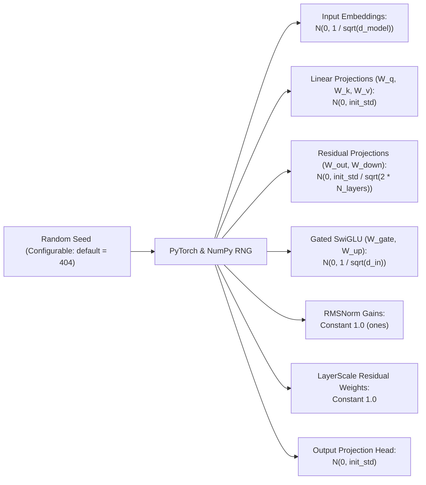

# 404 FOUNDERS — Model Initialization & Auditing Specification

**Document ID:** `DOC-INIT-001`  
**Phase:** Phase 06 Complete  
**Authors:** Principal AI Research Scientist & Neural Architecture Developer  

---

## 1. Zero-Pretrained Mandate & Engineering Policy

In strict accordance with the approved architecture decisions:
1. **Completely Custom Topology:** Parameter matrices do not mirror proprietary third-party topologies.
2. **Pure Random Initialization:** **Zero pretrained weights, external checkpoints, or adapter layers are used.** Every single parameter tensor is initialized randomly from statistical distributions.
3. **No External Network Downloads:** The initialization runtime makes zero network calls to download model weights.
4. **Reproducible Cryptographic Auditing:** Every initialization pass generates a full `InitializationReport` accompanied by a SHA-256 weight fingerprint.

---

## 2. Statistical Initialization Formulations

To ensure that activations and gradients maintain stable unit variance throughout deep forward and backward passes:

### 2.1 Embedding & Linear Projections
Linear projections ($W_q, W_k, W_v$) and input embeddings are sampled from a zero-mean Gaussian distribution with standard deviation scaled by fan-in:
$$W_{i,j} \sim \mathcal{N}\left(0, \sigma^2\right), \quad \sigma = \frac{1}{\sqrt{d_{\text{in}}}}$$
This prevents variance explosion across matrix multiplications:
$$\mathbb{E}[y_i] = 0, \quad \text{Var}(y_i) = d_{\text{in}} \cdot \text{Var}(x_j) \cdot \frac{1}{d_{\text{in}}} = \text{Var}(x_j)$$

### 2.2 Deep Residual Down-Scale Factor
For linear projections feeding directly into residual accumulation pathways ($W_o$ in attention, $W_{\text{down}}$ in SwiGLU feed-forward networks, and MoE expert outputs), standard deviations are scaled down by $\frac{1}{\sqrt{2 N_{\text{layers}}}}$:
$$\sigma_{\text{residual}} = \frac{\sigma}{\sqrt{2 N_{\text{layers}}}}$$
This ensures that the variance of the hidden states across $N$ residual additions does not grow linearly with depth.

### 2.3 Normalization Gains & LayerScale
- **CustomRMSNorm:** Gain parameter $\gamma$ is initialized uniformly to $1.0$ (`torch.ones(dim)`).
- **Residual LayerScale:** Learnable residual scale vector $\alpha$ is initialized uniformly to $1.0$ (`torch.full((dim,), initial_scale)`).
- **Biases:** When present, all biases are strictly initialized to $0.0$.

---

## 3. Auditable Initialization Pipeline

The `ModelInitializer` (`training/initialization/initializer.py`) executes an auditable multi-step process:

1. **RNG Seeding:** Simultaneously seeds Python `random`, `numpy.random`, and `torch.manual_seed`.
2. **Distribution Application:** Traverses model named modules and applies statistical distribution rules.
3. **Finiteness Audit:** Inspects every tensor using `torch.all(torch.isfinite(p))`; aborts if any NaN or Inf is encountered.
4. **Cryptographic Fingerprint:** Computes SHA-256 hash across all tensor names, shapes, and raw float byte streams.
5. **Report Generation:** Produces `InitializationReport` detailing parameter count, memory footprint (MB), and statistical invariants (mean, std, min, max per tensor).

---

## 4. Verification & Reproducibility Guarantee

- **Reproducibility Test:** Initializing twice with identical seed ($s=404$) yields bitwise identical SHA-256 fingerprints.
- **Divergence Test:** Initializing with $s=404$ vs $s=405$ yields differing hashes.
- **Zero Pretrained Weights:** The report asserts `is_random_initialization = True` and `pretrained_weights_loaded = False`.
