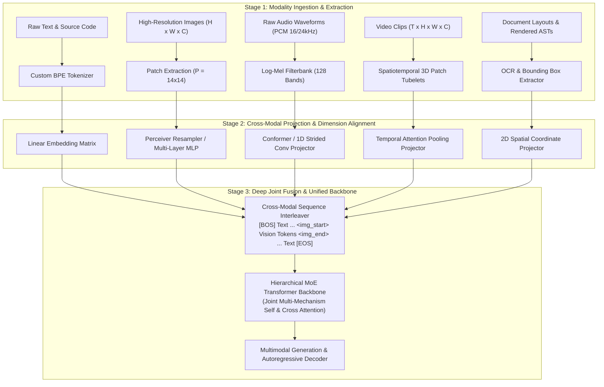

# 404 FOUNDERS — Multimodal Architecture Specification

**Document ID:** `DOC-ARCH-003`  
**Status:** Architecture Blueprint (Phase 02 Baseline)  
**Authors:** Chief Software Architect & Principal AI Systems Engineer  

---

## 1. Executive Summary

404 FOUNDERS is fundamentally designed as a **Unified Multimodal Intelligence Model**. Rather than retrofitting separate modality adapters to a pre-existing text LLM, all sensory modalities—**Text & Code**, **Vision (Images)**, **Audio (Speech & Acoustics)**, **Video (Spatiotemporal Streams)**, and **Structured Documents (PDF/HTML)**—are integrated into a cohesive latent space.

---

## 2. Multi-Stage Multimodal Fusion Pipeline

The multimodal architecture operates across three distinct stages:

---

## 3. Modality Specifications & Processing Mechanics

### 3.1 Text and Source Code (`multimodal/text/`)
- **Ingestion:** UTF-8 stream normalization (NFC form).
- **Tokenization:** Custom Byte-Pair Encoding (BPE) with dedicated tokens for indentation, line breaks, code syntax, and system actions.
- **Dimensionality:** Token IDs mapped to $d_{\text{model}} \in \{2048, 4096\}$.

### 3.2 High-Resolution Vision (`multimodal/vision/`)
- **Ingestion:** Images of variable aspect ratio dynamically divided into standard patches ($14 \times 14$ pixels).
- **High-Resolution Tiling:** Images $>448 \times 448$ are partitioned into $N$ grid sub-tiles plus a downscaled global thumbnail.
- **Projection:** A 2-layer MLP projection layer with GELU non-linearity projects raw patch embeddings to $d_{\text{model}}$.

### 3.3 Audio and Speech (`multimodal/audio/`)
- **Ingestion:** Mono PCM audio normalized to 16 kHz or 24 kHz.
- **Feature Extraction:** 128-band log-mel spectrograms extracted with 25 ms window length and 10 ms hop size.
- **Strided Compression:** 1D convolutions with stride 4 compress audio frames along the temporal dimension, matching text token frequency (~12.5–25 tokens/sec).

### 3.4 Spatiotemporal Video (`multimodal/video/`)
- **Ingestion:** Video streams sampled at 1–4 FPS depending on temporal dynamics.
- **3D Tubelet Encoding:** Video frames grouped into $2 \times 14 \times 14$ spatiotemporal tubelet patches.
- **Temporal Compression:** Learned temporal query tokens in a Perceiver Resampler bottleneck pool video frames into a fixed budget of visual tokens per minute of video.

### 3.5 Structured Documents (`multimodal/documents/`)
- **Ingestion:** PDFs, technical schematics, financial disclosures, and web layouts.
- **Spatial Embeddings:** Integrates 2D coordinates $(x_0, y_0, x_1, y_1)$ normalized to $[0, 1000]$ into token embeddings to preserve spatial relationships.

---

## 4. Multi-Stage Multimodal Fusion Strategy

1. **Early Hybrid Interleaving:**
   - Visual, acoustic, and document tokens are converted into standard vectors of dimension $d_{\text{model}}$ and assigned distinct modality segment identifiers.
   - Modality delimiters (`<img_start>`, `<img_end>`, `<audio_start>`, `<audio_end>`) wrap continuous token sequences.
2. **Deep Cross-Attention Interaction:**
   - In deeper layers of the Hierarchical Transformer backbone, modality-specific experts process specialized representations, while shared attention layers enable cross-modal reasoning.

---

## 5. Implementation Status

- **Established in Phase 02:**
  - Package structure: `multimodal/text/`, `multimodal/vision/`, `multimodal/audio/`, `multimodal/video/`, `multimodal/documents/`.
  - Interfaces for input tensor dimensions and metadata validation.
- **Scheduled for Future Phases:**
  - Concrete Vision Patch Extraction & Resampler kernels (Phase 04).
  - Audio log-mel feature extraction pipeline (Phase 04).
  - Multimodal streaming dataset readers (Phase 03).
