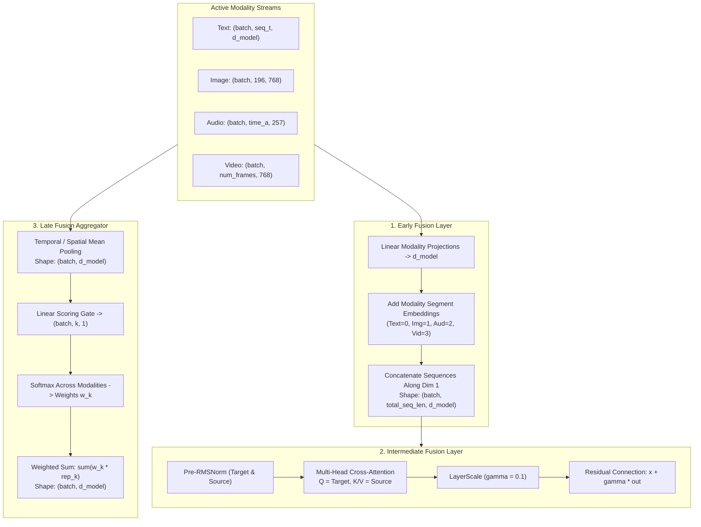

# 404 FOUNDERS — Multimodal Fusion Engine Architecture
**Document Identifier:** `DOC-MULTI-006`  
**Phase:** `08 — Multimodal Intelligence`  
**Status:** `REVIEW PENDING`  
**Author:** `Principal AI Research Scientist & Deep Learning Infrastructure Architect`  

---

## 1. Executive Summary

The Multimodal Fusion Engine (`neural_architecture.fusion.multimodal_fusion`) provides a hybrid multi-stage tensor unification architecture. Rather than forcing all modalities into a single naive concatenation or late average, 404 FOUNDERS implements three complementary fusion stages:

1. **Early Fusion Layer (`EarlyFusionLayer`):** Token projection and sequence concatenation with learned modality segment embeddings.
2. **Intermediate Fusion Layer (`CrossModalAttentionFusion`):** Multi-head cross-attention with pre-RMSNorm and LayerScale residual stabilization.
3. **Late Fusion Aggregator (`LateFusionAggregator`):** Adaptive softmax gating across pooled modality decision vectors.

---

## 2. Multi-Stage Fusion Topology

---

## 3. Mathematical Formulations

### Early Fusion
Given projection adapters \(W_m \in \mathbb{R}^{d_m \times d_{\text{model}}}\) and learned modality embeddings \(E_m \in \mathbb{R}^{d_{\text{model}}}\):

$$z_m = X_m W_m + E_m$$

The fused sequence is:
$$Z_{\text{early}} = [z_{\text{text}} \,\|\, z_{\text{image}} \,\|\, z_{\text{audio}} \,\|\, z_{\text{video}}] \in \mathbb{R}^{B \times L_{\text{total}} \times d_{\text{model}}}$$

### Intermediate Cross-Attention with LayerScale
For target query modality \(X_q\) and source key/value modality \(X_{kv}\):

$$\tilde{X}_q = \text{RMSNorm}(X_q), \quad \tilde{X}_{kv} = \text{RMSNorm}(X_{kv})$$

$$\text{Attention}(Q, K, V) = \text{softmax}\left(\frac{Q K^T}{\sqrt{d_k}}\right) V$$

LayerScale modulates the residual output using learnable parameter \(\gamma \in \mathbb{R}^{d_{\text{model}}}\) initialized to \(0.1\):

$$X_{\text{out}} = X_q + \gamma \odot W_o \cdot \text{Attention}(Q, K, V)$$

### Late Fusion Adaptive Softmax Gating
For \(K\) active modalities with pooled representations \(r_k \in \mathbb{R}^{d_{\text{model}}}\):

$$\alpha_k = \frac{\exp(w_g^T r_k)}{\sum_{j=1}^K \exp(w_g^T r_j)}$$

$$r_{\text{fused}} = \sum_{k=1}^K \alpha_k r_k \in \mathbb{R}^{B \times d_{\text{model}}}$$

Where \(\sum_k \alpha_k = 1.0\), providing dynamic, input-conditioned weighting across modalities.
