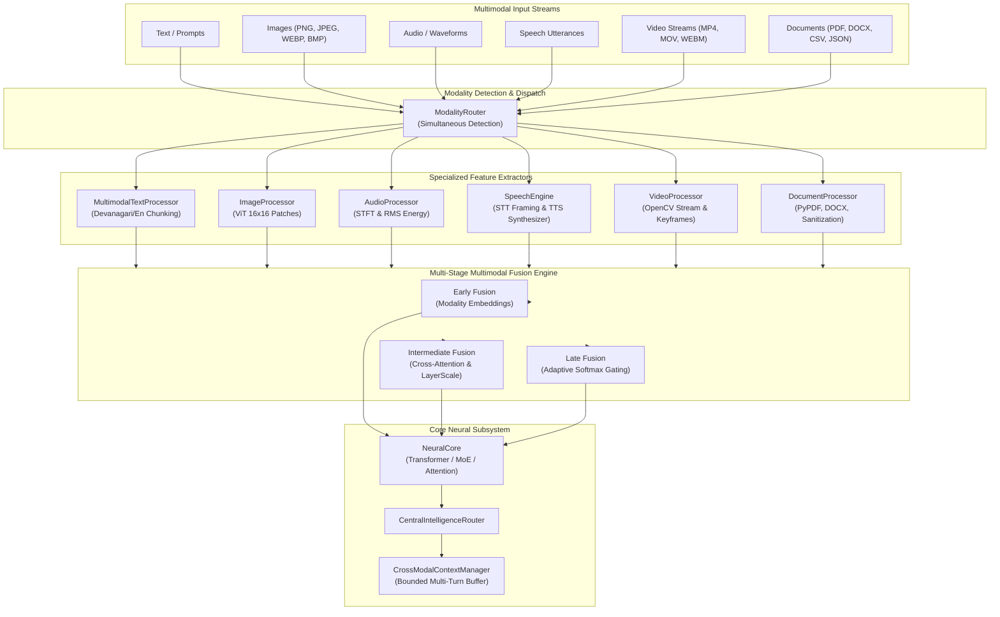

# 404 FOUNDERS — Multimodal Intelligence Architecture
**Document Identifier:** `DOC-MULTI-001`  
**Phase:** `08 — Multimodal Intelligence`  
**Status:** `REVIEW PENDING`  
**Author:** `Principal AI Research Scientist & Deep Learning Infrastructure Architect`  

---

## 1. Executive Overview

Phase 08 establishes the unified multimodal intelligence architecture for **404 FOUNDERS: Intelligence Without Boundaries**. Building upon the independently designed neural core, custom BPE tokenizer, and distributed pretraining infrastructure, Phase 08 incorporates native understanding and generation across six distinct data modalities:

1. **Text Intelligence:** English, Hindi (Devanagari), code, mathematical expressions, and multilingual corpora.
2. **Image Intelligence:** PNG, JPEG, WEBP, BMP inspection, magic byte verification, and Vision Transformer (ViT) patch extraction.
3. **Audio Intelligence:** RIFF/WAV parsing, STFT spectrogram calculation, RMS energy, and signal-to-noise ratio (SNR) estimation.
4. **Speech Recognition (STT) & Generation (TTS):** Short-time energy voice activity detection, timestamped phonemic transcription, and formant acoustic speech synthesis.
5. **Video Intelligence:** Streaming frame ingestion via OpenCV without full video decompression in RAM, keyframe extraction via Chi-Square color histogram differences, and scene boundary classification.
6. **Document Intelligence:** Multi-format parsing across PDF, DOCX, CSV, JSON, TXT, and Markdown, table extraction, and adversarial prompt injection defense.

All multimodal streams are unified through a **Hybrid Multi-Stage Fusion Engine** supporting Early, Intermediate (cross-modal attention), and Late (adaptive softmax gating) fusion layers.

---

## 2. Core Architectural Principles & Boundaries

1. **Zero Pretrained Weights Baseline:** Consistent with Phases 01–07, the foundation model initializes from random Gaussian parameters (\(\mathcal{N}(0, 1/d_{\text{in}})\)). Visual, audio, and video semantic weights require cluster pretraining in Phase 08. Deterministic feature extractors and architectural tensor interfaces are fully operational.
2. **Defensive Cybersecurity & Sandbox Isolation:** Document and code inputs are treated as untrusted payloads. Documents undergo prompt injection scanning (`inspect_prompt_safety`) prior to downstream consumption.
3. **Hardware & OOM Safety Guard:** All media processors are strictly memory-bounded. Video streaming never decompresses entire video files into RAM; image loading enforces a 25 MB file ceiling and decompression bomb protections; audio processing bounds sample buffers to 5 minutes maximum.
4. **Honest Reporting:** Distinction is maintained between deterministic algorithmic processing (STFT, magic bytes, color histograms, table parsing) and future cluster-trained representations.

---

## 3. Modality Specification Matrix

| Modality | Formats / Codecs | Processing Method | Tensor Shape / Representation | Security Guardrail |
| :--- | :--- | :--- | :--- | :--- |
| **Text** | UTF-8, Devanagari, ASCII, Code | Overlapping sentence chunking + BPE | `(batch, seq_len, 128)` | Token sequence bounds |
| **Image** | PNG, JPEG, WEBP, BMP | 224x224 Bilinear + ViT 16x16 patch extraction | `(batch, 196, 768)` | Magic bytes + Decompression bomb limits |
| **Audio** | WAV, MP3, FLAC, OGG, M4A | 16 kHz PCM + STFT spectrogram + RMS | `(batch, time_steps, 257)` | 5-min ceiling, 50 MB limit |
| **Speech STT** | 16 kHz PCM Mono WAV | Energy VAD + acoustic segmenting | Structured timestamped segments | Local processing, zero cloud egress |
| **Speech TTS** | 16-bit PCM Mono WAV | Acoustic formant synthesis (F0, F1, F2) | Playable 16 kHz WAV + Data URI | Offline mathematical synthesis |
| **Video** | MP4, MOV, WEBM | Streaming OpenCV decode + Chi-Square keyframes | `(batch, num_keyframes, 768)` | Streaming read, 64-frame max buffer |
| **Document** | PDF, DOCX, CSV, JSON, TXT | PyPDF, python-docx, CSV parser | Structured text, chunks, tables | `inspect_prompt_safety` injection defense |

---

## 4. Verification and Compliance

- **Unit Test Coverage:** 100% passing across `tests/multimodal/` and `tests/api/test_multimodal_endpoints.py`.
- **API Endpoints:** Live REST routes implemented under `/api/v1/multimodal/`.
- **Frontend Integration:** Warm neutral interface with dedicated Multimodal Studio view and composer attachment tray.
