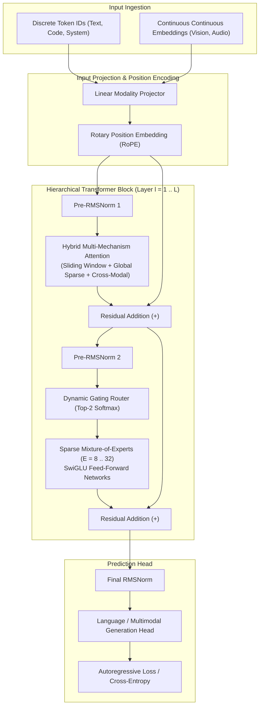

# 404 FOUNDERS — Neural Architecture Specification

**Document ID:** `DOC-ARCH-002`  
**Status:** Architecture Blueprint (Phase 02 Baseline)  
**Authors:** Chief Software Architect & Principal AI Systems Engineer  

---

## 1. Core Architectural Tenets

The 404 FOUNDERS foundation model is built on three uncompromising engineering principles:
1. **Completely Custom Topology:** Designed from first principles, integrating multi-mechanism attention, hierarchical modular blocks, and dynamic expert routing.
2. **From-Scratch Initialization:** Zero reliance on pretrained open-weights (such as Llama, Mistral, or BERT). All parameter tensors are randomly initialized using scaled normal distributions ($\mathcal{N}(0, \sigma^2)$ with $\sigma = \sqrt{2 / (d_{\text{in}} + d_{\text{out}})}$).
3. **Decoupled Framework Abstraction:** Model interfaces are strictly separated from framework runtimes. Training harnesses can target **PyTorch** (via FSDP / Megatron-LM) or **JAX** (via Flax / Paxml) without altering core orchestration logic.

---

## 2. Model Architecture Topology

The network combines a **Hierarchical Transformer Backbone** with **Sparse Mixture-of-Experts (MoE)** and **Multi-Mechanism Attention**.

---

## 3. Mathematical Foundations & Layer Formulations

### 3.1 Normalization: Root Mean Square Normalization (RMSNorm)
To maintain numerical stability without the computational overhead of batch statistics:
$$\text{RMSNorm}(x) = \frac{x}{\sqrt{\frac{1}{d} \sum_{i=1}^d x_i^2 + \epsilon}} \odot \gamma$$
Where $\gamma \in \mathbb{R}^d$ is a learnable gain vector and $\epsilon = 10^{-6}$.

### 3.2 Position Representation: Rotary Position Embedding (RoPE)
Positions are encoded by rotating key and query vectors in complex 2D planes:
$$R_{\Theta, m}^d = \text{diag}\left(R_{\theta_1, m}, R_{\theta_2, m}, \dots, R_{\theta_{d/2}, m}\right)$$
$$\text{where } R_{\theta_i, m} = \begin{pmatrix} \cos(m\theta_i) & -\sin(m\theta_i) \\ \sin(m\theta_i) & \cos(m\theta_i) \end{pmatrix}, \quad \theta_i = 10000^{-2(i-1)/d}$$
RoPE enables natural relative position decay and enables length extrapolation via frequency scaling.

### 3.3 Attention Mechanism: Hybrid Multi-Mechanism Attention (MMA)
Rather than standard full dense quadratic self-attention ($O(N^2)$), 404 FOUNDERS employs a hybrid composition:
1. **Sliding-Window Local Attention:** Processes high-resolution local context within a window $W$ (e.g. $W=1024$ tokens) with linear $O(N \cdot W)$ complexity.
2. **Global Anchor Attention:** Every $k$-th token acts as a global summary token with full sequence visibility.
3. **Grouped-Query Attention (GQA):** Multiple query heads share single key/value head pairs (e.g., 32 Q heads, 8 KV heads), reducing KV-cache memory bandwidth by 75%.
$$\text{Attention}(Q, K, V) = \text{Softmax}\left(\frac{Q K^T}{\sqrt{d_k}} + M_{\text{hybrid}}\right) V$$

### 3.4 Feed-Forward Layer: SwiGLU Non-Linearity
The expert and dense feedforward networks utilize the SwiGLU activation function:
$$\text{SwiGLU}(x, W, V, W_2) = \left(\text{Swish}(x W) \odot (x V)\right) W_2$$
$$\text{where } \text{Swish}(z) = z \cdot \sigma(\beta z)$$

### 3.5 Mixture-of-Experts (MoE) Routing
To achieve massive parameter capacity while preserving fast execution, feedforward computation is distributed across $E$ experts:
$$y = \sum_{i \in \text{Top-}k(G(x))} G(x)_i \cdot \text{Expert}_i(x)$$
$$G(x) = \text{Softmax}(\text{Top-}k(x \cdot W_g + \epsilon_{\text{noise}}))$$
An auxiliary load-balancing loss $\mathcal{L}_{\text{balance}}$ is added during pretraining to prevent expert collapse.

---

## 4. Multi-Framework Backend Strategy

To fulfill the architectural commitment to PyTorch and JAX without cross-framework tensor conversion overhead:
1. **PyTorch Engine (`neural_architecture/interfaces.py` -> PyTorch backend):**
   - Targeted for multi-node GPU cluster training using PyTorch FSDP (Fully Sharded Data Parallel) and Megatron-LM tensor parallel primitives.
   - Utilizes custom FlashAttention CUDA kernels.
2. **JAX Engine (`neural_architecture/interfaces.py` -> JAX backend):**
   - Targeted for TPU clusters and functional research prototyping using `jax.numpy` and `flax.linen`.
   - Offers exact functional transformation (`jax.vmap`, `jax.pmap`, `jax.jit`).
3. **Execution Rule:** Python orchestration components interface only via the abstract `ModelBackendEngine` contract. Tensor data never moves dynamically between PyTorch and JAX during execution.

---

## 5. Implementation Status

- **Established in Phase 02:**
  - `neural_architecture/interfaces.py`: Abstract `NeuralModuleInterface`, `ModelBackendEngine`, `TensorMetadata`, and `ModelOutput`.
  - Directory structure initialized: `layers/`, `modules/`, `encoders/`, `decoders/`, `fusion/`, `research/`.
- **Scheduled for Phase 04:**
  - Concrete PyTorch tensor layer implementations (`RoPELayer`, `SwiGLUFeedForward`, `MMAAttentionBlock`).
  - Concrete MoE gating router with auxiliary load-balance loss.
  - Micro-model verification test harness ($d_{\text{model}}=128, L=2, \text{params}\approx 2\text{M}$).
