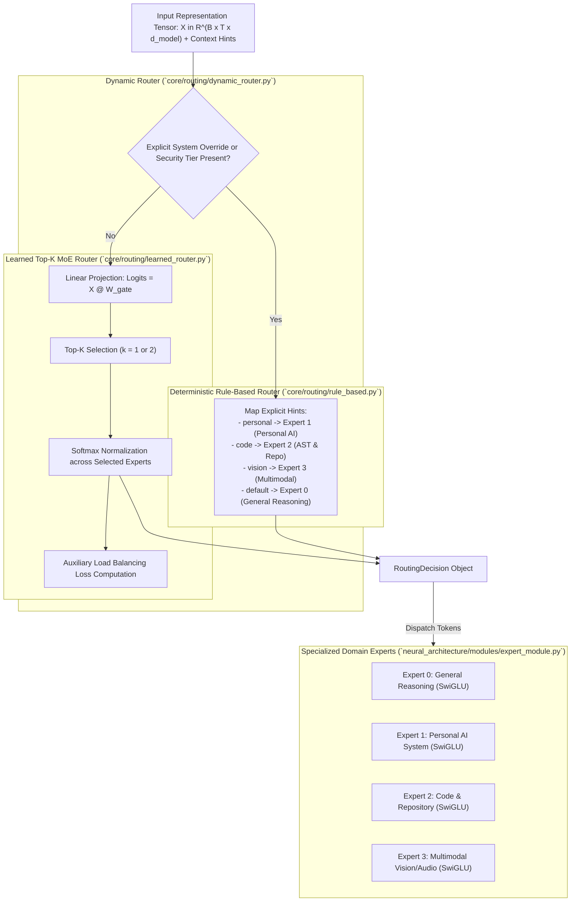

# 404 FOUNDERS — Neural Routing Design Specification

**Document ID:** `DOC-ROUTE-001`  
**Status:** Architecture Prototype Implemented (Phase 03 Baseline)  
**Authors:** Principal AI Research Engineer & Neural Architecture Developer  

---

## 1. Routing System Rationale

To balance broad general cognitive abilities with specialized personal AI endpoint capabilities, 404 FOUNDERS avoids monolithic parameter activation. Instead, the architecture incorporates a **Hierarchical Neural Routing Framework** capable of directing representations to specialized domain experts:



---

## 2. Router Implementations

### 2.1 Rule-Based Router (`core/routing/rule_based.py`)
- **Mechanism:** Deterministic inspection of execution metadata (`context_hints`).
- **Use Cases:** Security tier enforcement, user-selected operating modes (`FOUNDERS_OPERATING_MODE`), and hard-gated tool commands.
- **Benefits:** 100% reproducible, zero parameter footprint, deterministic auditing.

### 2.2 Learned Neural Router (`core/routing/learned_router.py`)
- **Mechanism:** Linear gating projection with top-$k$ selection:
  $$H = \text{MeanPool}(X), \quad G = H W_g \in \mathbb{R}^E$$
  $$\text{TopK\_Indices} = \arg\max_{S \subset \{1..E\}, |S|=k} \sum_{i \in S} G_i$$
  $$P_i = \frac{\exp(G_i)}{\sum_{j \in \text{TopK}} \exp(G_j)}$$
- **Auxiliary Load-Balancing Loss ($\mathcal{L}_{\text{balance}}$):**
  To prevent expert starvation or collapse during pretraining:
  $$\mathcal{L}_{\text{balance}} = E \sum_{i=1}^E f_i \cdot \bar{P}_i$$
  Where $f_i$ is the fraction of tokens routed to expert $i$, and $\bar{P}_i$ is the average gating probability allocated to expert $i$.
- **Prototype Status:** **Un-Trained Random Initialization.** The weights $W_g$ are initialized from $\mathcal{N}(0, 1/d_{\text{model}})$. Training occurs in subsequent phases.

### 2.3 Dynamic Hybrid Router (`core/routing/dynamic_router.py`)
- **Mechanism:** Evaluates policy priority. If strict overrides (`force_mode`, `security_tier`) exist, enforces rule-based routing; otherwise delegates to the learned router.

---

## 3. Interfaces & Contracts

All routers implement the abstract base contract defined in `core/routing/base.py`:

```python
class AbstractRouter(ABC):
    @property
    @abstractmethod
    def num_experts(self) -> int:
        pass

    @abstractmethod
    def route(self, x: torch.Tensor, context_hints: Optional[Dict[str, Any]] = None) -> RoutingDecision:
        pass
```

The resulting `RoutingDecision` structure exposes:
- `selected_expert_ids`: List of active expert IDs (`List[int]`).
- `routing_weights`: Softmax probability weights (`torch.Tensor`).
- `router_type`: String identifier (`rule_based`, `learned_top_k`, `dynamic`).
- `metadata`: Debugging parameters and load balancing indicators.
