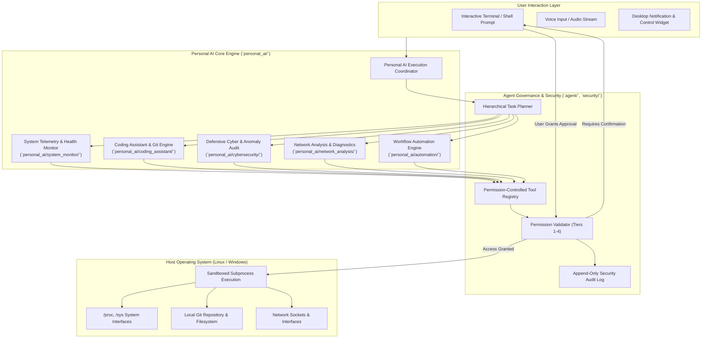

# 404 FOUNDERS — Personal AI Architecture Specification

**Document ID:** `DOC-ARCH-005`  
**Status:** Architecture Blueprint (Phase 02 Baseline)  
**Authors:** Chief Software Architect & Principal AI Systems Engineer  

---

## 1. Operating Concept & Mission

The **Personal AI System** transforms 404 FOUNDERS from a remote conversational model into an **autonomous operating system copilot** resident on the user's workstation.

It is engineered with deep endpoint awareness for **Kali Linux**, **Debian/Ubuntu**, and **Windows Subsystems**, providing technical assistance in systems administration, programming, defensive cybersecurity, and workflow automation.

---

## 2. Personal AI Subsystem Capabilities

### 2.1 System Monitoring (`personal_ai/system_monitor/`)
- **Telemetry Ingestion:** Real-time collection of CPU utilization, per-core frequencies, RAM allocation, memory buffers, swap status, and NVMe partition capacity.
- **Thermal & Power:** CPU package temperatures, throttling flags, battery discharge rate.
- **Safety Policy:** Operates strictly at **Permission Tier 1 (Read-Only)**. Does not alter kernel variables, governor profiles, or hardware thresholds.

### 2.2 Coding & Repository Assistant (`personal_ai/coding_assistant/`)
- **AST Parsing:** Parses Python, Rust, C++, JavaScript/TypeScript into structured Abstract Syntax Trees to identify dead code, cyclomatic complexity, and syntax errors.
- **Git Repository Governance:** Enforces phase-based commit standards, checks uncommitted changes, verifies branch synchronization, and audits diffs prior to staging.
- **Safety Policy:** Read-only inspection operates at Tier 1. Staging and committing files requires **Tier 2 (Protected)** with user visibility.

### 2.3 Defensive Cybersecurity Assistance (`personal_ai/cybersecurity/`)
- **Socket & Port Audit:** Inspects local listening TCP/UDP sockets (`ss -tulpn`, `lsof -i`) to detect unexpected daemon exposures.
- **Permission Auditing:** Scans sensitive local files (`~/.ssh`, `.env`, configuration keys) for unsafe world-readable permissions (`chmod 777`).
- **Log Anomaly Detection:** Parses auth logs (`/var/log/auth.log`, `journalctl`) for brute-force SSH attempts or unauthorized privilege escalation.
- **Safety Policy:** Analysis is strictly defensive and read-only. Offensive penetration testing utilities are disabled in autonomous mode.

### 2.4 Network Diagnostics (`personal_ai/network_analysis/`)
- **Interface Auditing:** Validates MTU, link speeds, packet drop counters, and IPv4/IPv6 routing tables.
- **Latency & Reachability:** Non-intrusive ICMP round-trip latency measurements, DNS resolution benchmarks against primary nameservers.

### 2.5 Safe Workflow Automation (`personal_ai/automation/`)
- **Script Generation:** Generates reproducible Bash, Python, and Makefile automation scripts for repetitive tasks.
- **Pre-Execution Dry Run:** Simulates file moves, directory reorganizations, and batch processes before asking for execution confirmation.

---

## 3. Security Boundary & Sandbox Guarantees

1. **Default Read-Only State:** The Personal AI system initializes in `read_only` mode. No modifications to disk, network sockets, or OS processes can occur without privilege escalation.
2. **Explicit Confirmation Gate:** Any operation classified under `protected` or `privileged` prompts the user with the exact command string and argument list.
3. **Catastrophic Pattern Exclusion:** Critical command patterns (`rm -rf /`, `mkfs`, partition writes, fork bombs) are intercepted and rejected by `security/sanitization.py`.

---

## 4. Implementation Status

- **Established in Phase 02:**
  - Package structure: `system_monitor/`, `coding_assistant/`, `cybersecurity/`, `network_analysis/`, `automation/`.
  - Tool registry and permission validator integrated (`agent/tools/registry.py`, `agent/permissions/validator.py`).
  - Security audit logging active (`security/audit.py`).
- **Scheduled for Phase 05:**
  - Concrete telemetry collectors (using `psutil` and `/proc` parsers).
  - Git diff analysis engine and AST inspection utilities.
  - Interactive terminal copilot interface.
