# 404 FOUNDERS — Personal AI Architecture Specification

**Document ID:** `DOC-PAI-001`  
**Status:** Implemented & Verified (Phase 10)  
**Authors:** Chief AI Architect, Lead OS Systems Engineer & Cybersecurity Architect  

---

## 1. Operating Concept & Mission

The **Personal AI System** integrates 404 FOUNDERS with the user's local computer through a modular, permission-controlled workstation copilot. Operating strictly within authorized security boundaries, the system provides zero-fabrication system inspection, hardware telemetry, process monitoring with protection guards, sandboxed file operations with automatic secret redaction, defensive terminal command advisory, network diagnostics, codebase intelligence, one-time operator approval tickets, an emergency kill switch, and an experimental voice interface foundation.

```mermaid
flowchart TD
    subgraph USER_LAYER ["Operator Interfaces"]
        UI["Warm Neutral Frontend (Dashboard)"]
        CLI["Local REST API (127.0.0.1:8000)"]
        VoiceInterface["Voice Foundation (Wake-Word & STT)"]
    end

    subgraph RUNTIME_GATEWAY ["Personal AI Gateway & Security Guard"]
        Runtime["LocalAgentRuntime (Localhost-Only Enforcement)"]
        KillSwitch["EmergencyShutdownController (Kill Switch)"]
        ApprovalMgr["ApprovalManager (One-Time Expiring Tickets)"]
        AuditLedger["AgentAuditSystem (Immutable SQLite Ledger)"]
        Router["NaturalLanguageToolRouter (EN / HI / Hinglish)"]
    end

    subgraph INTELLIGENCE_SUBSYSTEMS ["Local Workstation Intelligence Subsystems"]
        SysInfo["SystemInfoProvider (Real Telemetry)"]
        ProcMon["ProcessMonitor (Protected PID Guard)"]
        FileAssist["FileSystemAssistant (Traversal & Secret Redaction)"]
        CmdAdvisor["TerminalCommandAdvisor (Safety Risk Classifier)"]
        AppMgr["ApplicationManager (Safe App Launching)"]
        NetDiag["NetworkDiagnosticsModule (Interfaces, Ping, DNS)"]
        RepoAssist["RepositoryAssistant (Git, Diff, Topology, Tests)"]
        DefSecurity["DefensiveSecurityAssistant (Port Audits & Hardening)"]
        VoiceCore["VoiceAssistantFoundation (Lazy STT/TTS & Verification)"]
    end

    subgraph OS_ADAPTER_LAYER ["Hardware & OS Abstraction Layer"]
        OSFactory["get_os_adapter()"]
        LinuxAdapt["LinuxOSAdapter (/proc, /sys, /etc)"]
        WinAdapt["WindowsOSAdapter (WMI / Fallback)"]
    end

    subgraph MEMORY_INTEGRATION ["Phase 09 Multi-Layer Memory Bridge"]
        MemBridge["PersonalAIMemoryBridge"]
        LTM["Long-Term Memory"]
        Episodic["Episodic Action Trajectory"]
        Working["Working Memory Context"]
        Prefs["User Preference Memory"]
    end

    UI --> Runtime
    CLI --> Runtime
    VoiceInterface --> Runtime

    Runtime --> KillSwitch
    Runtime --> Router
    Router --> ApprovalMgr
    Router --> SysInfo
    Router --> ProcMon
    Router --> FileAssist
    Router --> CmdAdvisor
    Router --> AppMgr
    Router --> NetDiag
    Router --> RepoAssist
    Router --> DefSecurity
    Router --> VoiceCore

    SysInfo --> OSFactory
    ProcMon --> OSFactory
    AppMgr --> OSFactory
    NetDiag --> OSFactory

    OSFactory --> LinuxAdapt
    OSFactory --> WinAdapt

    Router --> AuditLedger
    Router --> MemBridge
    MemBridge --> LTM
    MemBridge --> Episodic
    MemBridge --> Working
    MemBridge --> Prefs
```

---

## 2. Architectural Core Subsystems

### 2.1 OS Abstraction & Hardware Telemetry (`personal_ai/os_adapters/`, `personal_ai/system_monitor/`)
- **OS Adapters:** `LinuxOSAdapter` and `WindowsOSAdapter` inherit from `BaseOSAdapter`.
- **Zero-Fabrication Metric Extraction:**
  - Reads `/proc/cpuinfo` for physical and logical core identification and model name.
  - Reads `/proc/meminfo` for accurate physical RAM, available memory, and swap allocation.
  - Reads `/proc/loadavg` for system load averages across 1, 5, and 15 minutes.
  - Reads `/sys/class/power_supply` for real battery status, capacity percentage, and charging state.
  - Reads `/sys/class/thermal` for thermal package zone temperatures.
- **Process Guard Invariant:** Critical operating system processes (PID 1, `systemd`, `init`, `kthreadd`, `sshd`, `auditd`) are marked `is_protected=True` and cannot be targeted for termination.

### 2.2 Sandboxed Filesystem Assistant (`personal_ai/filesystem/`)
- **Path Traversal Protection:** Every file access resolves canonical absolute paths via `os.path.realpath` and validates them against an authorized root whitelist (`REPO_ROOT`). Traversal attempts (`../../etc/passwd`) raise `SecurityViolationError`.
- **Sensitive File Exclusion:** Protected paths (`~/.ssh`, `~/.aws`, `.env`, `/etc/shadow`, credentials) are strictly barred from reading or modification.
- **Automated Secret Scrubbing:** File content passing to the assistant is scrubbed using `MemorySecurityManager`, substituting matching API tokens, private keys, and passwords with `[REDACTED_SECRET]`.

### 2.3 Terminal Command Safety Advisor (`personal_ai/terminal/`)
- **Advisory-Only Model:** The language model acts strictly as an analytical advisor and **never receives unrestricted shell execution capabilities**.
- **Five-Tier Risk Classification:**
  1. `READ_ONLY`: Harmless inspection (`ls`, `cat`, `git status`, `uname`, `uptime`).
  2. `LOW_RISK`: Standard local development (`pytest`, `npm test`, `cargo build`).
  3. `SENSITIVE`: Network calls or configuration alterations (`curl`, `docker run`, `git push`).
  4. `DESTRUCTIVE`: Potential data loss (`rm`, `git reset --hard`, `dropdb`).
  5. `PRIVILEGED`: Superuser commands (`sudo`, `chmod 777`, `chown`).
- **Hazardous Pattern Blocklist:** Fork bombs (`:(){ :|:& };:`), raw drive writes (`dd if=... of=/dev/sdX`), root file deletion (`rm -rf /`), and piping remote shell scripts directly into bash (`curl ... | bash`) are classified as permanently blocked.

### 2.4 Application Management (`personal_ai/apps/`)
- **Discovery:** Scans desktop entry registries (`/usr/share/applications`, `~/.local/share/applications`) and standard binary paths.
- **Controlled Launching:** Launching applications checks current execution state, validates binary paths, and requires a valid, unexpired `ApprovalTicket`.

### 2.5 Defensive Network Diagnostics (`personal_ai/network_analysis/`)
- **Interface Inspection:** Reads `/proc/net/dev` and socket configurations to list network interfaces and addresses.
- **Controlled Ping & DNS:** Safe, bounded ICMP echo requests (capped at 5 packets) and timeout-bounded DNS resolution benchmarking latency without flood capabilities.

### 2.6 Repository Intelligence & Safe Tests (`personal_ai/coding_assistant/`)
- **Codebase Topology:** Computes language distributions, file counts, and directory hierarchies within authorized project roots.
- **Git State Inspection:** Non-destructive queries for git status, untracked files, staged changes, and diffs.
- **Sandboxed Test Runner:** Executes `pytest` with timeouts and directory isolation, capturing stdout/stderr and return codes safely.

### 2.7 Defensive Cybersecurity Assistant (`personal_ai/cybersecurity/`)
- **Port Inspection:** Examines listening ports from `/proc/net/tcp` without intrusive active network scans.
- **Hardening Recommendations:** Evaluates open ports, SSH root login policies, and exposed administrative services, generating prioritized defensive mitigations.

### 2.8 Permission Workflow & Emergency Kill Switch (`personal_ai/permissions/`, `personal_ai/emergency/`)
- **One-Time Expiring Approval Tickets:** Any operation exceeding `READ_ONLY` generates a cryptographic ticket (`TICK-...`) valid for 300 seconds. Single-use enforcement guarantees tickets cannot be replayed.
- **Emergency Kill Switch:** `EmergencyShutdownController` instantly halts local agent execution, revokes all outstanding approval tickets, and blocks subsequent tool invocations until explicitly reset by a human operator.

### 2.9 Immutable Audit System (`personal_ai/audit/`)
- **Immutable Ledger:** Every agent action, approval decision, command advice query, and file inspection is written to `memory_audit_logs` in the local SQLite database. Deletion and modification APIs do not exist.

### 2.10 Experimental Voice Interface Foundation (`personal_ai/voice/`)
- **Voice Foundation:** Implements wake-word detection, lazy speech recognition (STT) and generation (TTS) connectors, and session interrupt state.
- **Biometric Boundary:** Voice biometrics are strictly an experimental foundation and **never authorize privileged or destructive actions alone**.

---

## 3. Strict Security Invariants

1. **Localhost-Only Binding:** The personal AI runtime binds strictly to `127.0.0.1` and `localhost`. It is never exposed to public network interfaces by default.
2. **Default Read-Only:** All operations default to read-only diagnostics. Destructive or privileged actions require human approval tickets.
3. **Zero Fabricated Metrics:** System metrics, CPU usage, RAM consumption, and process counts are gathered from real OS pseudo-filesystems.
4. **No Unrestricted Autonomous Execution:** The assistant provides safety analysis and command recommendations rather than executing arbitrary shell commands autonomously.
5. **Fail-Safe Emergency Stop:** An active kill switch blocks 100% of tool executions and agent operations immediately.
