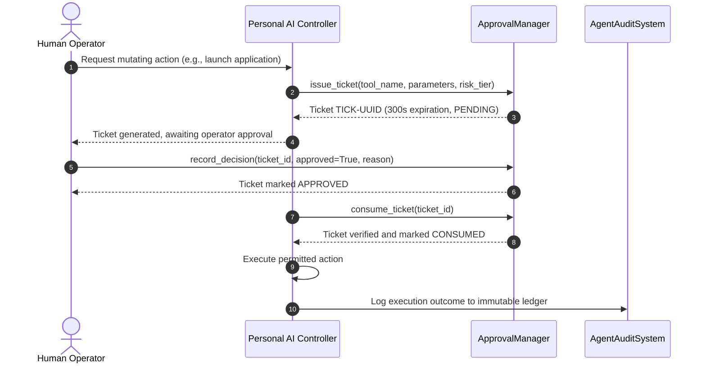

# 404 FOUNDERS — Personal AI Security, Permissions & Governance

**Document ID:** `DOC-PAI-003`  
**Status:** Implemented & Verified (Phase 10)  
**Authors:** Chief Information Security Officer & AI Safety Research Lead  

---

## 1. Security Philosophy & Principles

Personal AI operates inside the user's private computing environment. To ensure safety without crippling usability, the architecture adheres to four foundational axioms:

1. **Principle of Least Privilege:** By default, all agent operations execute in a restricted `READ_ONLY` mode.
2. **Explicit Human Consent for State Mutations:** Any operation capable of altering files, executing binaries, or modifying configuration requires explicit human confirmation via expiring approval tickets.
3. **No Unrestricted Autonomous Execution:** The model advises, parses, and formats commands for the operator; it is permanently blocked from executing arbitrary unstructured shell strings autonomously.
4. **Permanent Hazardous Command Blocklist:** Certain destructive patterns are categorically rejected regardless of prompt engineering, user phrasing, or simulation pretexts.

---

## 2. Command Risk Classification

Commands and actions are classified into five strict tiers by `TerminalCommandAdvisor` (`personal_ai/terminal/command_advisor.py`):

| Risk Tier | Examples | Execution Policy | Approval Ticket Required |
|---|---|---|---|
| `READ_ONLY` | `ls`, `cat`, `grep`, `git status`, `uptime`, `whoami` | Permitted in standard mode | No |
| `LOW_RISK` | `pytest`, `npm test`, `cargo build`, `python script.py` | Local execution with isolated environment | No |
| `SENSITIVE` | `curl`, `wget`, `docker run`, `git push`, `ssh` | Network requests or configuration changes | **Yes** |
| `DESTRUCTIVE` | `rm`, `git reset --hard`, `dropdb`, `truncate` | Potential permanent data loss | **Yes (High Warning)** |
| `PRIVILEGED` | `sudo`, `chown`, `chmod 777`, `systemctl restart` | System-level permission changes | **Yes (High Warning)** |

---

## 3. Approval Ticket Lifecycle

The `ApprovalManager` (`personal_ai/permissions/approval_manager.py`) manages the generation, validation, and consumption of one-time approval tickets.

### Key Ticket Invariants:
- **Single-Use Guarantee:** Once consumed, a ticket transitions to `CONSUMED` state and cannot be reused.
- **Expiration Window:** Unused tickets expire automatically after 300 seconds. Expired tickets cannot be approved or consumed.
- **Revocation on Emergency Stop:** Triggering the emergency kill switch instantly revokes all pending tickets across the runtime.

---

## 4. Hazardous Pattern Blocklist

The following command patterns are permanently blocked by `TerminalCommandAdvisor`:

- **Fork Bombs:** `:(){ :|:& };:`, `bomb() { bomb | bomb & }; bomb`
- **Root Filesystem Deletion:** `rm -rf /`, `rm -rf /*`, `rm -r --no-preserve-root /`
- **Raw Disk Overwrite:** `dd if=/dev/zero of=/dev/sd*`, `dd if=/dev/urandom of=/dev/nvme*`
- **Direct Remote Code Execution via Pipe:** `curl ... | bash`, `wget ... | sh`, `curl ... | python`
- **Filesystem Formatting:** `mkfs`, `fdisk`, `parted`

When a blocked pattern is detected, the advisor flags `is_blocked=True`, sets a detailed `block_reason`, and permanently refuses ticket generation.

---

## 5. Path Traversal & Sensitive File Shield

The `FileSystemAssistant` enforces strict canonical directory bounds:
- **Canonical Path Resolution:** `os.path.realpath(path)` resolves all symbolic links and relative segments (`..`).
- **Whitelist Enforcement:** Paths must reside within the authorized project root (`REPO_ROOT`).
- **Sensitive File Blocklist:** Reading or modifying `/etc/shadow`, `/etc/passwd`, `~/.ssh/*`, `~/.aws/*`, `.env`, and private key files raises an immediate `SecurityViolationError`.
- **Secret Scrubbing:** All retrieved text is scanned with `MemorySecurityManager` regex patterns. Discovered secrets (Bearer tokens, API keys, passwords) are replaced with `[REDACTED_SECRET]`.
