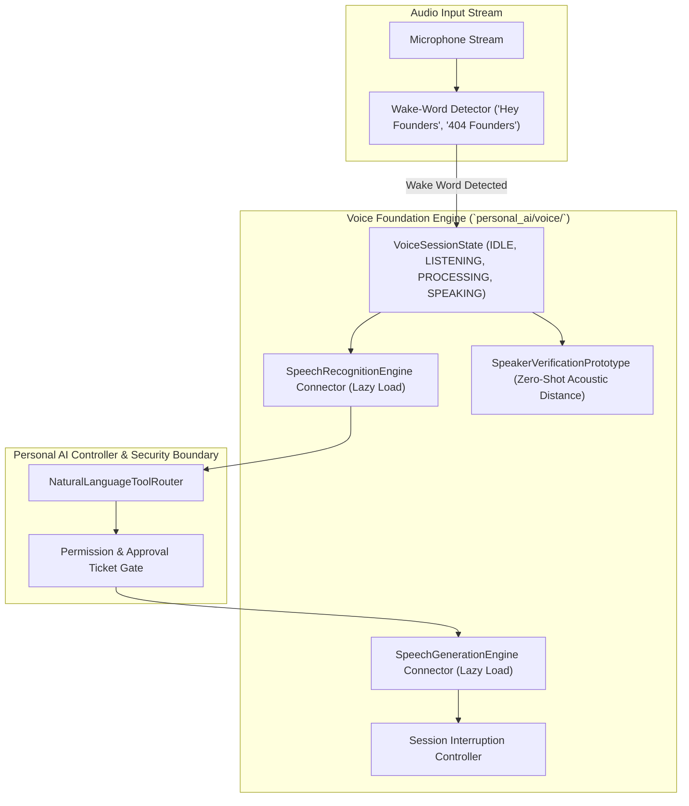

# 404 FOUNDERS — Personal AI Voice Foundation & Audio Interface

**Document ID:** `DOC-PAI-004`  
**Status:** Implemented & Verified (Phase 10 Foundation)  
**Authors:** Speech Processing Engineer & AI Safety Systems Lead  

---

## 1. Scope & Objective

The **Voice Assistant Foundation** (`personal_ai/voice/voice_interface.py`) integrates voice interaction capabilities into the Personal AI local assistant. It leverages Phase 08 Speech Recognition and Generation engines to provide hands-free system interaction while upholding strict safety invariants.

---

## 2. Architecture & Components

### 2.1 Wake-Word Detection
- Monitors incoming audio for approved wake phrases: `"hey founders"`, `"404 founders"`, `"founders ai"`.
- Activates listening session when wake word confidence exceeds threshold ($0.75$).

### 2.2 Lazy Engine Instantiation
- STT (`SpeechRecognitionEngine`) and TTS (`SpeechGenerationEngine`) components are initialized lazily upon first voice interaction.
- Prevents unnecessary memory consumption or circular dependencies during non-voice server startup.

### 2.3 Session Interruptibility
- When the assistant is synthesizing audio (`SPEAKING`), user speech input triggers an immediate barge-in interruption.
- Audio playback cancels promptly, transitioning state back to `LISTENING`.

---

## 3. Strict Biometric Safety Invariant

> [!WARNING]
> **Experimental Status Notice:** The speaker verification module is an experimental prototype based on cosine distance of spectral acoustic embeddings. It is **NOT** rated for production biometric authentication.
>
> **Safety Invariant:** Voice verification alone **NEVER** authorizes destructive (`DESTRUCTIVE`), sensitive (`SENSITIVE`), or privileged (`PRIVILEGED`) actions. All state mutations continue to require physical operator confirmation via the one-time `ApprovalTicket` workflow.
