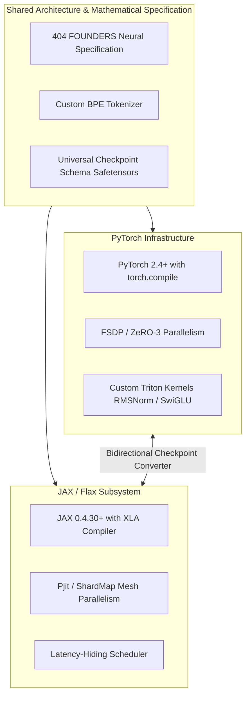

# 404 FOUNDERS — PyTorch & JAX Infrastructure Integration

## 1. Architectural Strategy

The **404 FOUNDERS** foundation model architecture adopts a dual-framework approach utilizing **PyTorch** and **JAX**:

- **PyTorch**: Primary engine for dynamic neural architecture exploration, production FSDP distributed training, custom Triton kernels, and rapid modular experimentation.
- **JAX**: Dedicated engine for whole-program XLA graph optimization, functional SPMD (Single Program, Multiple Data) sharding with `shard_map`, and cross-accelerator portability (NVIDIA GPUs and Google Cloud TPUs).



---

## 2. PyTorch Training Infrastructure

### Key Capabilities:
- **`torch.compile(mode="max-autotune")`**: Traces Python operations into high-performance fused C++ and Triton kernels, minimizing CUDA kernel launch overhead and maximizing memory bandwidth.
- **FSDP with `SHARDED_STATE_DICT`**: Distributed ranks save and load non-blocking tensor shards directly to parallel NVMe scratch storage without routing full parameter weights through a single master process.
- **FlashAttention-2 & FlashAttention-3 Integration**: Fused attention kernels running on Hopper Tensor Cores achieve near-theoretical memory bandwidth limits.

---

## 3. JAX / Flax Supercluster Infrastructure

### Key Capabilities:
- **XLA Latency-Hiding Scheduler**: Automatically overlaps communication operations (`all_reduce`, `all_gather`) with computational loops across the XLA HLO (High-Level Optimizer) graph.
- **Declarative Device Mesh**:
  ```python
  from jax.sharding import Mesh, PartitionSpec as P, NamedSharding
  # Define 64-GPU mesh: 8 data parallel x 4 tensor parallel x 2 pipeline parallel
  mesh = Mesh(devices.reshape((8, 4, 2)), ('data', 'model', 'pipe'))
  ```
- **Pure Functional State**: Facilitates reproducible distributed rollbacks and deterministic gradient checkpointing without state side-effects.

---

## 4. Checkpoint Interoperability & Weight Translation

To ensure zero lock-in between PyTorch and JAX, the checkpointing vault persists state dicts using standard **Safetensors** format coupled with JSON manifest schemas:

| Field | Description | PyTorch Key Format | JAX / Flax Key Format |
| :--- | :--- | :--- | :--- |
| **Embeddings** | Discrete input token table | `input_projection.embedding.weight` | `params/input_projection/embedding` |
| **Attention QKV** | Multi-head attention projection | `attention.qkv_proj.weight` | `params/attention/qkv_proj/kernel` |
| **SwiGLU Gate** | Feed-forward gate projection | `feature_transform.gate_proj.weight` | `params/feature_transform/gate/kernel` |
| **RMSNorm** | Root Mean Square layer scale | `norm.weight` | `params/norm/scale` |

The checkpoint vault includes an automated bidirection translator that reads PyTorch FSDP sharded Safetensors, aligns dimensional tensor orders (e.g. transposition between PyTorch row-major and JAX kernel formats), and emits corresponding JAX checkpoints with identical SHA-256 parameter validation.
