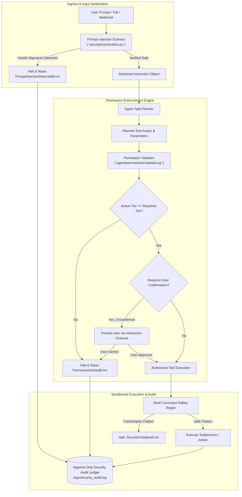

# 404 FOUNDERS — Security Architecture Specification

**Document ID:** `DOC-ARCH-007`  
**Status:** Security Baseline (Phase 02 Baseline)  
**Authors:** Chief Software Architect & Principal AI Systems Engineer  

---

## 1. Zero-Trust Security Philosophy

404 FOUNDERS operates under a strict **Zero-Trust Security Model**. Because the Personal AI operating mode possesses native endpoint inspection capabilities, the system must treat all inputs—including user prompts, external retrieved documents, network socket data, and tool outputs—as potentially hostile.



---

## 2. Threat Model & Attack Vectors

| Attack Vector | Threat Description | 404 FOUNDERS Defense Mechanism |
|---|---|---|
| **Direct Prompt Injection** | Adversarial instructions attempting to override system behavior or personality | Signature scanning in `security/sanitization.py` + strict system prompt delimiters |
| **Indirect Prompt Injection** | Hostile instructions hidden in ingested documents, web pages, or git commits | Untrusted context labeling; tools cannot execute instructions directly from retrieved data |
| **Arbitrary Shell Execution** | Exploiting agent tools to execute destructive commands (`rm -rf /`, `mkfs`) | Command pattern interception, argument whitelisting, prohibited catastrophic regexes |
| **Secret & Credential Leakage** | Committing or logging API keys, `.env` variables, SSH keys, or access tokens | `.gitignore` enforcement, pattern scrubbing in logs, environment separation |
| **Unauthorized Escalation** | Agent autonomously attempting root privilege operations or system writes | 4-tier permission gating; explicit user approval required for any modification |
| **Data Exfiltration** | Malicious agent tool transmitting local files over unverified network sockets | Outbound network egress restriction; network tools require `privileged` authorization |

---

## 3. Four-Tier Permission Hierarchy

The system defines four discrete, non-bypassable permission tiers (`security/permissions.py`):

```
+-----------------------------------------------------------------------------------------+
|                                    PERMISSION TIERS                                     |
+-----------------------------------------------------------------------------------------+
| Tier 1: READ_ONLY   | Safe inspection, system telemetry, git status, file reading       |
|                     | Allowed autonomously without confirmation.                        |
+---------------------+-------------------------------------------------------------------+
| Tier 2: PROTECTED   | Non-destructive writes within workspace, git add, code edits      |
|                     | Requires active user confirmation or elevated workspace policy.   |
+---------------------+-------------------------------------------------------------------+
| Tier 3: PRIVILEGED  | Network socket calls, service control, local package installation |
|                     | Strictly requires explicit user confirmation.                     |
+---------------------+-------------------------------------------------------------------+
| Tier 4: DANGEROUS   | Destructive actions (disk formatting, root execution, deletions)  |
|                     | Permanently blocked from autonomous agent invocation.             |
+-----------------------------------------------------------------------------------------+
```

---

## 4. Immutable Security Audit Logging

All security-sensitive operations—whether granted, denied, or intercepted—are recorded to an append-only JSONL log (`logs/security_audit.log`) via `security/audit.py`.

Each audit entry captures:
- ISO 8601 UTC timestamp and nanosecond epoch.
- Event type (`ACCESS_GRANTED`, `ACCESS_DENIED`, `CONFIRMATION_REQUIRED`, `INJECTION_BLOCKED`).
- Requested tool name and required permission tier.
- User confirmation boolean status.
- Sanitized invocation parameters.

---

## 5. Implementation Status

- **Fully Implemented & Validated in Phase 02:**
  - `security/permissions.py`: `PermissionTier` enum and parsing logic.
  - `security/audit.py`: `SecurityAuditLogger` with append-only file persistence.
  - `security/sanitization.py`: Catastrophic shell pattern checks and prompt injection scanners.
  - `agent/permissions/validator.py`: Permission validator enforcing tier boundaries and confirmation.
  - `agent/tools/registry.py`: Decorated tool registry with permission metadata.
  - Automated security tests in `tests/security/test_permissions.py`.
- **Scheduled for Future Phases:**
  - Linux namespaces / bubblewrap sandboxing for subprocess execution (Phase 05).
  - Cryptographic token generation and session signing (Phase 06).
