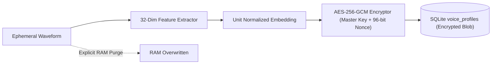

# 404 FOUNDERS — Voice Biometrics & Assistant Security Documentation
**Tagline:** Intelligence Without Boundaries.  
**System:** Voice Security Architecture & Privacy Safeguards  
**Classification:** Technical Security Architecture

---

## 1. Threat Model & Security Principles

The 404 FOUNDERS conversational voice assistant is designed under five strict non-negotiable security principles:

1. **Zero Raw Audio Persistence:** Raw acoustic recordings are strictly ephemeral. Waveforms reside in transient RAM only for the duration of feature extraction ($\le 20\text{ ms}$) and are wiped immediately.
2. **Local Data Sovereignty:** Private voice data is never sent to third-party cloud services or telemetry pipelines. All speech synthesis, feature extraction, and biometrics execute entirely on local compute.
3. **Defense-in-Depth (Probabilistic Gating):** Voice biometrics is probabilistic. An acoustic match (`VERIFIED`) grants conversational access and read-only system telemetry, but **never** authorizes destructive, state-altering, or privileged system operations.
4. **Single-Use Approval Tickets:** Mutating operations (e.g. launching apps, altering files, terminating processes) require an explicit one-time ticket consumed via the `ApprovalManager`. Re-use raises a `SecurityViolationError`.
5. **Acoustic Replay & Spoofing Mitigation:** Synthetic audio playback and loudspeaker re-recordings are detected and halted via harmonic decay, spectral LPC residual variance, and pitch micro-tremor analysis.

---

## 2. Cryptographic Profile Protection

Enrolled voice profiles are protected using authenticated encryption:
- **Cipher:** AES-256-GCM (Galois/Counter Mode).
- **Key Derivation:** Master key derived from host secrets or environment variable `FOUNDERS_BIOMETRIC_KEY` (minimum 256 bits).
- **Initialization Vector:** Unique 96-bit cryptographically secure random nonce generated per profile serialization.
- **Storage:** Ciphertext blobs and nonces stored in SQLite table `voice_profiles` with foreign key integrity.

---

## 3. Comprehensive Audit Logging

All voice events are logged immutably to `voice_audit_log`:
- `VOICE_ENROLLMENT`: Records profile ID, sample count, and timestamp.
- `SPEAKER_VERIFICATION`: Records similarity score, liveness score, outcome, and timestamp.
- `VOICE_REVOCATION`: Records permanent profile purge and deactivation.
- `BARGE_IN_INTERRUPT`: Records emergency speech cancellation.
