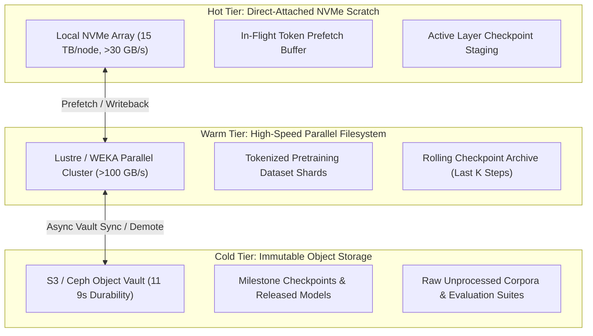
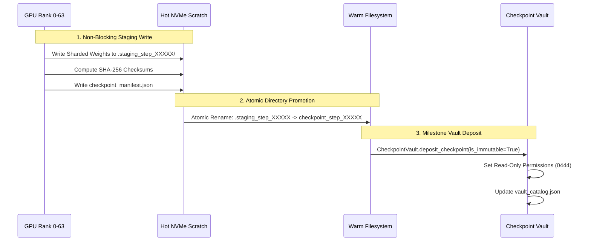

# 404 FOUNDERS — Multi-Tier Storage Architecture & Checkpoint Vault

## 1. Executive Summary

Distributed training of the **404 FOUNDERS** foundation model demands an ultra-high-throughput, low-latency storage hierarchy to ensure GPU compute engines are never starved of training tokens or stalled during frequent checkpoint persistence. This document specifies the Hot, Warm, and Cold storage tiering architecture, eviction lifecycles, and Checkpoint Vault operations.

---

## 2. Three-Tier Storage Architecture



### Storage Tier Specifications

| Parameter | Hot Scratch Tier | Warm Shared Tier | Cold Object Tier |
| :--- | :--- | :--- | :--- |
| **Media Type** | Direct-Attached PCIe 5.0 NVMe | Parallel Filesystem (Lustre/WEKA) | S3 Object Storage / Ceph |
| **Capacity (Tier C)** | 120 TB (15 TB/node) | 500 TB | 2,000 TB (2 PB) |
| **Read Throughput** | >30 GB/s per node (>240 GB/s total) | >100 GB/s aggregate | ~1–5 GB/s (batch egress) |
| **Random IOPS** | >1,000,000 IOPS per node | >500,000 IOPS aggregate | Low (Object REST access) |
| **Latency** | <15 microseconds | <500 microseconds | 50–150 milliseconds |
| **Persistence** | Ephemeral / Staging | High (RAID 6 / Erasure Coded) | Extreme (11 9s durability) |
| **Retention Policy** | 24 hours / LRU cache eviction | 30 days rolling window | Permanent / Immutable |

---

## 3. Storage Eviction & Quota Management

1. **Hot Cache Eviction**:
   - The `StorageTierManager` monitors hot NVMe capacity every 60 seconds.
   - When utilization exceeds **80%**, an LRU (Least Recently Used) eviction pass identifies unlocked training data chunks and unlinks them, freeing space for subsequent batches.
2. **Warm-to-Cold Migration**:
   - Rolling training checkpoints beyond the retention threshold (default: last 5 checkpoints) are evaluated.
   - Non-milestone checkpoints are safely purged from the warm tier.
   - Milestone checkpoints (e.g. step multiples of 10,000 or lowest validation loss) are copied to the cold vault and tagged as immutable.

---

## 4. Checkpoint Vault & Atomic Persistence

To protect multi-week pretraining runs against corruption caused by node failure or network partitions during checkpoint writing:



### Checkpoint Manifest Schema (`checkpoint_manifest.json`):
```json
{
  "step": 50000,
  "epoch": 2,
  "tokens_seen": 104857600000,
  "loss": 2.1485,
  "timestamp": 1730912400.0,
  "total_shards": 64,
  "shards": {
    "shard_00000.pt": "e3b0c44298fc1c149afbf4c8996fb92427ae41e4649b934ca495991b7852b855",
    "shard_00001.pt": "ca978112ca1bbdcafac231b39a23dc4da786eff8147c4e72b9807785afee48bb"
  },
  "commit_sha": "a1b2c3d4e5f6...",
  "is_milestone": true
}
```
