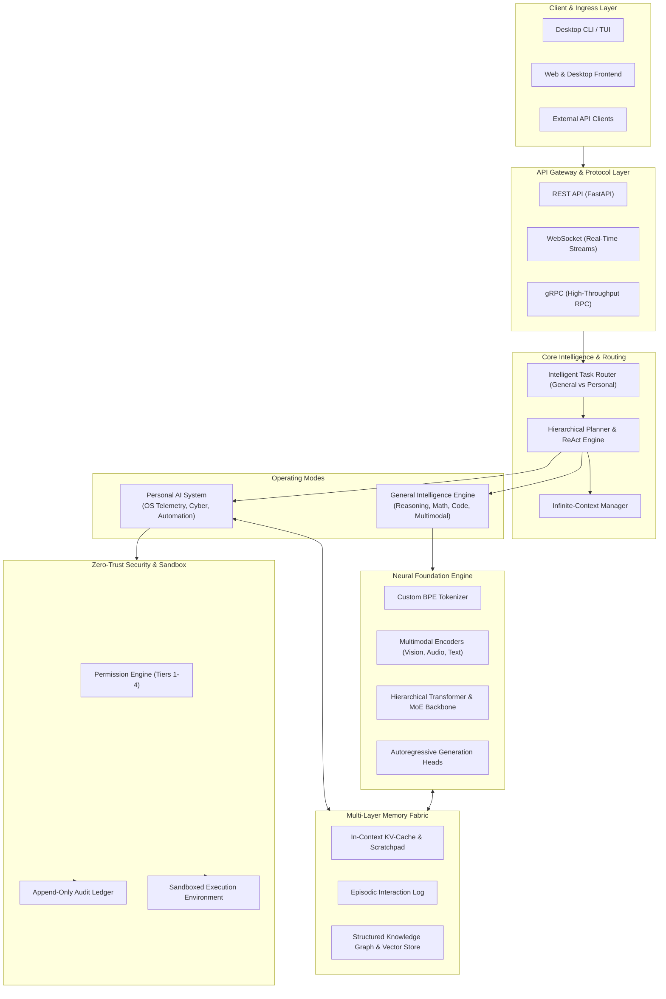
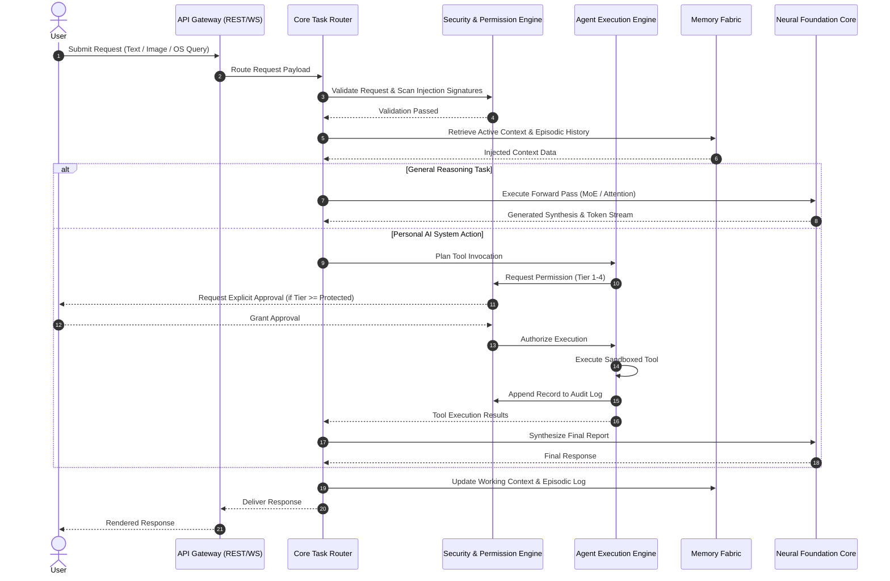

# 404 FOUNDERS — System Architecture Specification

**Document ID:** `DOC-ARCH-001`  
**Status:** Architecture Blueprint (Phase 02 Baseline)  
**Authors:** Chief Software Architect & Principal AI Systems Engineer  
**Tagline:** Intelligence Without Boundaries  

---

## 1. Executive Overview

**404 FOUNDERS** is an enterprise-grade AI ecosystem engineered around a **custom multimodal foundation model** coupled with an **autonomous personal computer intelligence assistant**. Unlike conventional wrapper architectures that rely on third-party commercial APIs, 404 FOUNDERS is architected for from-scratch foundation training, custom tokenizer design, hybrid multi-mechanism attention, and native operating system integration.

The architecture addresses two distinct, unified operating modes:
1. **General Intelligence Mode:** Multi-step logical reasoning, formal mathematics, scientific inquiry, software engineering, multilingual communication, and multimodal comprehension.
2. **Personal AI Mode:** Local endpoint intelligence, OS inspection (Linux and Windows), workspace repository analysis, defensive cybersecurity auditing, network diagnostics, workflow automation, and episodic memory.

---

## 2. Operating Modes & Behavioral Specifications

### 2.1 Mode A: General Intelligence Mode
General Intelligence Mode handles unconstrained cognitive tasks:
- **Symbolic & Mathematical Reasoning:** Chain-of-thought, program-aided math formulation, tree-of-thought exploration, and proof generation.
- **Scientific Research & Synthesis:** Structured literature parsing, hypothesis formulation, document summarization, and data extraction.
- **Software Engineering:** Multi-language code synthesis, AST refactoring, test-driven code generation, and complexity analysis.
- **Multimodal Understanding:** Cross-modal semantic projection between visual tokens, acoustic spectrograms, structured documents, and natural language.

### 2.2 Mode B: Personal AI Mode
Personal AI Mode operates as an autonomous resident operating system copilot:
- **Computer Analysis:** System health auditing, memory profiling, thermal monitoring, and bottleneck detection.
- **Multi-OS Assistance:** Native tooling for Kali Linux, Debian/Ubuntu, and Windows NT subsystems.
- **Codebase & Repository Intelligence:** Autonomous Git analysis, commit auditing, dependency vulnerability scanning, and branch management.
- **Defensive Cybersecurity:** Network socket inspection, listening port auditing, process behavior monitoring, and least-privilege enforcement.
- **Workflow Automation:** Execution of repetitive operational workflows subject to explicit authorization gates.
- **Personalized Context Memory:** Retains user preferences, project conventions, and past interaction transcripts.

---

## 3. Subsystem Breakdown & Component Responsibilities

| Subsystem | Directory | Responsibilities | Status |
|---|---|---|---|
| **Core Orchestration** | `core/` | Task routing, planning, context window expansion, system telemetry | Established (Interfaces) |
| **Neural Architecture** | `neural_architecture/` | Custom layers (RoPE, SwiGLU, GQA), encoders, decoders, MoE | Established (Interfaces) |
| **Multi-Layer Memory** | `memory/` | Working memory, vector persistence, episodic logs, consolidation | Established (Interfaces) |
| **Multimodal Ingestion** | `multimodal/` | Text, vision patch, audio spectrogram, and document processing | Established (Interfaces) |
| **Custom Tokenizer** | `tokenizer/` | Custom BPE training, merge tables, vocabulary serialization | Established (Interfaces) |
| **Learning Paradigms** | `learning/` | Next-token loss, self-supervised pretraining, DPO/RLHF | Established (Interfaces) |
| **Training Engine** | `training/` | Streaming dataset readers, checkpointing, distributed harness | Established (Interfaces) |
| **Personal AI** | `personal_ai/` | Hardware telemetry, network scanner, coding assistant | Established (Interfaces) |
| **Agent Execution** | `agent/` | ReAct loop, tool registry, permission validator, sandbox | **Implemented & Tested** |
| **Security & Audit** | `security/` | Permission tiers, prompt injection defense, append-only audit | **Implemented & Tested** |
| **Configuration** | `core/config.py` | Type-safe environment loading and YAML configurations | **Implemented & Tested** |
| **API Gateway** | `api/` | REST (FastAPI), WebSocket, and gRPC endpoint specifications | Established (Interfaces) |
| **Infrastructure** | `infrastructure/` | Local CPU settings, cloud VM scripts, Slurm GPU cluster | Established (Interfaces) |

---

## 4. Component Dependencies & Data Flow

---

## 5. Implementation Status: Phase 02 Baseline

To maintain absolute documentation integrity:
- **Implemented in Phase 02:**
  - Complete modular repository structure with isolated Python packages.
  - Type-safe configuration management (`core/config.py`, `configs/default_config.yaml`).
  - Structured logging framework (`core/logging.py`).
  - Unified error hierarchy (`core/exceptions.py`).
  - Framework-agnostic neural engine interfaces (`neural_architecture/interfaces.py`).
  - Granular 4-tier security permission engine (`security/permissions.py`).
  - Append-only security audit logging (`security/audit.py`).
  - Shell and prompt injection sanitization (`security/sanitization.py`).
  - Permission-controlled agent tool registry (`agent/tools/registry.py`).
  - Permission validator (`agent/permissions/validator.py`).
  - Automated test suite validating architecture and security (`tests/`).
- **Conceptual Designs (Scheduled for Future Phases):**
  - Concrete PyTorch/JAX neural layers and weights (Phase 04).
  - Concrete BPE tokenizer training scripts (Phase 03).
  - Streaming multimodal dataset pipelines (Phase 03).
  - Active network daemons and web UI (Phase 05/06).
