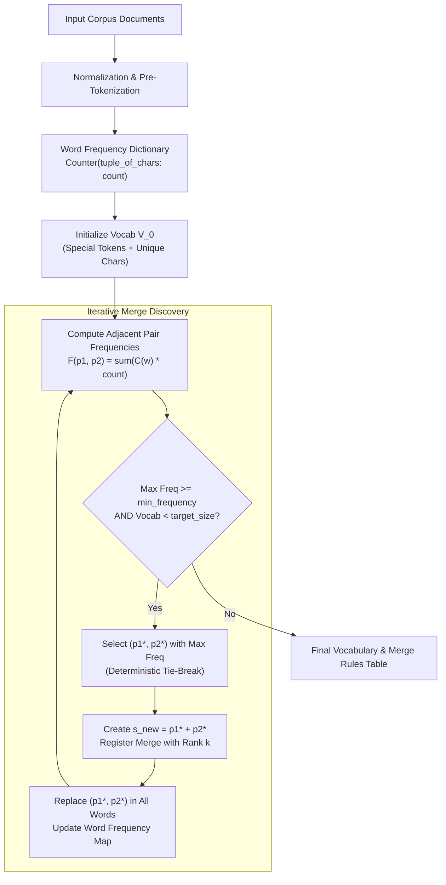

# 404 FOUNDERS — Tokenizer Training Specification

> **Document ID:** `DOC-TOK-002`  
> **Phase:** 04 — Custom BPE Tokenizer & Data Pipeline  
> **Target Audience:** Data Engineers, NLP Researchers, Tokenization Specialists  
> **Status:** Verified Implementation

---

## 1. Mathematical Formulation of Custom BPE Training

Byte Pair Encoding (BPE) is an iterative data compression algorithm adapted for subword text tokenization (Sennrich et al., 2016). In 404 FOUNDERS, the algorithm operates at the **character and grapheme level** rather than the byte level.

### Step 1: Pre-Tokenized Word Frequency Mapping
Let the normalized corpus $\mathcal{D}$ be pre-tokenized into a multiset of words $\mathcal{W}$, where each word $w \in \mathcal{W}$ is initially represented as a tuple of base Unicode characters $w = (c_1, c_2, \dots, c_m)$ prefixed by the whitespace marker ` `.

We compute the word frequency mapping:
$$C(w) = \sum_{d \in \mathcal{D}} \sum_{w' \in \text{pre\_tok}(d)} \mathbb{I}(w' = w)$$

### Step 2: Base Vocabulary Initialization
The initial vocabulary $V_0$ is constructed from the union of registered special tokens $S$ and the set of all unique base characters observed across all words in $\mathcal{W}$:
$$V_0 = S \cup \left\{ c \;\middle|\; \exists w \in \mathcal{W}, c \in w \right\}$$

### Step 3: Pair Frequency Calculation
At iteration $k \ge 0$, for each adjacent pair of subwords $(p_1, p_2)$ occurring in any word $w = (s_1, s_2, \dots, s_l) \in \mathcal{W}_k$, the total corpus pair frequency is:
$$F_k(p_1, p_2) = \sum_{w \in \mathcal{W}_k} C(w) \cdot \sum_{i=1}^{l-1} \mathbb{I}(s_i = p_1 \land s_{i+1} = p_2)$$

### Step 4: Deterministic Greedy Selection & Tie-Breaking
The pair with the maximal frequency is chosen for merging:
$$(p_1^*, p_2^*) = \arg\max_{(p_1, p_2)} \Big( F_k(p_1, p_2), p_1, p_2 \Big)$$

If multiple pairs share the identical maximum frequency, deterministic tie-breaking is enforced by sorting lexicographically by $p_1$ and then $p_2$. This guarantees 100% bit-for-bit reproducible merge rules across different runs, Python versions, and architectures.

### Step 5: Merge Rule Registration & Corpus Update
1. A new merged subword token is created: $s_{\text{new}} = p_1^* + p_2^*$.
2. The merge rule $(p_1^*, p_2^*) \to s_{\text{new}}$ is assigned priority rank $k$: $\text{rank}((p_1^*, p_2^*)) = k$.
3. The new token is added to the vocabulary: $V_{k+1} = V_k \cup \{ s_{\text{new}} \}$.
4. In all words $w \in \mathcal{W}_k$, all adjacent occurrences of $(p_1^*, p_2^*)$ are replaced with $s_{\text{new}}$, yielding $\mathcal{W}_{k+1}$.

### Step 6: Termination Conditions
The training loop terminates when either of the following conditions is satisfied:
1. **Target Vocabulary Size Reached:** $|V_k| \ge V_{\text{target}}$.
2. **Frequency Threshold Cutoff:** $\max_{(p_1, p_2)} F_k(p_1, p_2) < f_{\text{min}}$ (where $f_{\text{min}}$ is `min_frequency`, default 2).
3. **No Remaining Pairs:** All words in $\mathcal{W}_k$ have length 1.

---

## 2. Training Workflow

---

## 3. Configurable Training Hyperparameters

| Parameter | Type | Default | Description |
|---|---|---|---|
| `vocab_size` | `int` | `1024` (prototype) | Maximum total vocabulary size (Special + Base + Merges). |
| `min_frequency` | `int` | `2` | Minimum corpus frequency required to generate a merge rule. |
| `normalization` | `str` | `"NFC"` | Unicode canonical normalization mode (`NFC`, `NFKC`, or `none`). |
| `whitespace_symbol` | `str` | `" "` (`\u2581`) | Meta-character representing word boundaries. |
| `unknown_token` | `str` | `"<unk>"` | Out-of-vocabulary fallback symbol (ID 1). |
| `preserve_case` | `bool` | `True` | Preserves case distinctions for code symbols and names. |

---

## 4. Workstation vs. GPU Cluster Scaling Considerations

- **Local Workstation (Dell Latitude 5400, 15.4 GB RAM):**  
  Suitable for training micro-vocabularies (1,000 to 16,000 tokens) on sampled balanced datasets up to 500 MB in memory. Typical training time: 10–90 seconds on CPU.
- **Dedicated Training Cluster (NVIDIA H100 Target):**  
  Production vocabulary sizes (32,768 to 65,536 tokens) will be trained across multi-terabyte shards using distributed memory-mapped shard iterators and Rust-accelerated pair counting.
