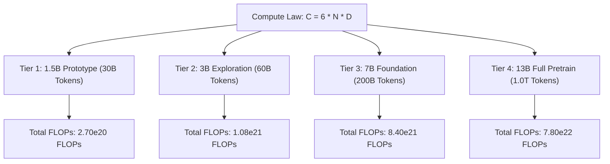

# 404 FOUNDERS — Training Compute Estimation & Scaling Laws

## 1. Executive Summary

This document establishes the mathematical foundations for estimating computational FLOPs, token budgets, GPU cluster sizing, and wall-clock training durations for the **404 FOUNDERS** foundation model. Computations are derived from Chinchilla optimal scaling principles and empirical Model FLOPs Utilization (MFU) benchmarks.

---

## 2. Fundamental Scaling Mathematics

The total theoretical floating-point operations ($C$) required to train a dense autoregressive Transformer model from random initialization is governed by:

$$C \approx 6 \times N \times D$$

Where:
- $N$ = Number of non-embedding active model parameters.
- $D$ = Total number of training tokens processed.
- The factor of $6$ accounts for the forward pass ($2 \times N$ FLOPs per token) plus the backward pass ($4 \times N$ FLOPs per token: 2 for activation gradients + 2 for weight gradients).

### Wall-Clock Duration Formula

$$\text{Duration (seconds)} = \frac{6 \times N \times D}{\text{Num GPUs} \times \text{Peak TFLOPS per GPU} \times 10^{12} \times \text{MFU}}$$

Where:
- **Peak TFLOPS per GPU**: Theoretical peak performance of the accelerator for the chosen numeric format (e.g., 989 TFLOPS for NVIDIA H100 SXM5 at BFloat16).
- **MFU (Model FLOPs Utilization)**: The ratio of observed throughput to theoretical peak hardware capability ($0 < \text{MFU} \le 1.0$).

---

## 3. Foundation Model Compute Profiles

### Compute & Duration Breakdown Matrix

| Model Parameter Tier | Training Tokens ($D$) | Total Theoretical FLOPs | Recommended Cluster | Estimated MFU | Wall-Clock Duration |
| :--- | :--- | :--- | :--- | :--- | :--- |
| **1.5 Billion** | 30 Billion | $2.70 \times 10^{20}$ | Tier A (2x RTX 4090) | 38.0% | ~12.5 days |
| **1.5 Billion** | 30 Billion | $2.70 \times 10^{20}$ | Tier B (8x H100 SXM5) | 50.0% | **~19.0 hours** |
| **3.0 Billion** | 60 Billion | $1.08 \times 10^{21}$ | Tier B (8x H100 SXM5) | 50.0% | **~3.1 days** |
| **7.0 Billion** | 200 Billion | $8.40 \times 10^{21}$ | Tier B (8x H100 SXM5) | 48.0% | ~25.6 days |
| **7.0 Billion** | 200 Billion | $8.40 \times 10^{21}$ | Tier C (64x H100 SXM5) | 52.0% | **~2.95 days** |
| **7.0 Billion** | 1.0 Trillion | $4.20 \times 10^{22}$ | Tier C (64x H100 SXM5) | 52.0% | **~14.75 days** |
| **13.0 Billion** | 1.0 Trillion | $7.80 \times 10^{22}$ | Tier C (64x H100 SXM5) | 50.0% | **~28.50 days** |

---

## 4. Empirical MFU Factors

In real-world distributed execution, achieveable MFU is impacted by:

1. **Interconnect Latency**:
   - Intra-node NVLink (Tier B) sustains ~50% MFU on 7B models.
   - Dual RTX 4090 over PCIe 4.0 (Tier A) incurs gradient synchronization overhead, limiting MFU to ~38%.
   - Multi-node Tier C achieves ~52% MFU via 3.2 Tbps InfiniBand NDR rail-optimized fabric and overlapping communication with backward compute.
2. **FlashAttention Kernel Efficiency**:
   - Replacing standard attention with FlashAttention-2/3 reduces memory read/writes from $O(S^2)$ to $O(S)$, unlocking 15–20% higher sustained TFLOPS on Hopper Tensor Cores.
3. **Activation Checkpointing Overhead**:
   - Recomputing attention layers during backward pass adds ~20–25% FLOP overhead but slashes activation memory by 70%, allowing 2x larger microbatch sizes.
