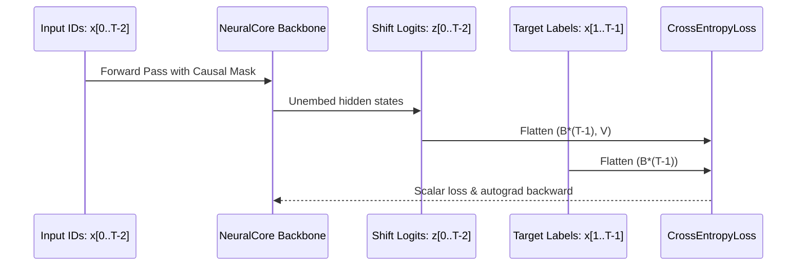

# 404 FOUNDERS — Training Objectives & Loss Formulations

**Document ID:** `DOC-TRAIN-002`  
**Phase:** Phase 06 Baseline  
**Authors:** Principal AI Research Scientist & Deep Learning Engineer  

---

## 1. Overview

The foundation pretraining track of 404 FOUNDERS employs a mathematically exact causal autoregressive objective for sequence modeling. This document formalizes the loss equations, shifting logic, numerical bounds, and current multimodal scope limitations.

---

## 2. Autoregressive Next-Token Objective

Given an input sequence of discrete tokens $x = (x_1, x_2, \dots, x_T) \in \mathcal{V}^T$, the model parameterizes conditional next-token probability distributions:

$$P_\theta(x_{t+1} \mid x_{1:t}) = \text{Softmax}\left(\frac{W_{\text{unembed}} \cdot h_t}{\tau}\right)$$

where $h_t \in \mathbb{R}^{d_{\text{model}}}$ is the final normalized representation at sequence position $t$, $W_{\text{unembed}} \in \mathbb{R}^{V \times d_{\text{model}}}$ is the output projection weight, and $\tau = 1.0$ is the sampling temperature.

### 2.1 Shifted Cross-Entropy Formulation

The training loss is computed as:

$$\mathcal{L}_{\text{AR}}(\theta) = -\frac{1}{\sum_{i=1}^B \sum_{t=1}^{T-1} \mathbb{I}(x_{i, t+1} \ne \text{PAD})} \sum_{i=1}^B \sum_{t=1}^{T-1} \mathbb{I}(x_{i, t+1} \ne \text{PAD}) \cdot \log P_\theta(x_{i, t+1} \mid x_{i, 1:t})$$

---

## 3. Padding Suppression & Token Accuracy

### 3.1 Ignore Index Handling
To prevent padding tokens (`<pad>`, ID = 0) from skewing the loss:
- Target positions containing `0` are masked out via `ignore_index = 0`.
- Only non-padded tokens contribute to the gradient calculation and denominator normalization.

### 3.2 Evaluation Metrics
- **Token Accuracy:** Fraction of valid target tokens correctly predicted by $\arg\max_v z_{t, v}$:
  $$\text{Acc} = \frac{1}{|\mathcal{T}_{\text{valid}}|} \sum_{(i, t) \in \mathcal{T}_{\text{valid}}} \mathbb{I}\left(\arg\max_v z_{i, t, v} = x_{i, t+1}\right)$$
- **Perplexity ($\text{PPL}$):** Exponential of the average cross-entropy loss:
  $$\text{PPL} = \exp(\mathcal{L})$$

---

## 4. Finite Value Protection & Exception Taxonomy

The `AutoregressiveLossEngine` enforces strict numerical invariants:
1. **$\text{NaN} / \infty$ Detection:** If $\mathcal{L}$ evaluates to `NaN` or `Inf`, execution halts immediately with `LossComputationError`.
2. **Negative Loss Protection:** If $\mathcal{L} < 0.0$, an invariant violation exception is raised.
3. **Perplexity Capping:** Exponential calculation is capped at $\min(\mathcal{L}, 20.0)$ to prevent floating-point overflow (`math.exp(20) \approx 4.85 \times 10^8$).

---

## 5. Scope & Multimodal Boundary

> [!IMPORTANT]
> The current pretraining objective evaluates **discrete sequence prediction** only. Continuous multimodal embeddings (image patches, audio spectra) will be introduced in subsequent multimodal alignment phases via contrastive and masked autoencoding objectives.
