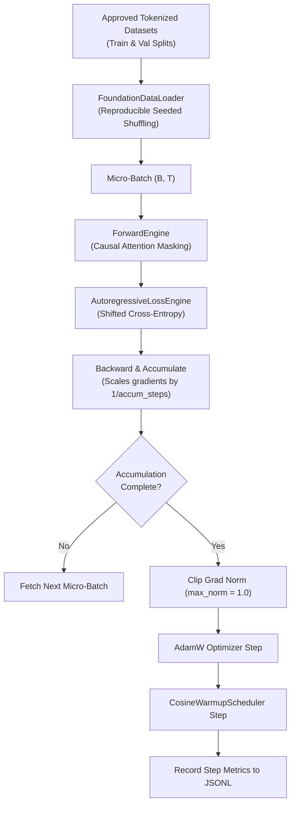

# 404 FOUNDERS — Pretraining Pipeline & Execution Architecture

**Document ID:** `DOC-TRAIN-003`  
**Phase:** Phase 06 Baseline  
**Authors:** Deep Learning Infrastructure Architect & Systems Engineer  

---

## 1. Pipeline Overview

The **404 FOUNDERS Pretraining Pipeline** coordinates model execution, batch collation, optimization steps, validation loops, and experiment telemetry.

---

## 2. Core Subsystems

### 2.1 Training Orchestrator (`training/engine/orchestrator.py`)
- Manages pretraining lifecycle from initialization to final checkpointing.
- Registers OS signal handlers (`SIGINT`, `SIGTERM`) for graceful emergency checkpoint saves.
- Coordinates evaluation interval triggers and best model tracking.

### 2.2 Data Loader (`training/dataloaders/data_loader.py`)
- Ingests integer token sequences generated by the Phase 04 `CustomBPETokenizer`.
- Generates `input_ids`, `attention_mask`, and `labels` tensors.
- Includes `SyntheticDatasetGenerator` for rapid deterministic smoke testing and overfitting verification.

### 2.3 Optimization Engine (`training/optimizers/optimization_engine.py`)
- Implements AdamW with decoupled weight decay ($\beta_1 = 0.9, \beta_2 = 0.95, \epsilon = 10^{-8}$).
- Partitions parameters into decayed (2D linear weights) and non-decayed (1D biases and normalization gains).
- Enforces gradient accumulation and gradient norm clipping.

### 2.4 Device Manager (`training/engine/device_manager.py`)
- Automatically probes execution device (CPU, CUDA, MPS).
- Enforces graceful CPU fallback without crashing on non-CUDA machines.
- Provides context-managed mixed-precision autocast execution (`BF16`, `FP16`, `FP32`).

---

## 3. Pretraining Step Execution Sequence

At each training step $t$:
1. **Data Ingestion:** Fetch micro-batch $\mathcal{B}_t = (X, M, Y)$ of shape $(B, T)$.
2. **Causal Forward Pass:** Pass $X$ through `NeuralCore` with upper-triangular boolean attention mask.
3. **Loss Computation:** Compute shifted cross-entropy $\mathcal{L} = \text{LossEngine}(\hat{Y}, Y)$.
4. **Gradient Accumulation:** Scale loss by $\frac{1}{k_{\text{accum}}}$ and call $\mathcal{L}_{\text{scaled}}.\text{backward}()$.
5. **Optimizer Step:** Once $k_{\text{accum}}$ micro-batches accumulate:
   - Compute total gradient norm $||\nabla_\theta||_2$.
   - Clip gradients to $g_{\max} = 1.0$.
   - Execute $\theta \leftarrow \text{AdamW}(\theta, \nabla_\theta, \eta_t, \lambda)$.
   - Update learning rate $\eta_{t+1} \leftarrow \text{Scheduler}(\eta_t)$.
   - Reset gradients to zero.
6. **Telemetry & Validation:** Record throughput, loss, latency, and execute periodic held-out evaluation.
