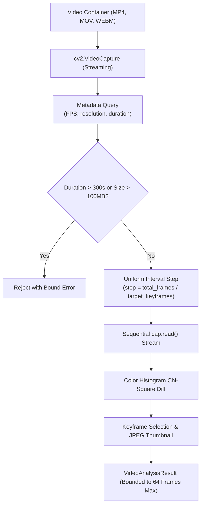

# 404 FOUNDERS — Video Intelligence Architecture
**Document Identifier:** `DOC-MULTI-004`  
**Phase:** `08 — Multimodal Intelligence`  
**Status:** `REVIEW PENDING`  
**Author:** `Principal AI Research Scientist & Deep Learning Infrastructure Architect`  

---

## 1. Executive Summary

The Video Intelligence Pipeline delivers memory-bounded video processing across MP4, MOV, and WEBM formats. On resource-constrained edge machines (such as swapless Linux environments), uncompressed video frames rapidly trigger kernel Out-Of-Memory (OOM) termination. 404 FOUNDERS circumvents this by using streaming frame decoding via OpenCV, uniform temporal sampling, Chi-Square histogram keyframe selection, and thumbnail generation.

---

## 2. Streaming Frame Ingestion & Memory Safeguards

### Safety Limits
- **Max File Size:** 100 MB (`104,857,600` bytes).
- **Max Duration:** 300.0 seconds (5 minutes).
- **Max Sampled Frames Buffer:** 64 keyframes maximum.
- **Frame Decompression:** Individual frames are read, processed, thumbnailed, and immediately garbage-collected without buffering raw RGB arrays in RAM.

---

## 3. Scene Change Detection via Chi-Square Histogram Distance

To identify major scene transitions and visual boundaries, `VideoProcessor` computes 3D color histograms (8 bins per RGB channel = 512 bins) and calculates the Chi-Square metric:

$$D_{\chi^2}(H_1, H_2) = \sum_i \frac{(H_1(i) - H_2(i))^2}{H_1(i) + H_2(i)}$$

Where:
- \(H_1, H_2\) are normalized color histograms of consecutive sampled frames.
- A threshold \(D_{\chi^2} > 5.0\) flags a significant visual scene boundary (`is_scene_boundary = True`).
- Opening frames (\(t = 0.0\)) are automatically marked as opening scene boundaries.

---

## 4. Keyframe Thumbnails

Each selected keyframe is scaled to a compact preview thumbnail (\(\le 120\)px) and encoded as a JPEG Data URI:
`data:image/jpeg;base64,...`
This enables horizontal keyframe filmstrip rendering on the frontend without disk writes.
