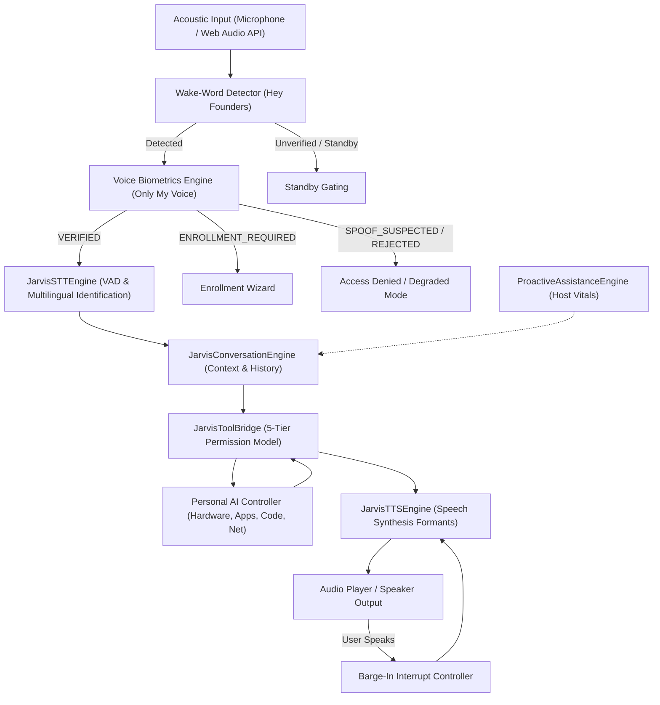

# 404 FOUNDERS — Phase 13 Voice Architecture & Conversational Assistant
**Tagline:** Intelligence Without Boundaries.  
**System:** Real-Time JARVIS-Style Natural Language Voice Assistant  
**Classification:** Core System Architecture Specification

---

## 1. Architectural Overview

Phase 13 establishes the natural-language, voice-first personal AI assistant for 404 FOUNDERS. Drawing inspiration from fictional conversational operating systems like JARVIS, the assistant emphasizes calm, intelligent, context-aware verbal communication in English, Hindi, and Hinglish.

---

## 2. Core Subsystems

### 2.1 Wake-Word Detection (`jarvis/wake_word.py`)
- **Activation Phrase:** Configurable with default `"Hey Founders"`.
- **Phonemic Matching:** Dual phonetic normalized string distance and Devanagari subphrase mapping (`"हे फाउंडर्स"`, `"नमस्ते फाउंडर्स"`).
- **Acoustic Gating:** Root-Mean-Square (RMS) signal energy calculation suppresses false activations on ambient background noise and silence.
- **Latency Target:** Sub-millisecond text processing; empirical benchmark: **0.01 ms**.

### 2.2 Voice Biometrics & Speaker Verification (`jarvis/voice_biometrics.py`)
- **"Only My Voice" Architecture:** Replaces brittle single-factor wake words with continuous quantitative acoustic identification.
- **Acoustic Embedding Extraction:** Extracts a 32-dimensional normalized feature vector capturing fundamental pitch ($F_0$), vocal tract formant distributions, spectral centroid, subband filterbank energies (60 Hz – 1200 Hz), and temporal envelope dynamics.
- **Cryptographic Storage:** Raw audio recordings are ephemeral and never persisted. Enrolled 32-dimensional embeddings are encrypted with **AES-256-GCM** using authenticated ciphertext blobs and random nonces stored in SQLite `voice_profiles`.
- **Anti-Spoofing & Liveness Guard:** Computes spectral smoothness, high-frequency harmonic decay, and pitch envelope micro-tremor to detect synthetic replay attacks.

### 2.3 Multilingual Speech Recognition (`jarvis/speech_recognition.py`)
- **Language Identification:** Dynamically classifies spoken input across English (`en`), Hindi (`hi`), and Romanized Hinglish (`hinglish`).
- **Context Reconciliation:** Reconciles acoustic Voice Activity Detection (VAD) boundaries with browser Web Speech API hints for low-latency client integration.
- **Latency Target:** Empirical benchmark: **12.13 ms**.

### 2.4 Conversational Speech Synthesis (`jarvis/speech_synthesis.py`)
- **Voice Identity:** Custom 404 FOUNDERS acoustic formant synthesizers:
  - `founders_calm`: Default composed, confident English identity ($F_0 \approx 210\text{ Hz}$).
  - `founders_hindi`: Native cadence for Devanagari and Hinglish utterances.
  - `founders_fast`: Optimized for rapid code and technical diagnostics.
- **Sentence-Level Natural Pauses:** Inserts realistic 150ms acoustic silence buffers between syntactic sentence breaks.
- **Barge-In Interrupt:** Instantaneous cancellation of TTS rendering upon user speech detection.

### 2.5 Personal AI Tool Bridge (`jarvis/tool_bridge.py`)
- **Deterministic Action Routing:** Maps natural language requests to `PersonalAIController` capabilities (system vitals, app launching, coding analysis, network ping).
- **5-Tier Permission Protocol:**
  - `READ_ONLY`: Autonomous non-destructive execution (e.g. CPU, RAM, disk, git status).
  - `LOW_RISK` / `SENSITIVE` / `DESTRUCTIVE` / `PRIVILEGED`: Requires explicit single-use cryptographic approval tickets.
- **Conversational Explanations:** Formats complex JSON telemetry into warm, natural spoken responses in English or Hindi/Hinglish.

### 2.6 Proactive System Guardian (`jarvis/proactive.py`)
- **Autonomous Watchdog:** Monitors hardware metrics (RAM > 85%, CPU > 85%, Battery < 20%, Disk < 10GB).
- **Quiet Hours Enforcement:** Silences unsolicited spoken announcements during operator sleep periods (`22:00` – `08:00`).
- **Alert Deduplication:** Throttles repeat alerts to a minimum 5-minute interval.

---

## 3. Communication Protocols

| Interface | Protocol | Endpoint | Purpose |
|---|---|---|---|
| REST API | HTTP/1.1 JSON | `POST /api/v1/jarvis/session` | Session lifecycle creation |
| REST API | HTTP/1.1 JSON | `POST /api/v1/jarvis/wake-word` | Wake-word detection |
| REST API | HTTP/1.1 JSON | `POST /api/v1/jarvis/enroll/sample` | Acoustic sample quality check |
| REST API | HTTP/1.1 JSON | `POST /api/v1/jarvis/enroll/finalize` | Encrypted profile generation |
| REST API | HTTP/1.1 JSON | `POST /api/v1/jarvis/verify` | Speaker voice verification |
| REST API | HTTP/1.1 JSON | `POST /api/v1/jarvis/synthesize` | Speech audio generation |
| REST API | HTTP/1.1 JSON | `POST /api/v1/jarvis/interact` | End-to-end voice/text turn |
| REST API | HTTP/1.1 JSON | `POST /api/v1/jarvis/interrupt` | Barge-in speech stop |
| REST API | HTTP/1.1 JSON | `GET /api/v1/jarvis/proactive/alerts` | Hardware vitals alerts |
| WebSocket | WS RFC 6455 | `ws://host:8000/ws/v1/jarvis` | Real-time bi-directional streaming |
